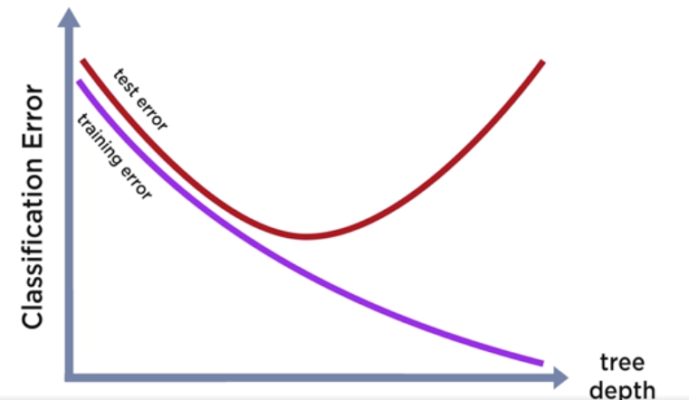
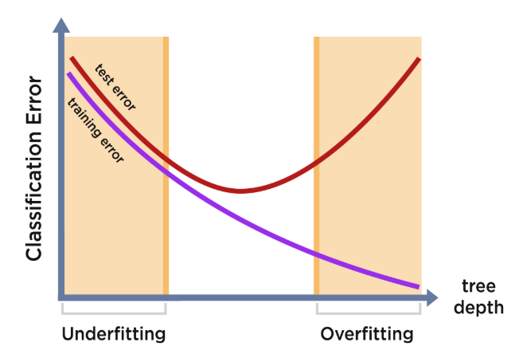

# Decision Tree
Regression trees use a modified impurity metric appropriate for continuous label values.

Classification and regression tree (CART) algorithms recursively split the data into partitions. You can keep track of these partitions in a tree structure. During inference, a validation/test point traverses the tree until it falls into a leaf. Each leaf is associated with one of the data partitions, and you assign the validation/test point the most common label within that partition (or the average label in the case of regression.)

Is it always possible to find a consistent tree?

example
```
from sklearn.tree import DecisionTreeClassifier
from sklearn.datasets import load_iris

# Train model
X, y = load_iris(return_X_y=True)
tree = DecisionTreeClassifier(max_depth=3, random_state=42)
tree.fit(X, y)

# Sample to explain
sample = X[0:1]

# Nodes visited
node_indicator = tree.decision_path(sample)
leaf_id = tree.apply(sample)

feature_names = load_iris().feature_names

for node_id in node_indicator.indices:
    if leaf_id[0] == node_id:
        print(f"Reached leaf node {node_id}")
        continue

    feature = tree.tree_.feature[node_id]
    threshold = tree.tree_.threshold[node_id]

    if sample[0, feature] <= threshold:
        decision = "<="
    else:
        decision = ">"

    print(
        f"{feature_names[feature]} ({sample[0, feature]:.2f}) "
        f"{decision} {threshold:.2f}"
    )
```

## Entropy

Yes, if and only if no two input vectors have identical features and different labels.
When building a tree, you want each partition to become “purer” (i.e., containing only data from a single class). If your partitions are pure, you can easily and confidently assign labels to new data points that lie within a partition. 
wo impurity functions — the Gini impurity and the entropy — to quantify the heterogeneity of a subsection of data. Intuitively, the impurity of a set of points is higher when the points have many different labels and lower when most points have the same label.

Gini impurity and entropy both measure node impurity in decision trees. Gini is computationally simpler and usually faster, while entropy is based on information theory and is more sensitive to class distribution changes. In practice they often produce very similar trees, so Gini is commonly used as the default, whereas entropy may be preferred when emphasizing information gain or minority-class separation.

### Real-World Rule of Thumb
If you are trying to predict:
* Disease diagnosis
* Patient risk
* Readmission
* Adverse event occurrence
then a classification tree using Gini impurity is usually the better choice.

If you are trying to predict:
* A measurement
* A count
* A cost
* A duration
then a regression tree is the appropriate choice.

* Start with Gini if:
    You are building classification trees
    Performance matters
    No special class imbalance concerns exist
This covers about 90% of use cases.
* Try Entropy if:
    Minority-class detection is important
    You have severe class imbalance
    You want to experiment with model quality

### Comparison

| Distribution | Gini | Entropy |
|---|---|---|
| 100/0 | 0 | 0 |
| 90/10 | 0.18 | 0.469 |
| 80/20 | 0.32 | 0.722 |
| 50/50 | 0.50 | 1.000 |

Notice they both:
* Are 0 when pure
* Increase as classes become mixed
* Reach maximum when classes are equally distributed

They produce very similar trees in practice
*Gini*
```def gini_impurity(class_counts):
    total = sum(class_counts)

    gini = 1.0
    for count in class_counts:
    probability = count / total
    gini -= probability ** 2

    return gini


# Example: 8 Yes, 2 No
counts = [8, 2]

gini = gini_impurity(counts)

print(f"Gini Impurity: {gini:.3f}")
Entropy Function
import math

def entropy(class_counts):
total = sum(class_counts)

ent = 0.0
for count in class_counts:
if count == 0:
continue

probability = count / total
ent -= probability * math.log2(probability)

return ent


# Example: 8 Yes, 2 No
counts = [8, 2]

print(f"Entropy: {entropy(counts):.3f}")
```

#Example Entropy#
```
import math

# -------------------------
# Entropy Function
# -------------------------
def entropy(red_count, blue_count):
    total = red_count + blue_count

    # Convert counts to probabilities
    p_red = red_count / total
    p_blue = blue_count / total

    ent = 0

    # Skip log(0)
    if p_red > 0:
        ent -= p_red * math.log2(p_red)

    if p_blue > 0:
        ent -= p_blue * math.log2(p_blue)

    return ent


# -------------------------
# Parent (Root) Node
# -------------------------
root_entropy = entropy(16, 14)
print(f"Root Entropy: {root_entropy:.4f}")


# -------------------------
# Left Child
# -------------------------
left_entropy = entropy(12, 1)
print(f"Left Child Entropy: {left_entropy:.4f}")


# -------------------------
# Right Child
# -------------------------
right_entropy = entropy(4, 13)
print(f"Right Child Entropy: {right_entropy:.4f}")


# -------------------------
# Weighted Entropy After Split
# -------------------------

left_weight = 13 / 30
right_weight = 17 / 30

new_entropy = (left_weight * left_entropy + right_weight * right_entropy)
print(f"New Entropy After Split: {new_entropy:.4f}")


# -------------------------
# Information Gain
# -------------------------

information_gain = root_entropy - new_entropy
print(f"Information Gain: {information_gain:.4f}")
```

## CART algorithm
CART algorithm builds a decision tree by iterating through each value of each feature and identifying splits that result in the greatest entropy drop at each node.  
CART (Classification and Regression Trees) builds a decision tree by evaluating all possible splits, calculating the weighted impurity of each split using metrics such as Gini Impurity or Entropy, and selecting the split with the lowest weighted impurity. The process is applied recursively until nodes become pure or no further splits are possible.

### Goal of CART
Now that we have a way to measure impurity (using Gini Impurity or Entropy), we can use that metric to build a decision tree.
The basic idea:
1. Split the dataset into smaller subsets.
2. Measure the impurity of the resulting subsets.
3. Choose the split that produces the lowest impurity.
4. Repeat recursively on each subset.

The CART algorithm:
* Tries every possible split.
* Calculates how good each split is.
* Selects the split with the lowest weighted impurity.
* Repeats the process on the resulting child nodes.

### Is the Split Good?
Not necessarily.
One side is perfect.
One side is terrible.
We need to consider:
How likely are we to end up in each partition?
For every candidate split:
    Compute impurity of left child.
    Compute impurity of right child.
    Compute weighted average impurity.

Weighted Impurity=N_left/N(Impurity_left)+N_right/N(Impurity_right)

Where:
    N= total records
    N_left= records in left node
    N_right= records in right node


CART evaluates every possible split and chooses the one with:  "Lowest Weighted Impurity" 
CART repeats the same process on:
    Left child
    Right child
independently.
This continues until stopping conditions are met


## Information Gain (Entropy Version)
When entropy is used, the metric is usually called Information Gain:
Information Gain=Entropy(Parent)−Weighted Entropy(Children)Information\ Gain =
Entropy(Parent)
-
Weighted\ Entropy(Children)Information Gain=Entropy(Parent)−Weighted Entropy(Children)
A split that reduces entropy the most provides the most information and is selected.

### Why Two Metrics?
**Gini**

* Computationally simpler (no logarithms)
* Slightly faster
* Default in many implementations (e.g., Scikit-Learn)

**Entropy**

Strong theoretical basis from information theory
Sometimes favors cleaner, more balanced splits
Produces similar results to Gini most of the time

In practice, the prediction accuracy difference is usually very small.

### Non-binary cases
CART will still work but can't use Gini or Entropy (this assume binary); use square-loss
* In each partition calculate the average of all the labels
* Calc. impurity via the squared difference of every single label from the average
* This impurity quantifies the "spread" or variance of the labels in a set.  
* Each leaf in the final tree predicts the mean label of the training points inside the leaf. 
* we can tweak classification trees for continuous valued labels (regression). Because labels are no longer categorical, we redefine impurity such that it captures the "spread" of values in each node. Conveniently, we can capture this spread within a set by the variance of the labels within the set. 
** Take the median of the dataset and then subtract it from each value in the dataset (squaring each result).  Add all these values together

Suppose a node contains the target values:
`y=[8,10,12,14]`
The best prediction for all samples in that node is their mean:
`y^=yˉ=11`
The squared loss of the node is:
`(8−11)^2+(10−11)^2+(12−11)^2+(14−11)^2`
`=9+1+1+9=20=`
This value represents the impurity of the node.
A "pure" regression node is one where all target values are identical:
`y=[10,10,10]`
Then
`yˉ=10`
and
`∑(yi−yˉ)^2=0`

* Larger data sets take longer to compute and may result in more errors. 
* Doubling dataset quadruples time to process

#### Linear Time Regression Trees Shortcut
Regression trees use squared error impurity.
Naively computing impurity for every split leads to quadratic complexity.
Consecutive splits differ by only one sample moving across the boundary.
Maintain three statistics for each side:

n: count
s: sum of labels
q: sum of squared labels


Squared-error impurity can be rewritten as:

`Impurity=q−s^2/n`

This allows impurity updates in constant time.
Split search becomes effectively linear in the number of samples, making CART practical on large datasets.

feature   # Which feature/column to split on
cut       # Threshold value for the split
bestloss  # Impurity after making that split

n = number of labels
s = sum(y)
q = sum(y**2)

## Hyperparameters
Imagine your data has a data error, producing an outlier (e.g. a red dotin a sea of blue).  If you build a tree to be perfect on the training data it will be very inaccurate in real-life data.





**underfit** That's the first region. That's the region where our classifier is not complex enough and we can't even do well on the training data set. 

**overfit** we do well on the training data set, but now we do badly again on the testing data set because
we started memorizing things essentially from the training data set that don't hold on the testing set. 
We would like to find the sweet spot right in the middle but we don't underfit and we don't overfit. To find the sweet spot we have hyperparameters. 
In the CART tree for example we can introduce a hyperparameter that says, #this is the maximum number of nodes that we allow to have in the tree#, or the maximum number of splits, or the maximum depth.

A model hyperparameter is a configuration that is external to the model and whose value cannot be estimated from data. 

Model hyperparameters are sometimes also referred to as model parameters, which can make things confusing. A good rule of thumb to overcome this confusion is as follows: If you have to specify a model parameter manually, then it is probably a model hyperparameter.

Hyperparameters are often:
* Used to adapt a model to a particular setting
* Specified by the practitioner
* Set using heuristics
* Tuned for a given predictive modeling problem
* Regulate the complexity of a classifier

You cannot know the best value of a model hyperparameter for a given problem and data set. You may use common approaches:
* copy values used on other models
* search for the best value by trial and error. 

### Types of Hyperparameters
* Number of nearest neighbors (k) in k-NN
* Depth of tree in decision trees
* Learning rate (alpha) in gradient descent

### How to find
Cross validation is a method used to estimate the testing error of a machine learning model.  
1. Split training data into 80% training and 20% validation (because you only test on your test set once)
2. Plot validation error and pick the minimum
However, if you only have a little data then use K-fold cross-validation
1. Split data set into k buckets
2. Take k minus one of these buckets as training and kth as validation
3. Repeat for k times
4. Take the average of all the produced curves and take the minimum of the average
5. Retrain entire classifier on new hyperparameter and share this model
e.g. If 5 is 5 then you have 5 buckets, each with 20% of the data.  You combine 4 for training and 1 as validation and do this 5 times (viz. each bucket will become a validation set once)

### Setting multiple hyperparameters
Classification and regression trees have multiple hyperparameters: 
- the number of nodes
- the maximum depth
- impurity function (Gini or entropy)

There are various searches you can use to set the best hyperparameters, 
- **Grid Search**
1. Take the first hyperparameter and think about several candidates want to explore (make that the X axis)
2. Make second hyperparameter, and its candidates, the y-axis
3. Combination ov values makes a grid
4. very single point on the grid, we evaluate (we train a model with exactly this hyperparameter's configuration)
5. we estimate the validation error, for example with k-fold cross-validation.  Store answer somewhere
6. Lowest answer of all is the configuration to be used
- **Telescopic Grid Search**
* if you have a really good setting, then you zoom in one more time around that area, and do another grid search to really fine-tune your parameter setting
- **Random Search**
- If lots of hyperparameters grid search becomes very slow.  
- pick random configurations and evaluate


## Pruning
Technique used to speed up the CART algorithm by finding the right balance between complexity and simplicity in a decision tree.
1. split training data into training and validation
2. Build a full tree on the training data set until you get zero error (don't worry about overfitting)
3. From this gigantic tree start pruning away nodes that have no (or a negative) effect on the error on the validation data set
- Do this bottom-up
- Look at lowest level node that has some children and ask if it helps on validation set (not training set).  If no then replace with a leaf (tree ends here)

## Regulate classifier complexity
* Hyperparameters primarily regulate model complexity.
* Too much complexity leads to overfitting.
* Too little complexity leads to underfitting.
* Regularization adds a penalty for complexity.
* Lambda (λ\lambdaλ) controls the balance between model fit and simplicity.
* Early stopping monitors validation error and stops training at the optimal point.
* Decision trees, logistic regression, and SVMs all use forms of complexity control.

In practice, machine learning practitioners may use:
* Regularization
* Early stopping
* Or both together

**Regularization**
Introduce a penalty that penalized classifiers if they get too complex.
e.g. In a decision tree an example:
* Method 1: Hard Constraint.  Limit tree growth directly by setting the max depth (watch as trains and when classification error starts to go back up then stop, go back a bit and use that depth)
Example:
Maximum depth = 5
Tree cannot grow beyond 5 levels
* Method 2: Penalized Objective Function
Modify the impurity measure:
Objective=Entropy Impurity+λ×Number of Nodes\text{Objective} = \text{Entropy Impurity} + \lambda \times \text{Number of Nodes}Objective=Entropy Impurity+λ×Number of Nodes
Where:

Entropy impurity measures prediction quality.
Number of nodes measures complexity.
λ\lambdaλ controls the strength of the penalty.

### Regularization in Linear Models
* Logistic Regression
* Support Vector Machines (SVMs)

he objective function becomes:
Loss+λ×Complexity\text{Loss} + \lambda \times \text{Complexity}Loss+λ×Complexity
A common complexity measure is the L2 norm:
Loss+λ∣∣w∣∣2\text{Loss} + \lambda ||w||^2Loss+λ∣∣w∣∣2
Where:

www = weight vector
∣∣w∣∣2||w||^2∣∣w∣∣2 = L2 norm (weight magnitude)

**Effect**
* Large weights increase model complexity.
* Regularization discourages excessively large weights.
* Gradient descent balances minimizing loss and minimizing complexity.

### Role of Lambda (λ\lambdaλ)
λ\lambdaλ is a key hyperparameter.

**Small λ\lambdaλ**
- Weak regularization
- More complex model
- Higher risk of overfitting

**Large λ\lambdaλ**
- Strong regularization
- Simpler model
- Higher risk of underfitting

**Purpose**
Controls the trade-off between:
- Accuracy
- Simplicity

### Regularization vs. Early Stopping
| Regularization                         | Early Stopping                                  |
| -------------------------------------- | ----------------------------------------------- |
| Adds an explicit complexity penalty    | Stops training before model becomes too complex |
| Uses a hyperparameter (λ)              | Uses validation performance                     |
| Common in logistic regression and SVMs | Common in iterative learning algorithms         |
| Controls complexity mathematically     | Controls complexity through training duration   |

## Ensembling
Ensembling can help produce better predictive results in AI by combining multiple ML models.  This process improves accuracy by allowing the end-user to go off collective judgement instead of a single model's response (though it's important to use models which would make different kinds of errors, viz. the models combined have complementary strengths and weaknesses).  To this end there are a few different methods to be used in ensembline, namely bagging (where the results from multiple models are combined and then averaged), boosting (where, in a waterfall type fashion, each model focuses on correcting errors made by previous models) and stacking (where different models are run and then another model learns how to combine them).  

This isn't to say that one should always use ensembling.  For example, in cases where you already have a model which performs well or there are limitations on costs or amount of time allowed to get an answer.  Also, ensembling reduces simplicity and explainability, which can make it more difficult to support in prod. (e.g. debugging) or to justify answers (which in industries such as healthcare or finance might not be acceptable).

## Viewing decisions

### export_text()
`from sklearn.tree import export_text`
`print(export_text(tree, feature_names=feature_names))`

example output
```
|--- petal width (cm) <= 0.80
|   |--- class: setosa
|--- petal width (cm) >  0.80
|   |--- petal length (cm) <= 4.95
|   |   |--- class: versicolor
|   |--- petal length (cm) >  4.95
|   |   |--- class: virginica
```

### plot_tree()
`import matplotlib.pyplot as plt2`
`from sklearn.tree import plot_tree`
`plot_tree(tree, filled=True)`

example output
```
                   petal_width <= 0.8
               gini=0.667 samples=150
                     /            \
                    /              \
           gini=0.0               petal_length<=4.95
          samples=50             gini=0.5 samples=100
          value=[50,0,0]           /              \
                                 /                  \
                     value=[0,48,2]         value=[0,2,48]

```

---

# Extended Derivations & Python Lab

The sections above cover concepts and applied recipes. This appendix adds (1) the derivations from the PDF worth doing on paper at least once, and (2) runnable NumPy / scikit-learn code you can drop into a notebook to *see* every idea work.

## A. Extended Derivations from the PDF

### A.1 Formalizing impurity

For a set $S$ with $n$ labeled points and $c$ classes, define

$$p_k \;=\; \frac{|S_k|}{|S|} \;=\; \text{fraction of points in } S \text{ with label } k.$$

**Gini impurity** — probability that two points drawn uniformly at random from $S$ disagree:

$$G(S) \;=\; \sum_{k=1}^{c} p_k(1 - p_k) \;=\; 1 - \sum_{k=1}^{c} p_k^2.$$

**Entropy** — expected number of bits to encode a label drawn from $S$:

$$H(S) \;=\; -\sum_{k=1}^{c} p_k \log_2 p_k.$$

Both attain their **minimum $0$** at a pure node and their **maximum** at the uniform distribution ($1 - 1/c$ for Gini, $\log_2 c$ for entropy).

### A.2 Impurity of a tree (recursive definition)

For an internal node splitting $S$ into left/right children $S_L, S_R$:

$$I(S) \;=\; \frac{|S_L|}{|S|}\, I(S_L) \;+\; \frac{|S_R|}{|S|}\, I(S_R),$$

and **information gain** for a candidate split is

$$\text{IG}(S; f, t) \;=\; I(S) \;-\; \left[\frac{|S_L|}{|S|} I(S_L) + \frac{|S_R|}{|S|} I(S_R)\right],$$

where feature $f$ and threshold $t$ define $S_L = \{(\mathbf{x},y) \in S : x_f \le t\}$ and $S_R = S \setminus S_L$. CART picks the $(f, t)$ maximizing IG (equivalently, minimizing weighted child impurity).

### A.3 Worked entropy example (from the PDF: 30 loan applicants)

Root: 16 default, 14 payoff.

$$H(\text{root}) \;=\; -\tfrac{16}{30}\log_2\tfrac{16}{30} - \tfrac{14}{30}\log_2\tfrac{14}{30} \;\approx\; 0.996.$$

**Split on Balance** ($<\$50\text{K}$ has 12/1; $\ge\$50\text{K}$ has 4/13):

$$H(\text{Balance}<\!50\text{K}) \approx 0.39, \quad H(\text{Balance}\!\ge\!50\text{K}) \approx 0.79.$$

$$H(\text{split}) = \tfrac{13}{30}(0.39) + \tfrac{17}{30}(0.79) \approx 0.62, \quad \text{IG} \approx 0.37.$$

**Split on Residence** (OWN 7/6, RENT 9/8): both children have $p \approx 0.5$, so $H(\text{child}) \approx 0.99$ and $\text{IG} \approx 0$. **Balance is the correct split.**

### A.4 Squared-loss regression impurity

For a regression leaf $S$ with mean label $\bar y_S$, the impurity is the average squared deviation:

$$I(S) \;=\; \frac{1}{|S|}\sum_{(\mathbf{x},y)\in S} (y - \bar y_S)^2 \;=\; \text{variance of labels in } S.$$

Because $|S|$ is fixed across a split, CART picks the split minimizing the un-normalized

$$\sum_{(\mathbf{x},y)\in S_L}(y-\bar y_{S_L})^2 \;+\; \sum_{(\mathbf{x},y)\in S_R}(y-\bar y_{S_R})^2.$$

### A.5 The $O(1)$ split-update trick (regression trees)

Expand the SSE in a node:

$$\sum_{i \in S}(y_i - \bar y)^2 \;=\; \sum_i y_i^2 - 2\bar y \sum_i y_i + n \bar y^2 \;=\; q - 2 \tfrac{s}{n}\cdot s + n \tfrac{s^2}{n^2} \;=\; q - \frac{s^2}{n},$$

where

$$n = |S|, \quad s = \sum_{i\in S} y_i, \quad q = \sum_{i\in S} y_i^2.$$

Now sort the feature. As the split boundary slides right by one point $(x_j, y_j)$:

$$n_L \mathrel{+}= 1,\quad s_L \mathrel{+}= y_j,\quad q_L \mathrel{+}= y_j^2, \qquad n_R \mathrel{-}= 1,\quad s_R \mathrel{-}= y_j,\quad q_R \mathrel{-}= y_j^2,$$

so each candidate split costs **$O(1)$** instead of $O(n)$ — turning naive $O(dn^2)$ per node into $O(dn \log n)$ (dominated by sorting).

### A.6 Why splits reduce impurity in expectation (concavity)

For concave impurity $I$ (both Gini and entropy are concave in $p$), Jensen's inequality gives

$$I(S) \;\ge\; \frac{|S_L|}{|S|} I(S_L) + \frac{|S_R|}{|S|} I(S_R),$$

with equality only when the child label distributions equal the parent's. So **any non-trivial split weakly decreases impurity** — CART is a greedy hill-climb on this bound.

### A.7 Bias–variance and the depth knob

Let $\hat f_D$ be a tree trained on dataset $D$. For squared loss:

$$\mathbb{E}_{D}\big[(y - \hat f_D(\mathbf{x}))^2\big] \;=\; \underbrace{(\mathbb{E}[\hat f_D(\mathbf{x})] - y)^2}_{\text{bias}^2} \;+\; \underbrace{\text{Var}_D[\hat f_D(\mathbf{x})]}_{\text{variance}} \;+\; \sigma^2.$$

- Shallow tree ⇒ high bias, low variance (**underfit**).
- Deep tree ⇒ low bias, high variance (**overfit**).
- **Ensembles** (bagging, random forests) reduce variance by averaging.

---

## B. Python Lab

All snippets are self-contained NumPy / scikit-learn. Copy any block into a notebook.

### B.1 Impurity functions from scratch (and matching sklearn)

```python
import numpy as np

def gini(y):
    _, counts = np.unique(y, return_counts=True)
    p = counts / counts.sum()
    return 1.0 - np.sum(p * p)

def entropy(y):
    _, counts = np.unique(y, return_counts=True)
    p = counts / counts.sum()
    return -np.sum(p * np.log2(p + 1e-12))

# Sanity check the PDF's loan example
y_root  = np.array([0]*16 + [1]*14)            # 16 default, 14 payoff
y_lo    = np.array([0]*12 + [1]*1)             # Balance < 50K
y_hi    = np.array([0]*4  + [1]*13)            # Balance >= 50K

H_root  = entropy(y_root)
H_split = (len(y_lo)/len(y_root))*entropy(y_lo) + (len(y_hi)/len(y_root))*entropy(y_hi)
print(f"H(root) = {H_root:.3f}")
print(f"H(split on Balance) = {H_split:.3f}")
print(f"Information gain    = {H_root - H_split:.3f}")   # ~0.37
```

### B.2 Plot Gini vs entropy vs classification error (binary case)

```python
import numpy as np, matplotlib.pyplot as plt

p = np.linspace(1e-6, 1-1e-6, 400)
plt.plot(p, 2*p*(1-p),                        label='Gini')
plt.plot(p, -(p*np.log2(p)+(1-p)*np.log2(1-p)), label='Entropy')
plt.plot(p, 1 - np.maximum(p, 1-p),           label='Misclassification')
plt.xlabel('p (fraction of class 1)'); plt.ylabel('impurity')
plt.legend(); plt.title('Impurity functions on binary labels')
```

All three peak at $p = 0.5$ and hit $0$ at the endpoints. Entropy and Gini are smooth and concave; misclassification is piecewise linear — which is *why* CART doesn't optimize misclassification directly (its gradient is zero almost everywhere).

### B.3 A minimal CART classifier from scratch

```python
import numpy as np

class Node:
    __slots__ = ('feature', 'threshold', 'left', 'right', 'prediction')
    def __init__(self, prediction=None):
        self.feature = self.threshold = self.left = self.right = None
        self.prediction = prediction

def _gini(y):
    if len(y) == 0: return 0.0
    _, c = np.unique(y, return_counts=True)
    p = c / c.sum()
    return 1.0 - (p*p).sum()

def _best_split(X, y):
    n, d = X.shape
    best = (np.inf, None, None)                  # (weighted impurity, f, t)
    for f in range(d):
        order = np.argsort(X[:, f])
        xs, ys = X[order, f], y[order]
        for i in range(1, n):
            if xs[i] == xs[i-1]: continue
            t = 0.5 * (xs[i] + xs[i-1])
            imp = (i/n)*_gini(ys[:i]) + ((n-i)/n)*_gini(ys[i:])
            if imp < best[0]:
                best = (imp, f, t)
    return best

def build_tree(X, y, depth=0, max_depth=5, min_samples=2):
    if len(np.unique(y)) == 1 or depth >= max_depth or len(y) < min_samples:
        return Node(prediction=np.bincount(y).argmax())
    imp, f, t = _best_split(X, y)
    if f is None:
        return Node(prediction=np.bincount(y).argmax())
    mask = X[:, f] <= t
    node = Node(); node.feature, node.threshold = f, t
    node.left  = build_tree(X[mask],  y[mask],  depth+1, max_depth, min_samples)
    node.right = build_tree(X[~mask], y[~mask], depth+1, max_depth, min_samples)
    return node

def predict_one(node, x):
    while node.prediction is None:
        node = node.left if x[node.feature] <= node.threshold else node.right
    return node.prediction

def predict(tree, X):
    return np.array([predict_one(tree, x) for x in X])

# Verify against sklearn on Iris
from sklearn.datasets import load_iris
from sklearn.tree import DecisionTreeClassifier
X, y = load_iris(return_X_y=True)

mine = build_tree(X, y, max_depth=4)
skl  = DecisionTreeClassifier(max_depth=4, criterion='gini', random_state=0).fit(X, y)
print(f"scratch train acc = {(predict(mine, X) == y).mean():.3f}")
print(f"sklearn train acc = {skl.score(X, y):.3f}")
```

### B.4 Regression tree with the $O(1)$ split-update from §A.5

```python
import numpy as np

def best_split_regression(X, y):
    """Return (best_sse, feature, threshold) using constant-time updates."""
    n, d = X.shape
    y_total_s = y.sum(); y_total_q = (y*y).sum()
    best = (np.inf, None, None)
    for f in range(d):
        order = np.argsort(X[:, f])
        xs, ys = X[order, f], y[order]
        nL = 0; sL = 0.0; qL = 0.0
        nR = n; sR = y_total_s; qR = y_total_q
        for i in range(n - 1):
            yi = ys[i]
            nL += 1; sL += yi; qL += yi*yi
            nR -= 1; sR -= yi; qR -= yi*yi
            if xs[i] == xs[i+1]: continue
            sse = (qL - sL*sL/nL) + (qR - sR*sR/nR)
            if sse < best[0]:
                best = (sse, f, 0.5*(xs[i] + xs[i+1]))
    return best

# Compare to naive O(n) per split
def best_split_naive(X, y):
    n, d = X.shape
    best = (np.inf, None, None)
    for f in range(d):
        order = np.argsort(X[:, f])
        xs, ys = X[order, f], y[order]
        for i in range(1, n):
            if xs[i] == xs[i-1]: continue
            yL, yR = ys[:i], ys[i:]
            sse = ((yL - yL.mean())**2).sum() + ((yR - yR.mean())**2).sum()
            if sse < best[0]:
                best = (sse, f, 0.5*(xs[i] + xs[i-1]))
    return best

rng = np.random.default_rng(0)
X = rng.normal(size=(500, 3)); y = X[:,0]**2 + 0.1*rng.normal(size=500)

import time
t0 = time.time(); a = best_split_naive(X, y);       t1 = time.time()
t2 = time.time(); b = best_split_regression(X, y);  t3 = time.time()
print(f"naive:    sse={a[0]:.4f}  time={t1-t0:.3f}s")
print(f"fast O(1):sse={b[0]:.4f}  time={t3-t2:.3f}s")
```

### B.5 Approximating a sine curve with piecewise-constant leaves

```python
import numpy as np, matplotlib.pyplot as plt
from sklearn.tree import DecisionTreeRegressor

rng = np.random.default_rng(0)
X = np.sort(rng.uniform(-3, 3, 120)).reshape(-1, 1)
y = np.sin(X).ravel() + 0.1*rng.normal(size=len(X))

fig, axes = plt.subplots(1, 4, figsize=(16, 3.5), sharey=True)
for ax, depth in zip(axes, [1, 3, 5, 12]):
    tree = DecisionTreeRegressor(max_depth=depth).fit(X, y)
    xs = np.linspace(-3, 3, 500).reshape(-1, 1)
    ax.scatter(X, y, s=10, alpha=0.5)
    ax.plot(xs, tree.predict(xs), lw=2)
    ax.set_title(f'max_depth = {depth}')
```

Watch how the tree turns into a staircase — each leaf predicts the *mean* label of its slice. Depth 1 = massively underfit, depth 12 = overfit noise into little bubbles.

### B.6 The overfitting curve (training vs test error vs depth)

```python
import numpy as np, matplotlib.pyplot as plt
from sklearn.datasets import load_breast_cancer
from sklearn.model_selection import train_test_split
from sklearn.tree import DecisionTreeClassifier

X, y = load_breast_cancer(return_X_y=True)
X_tr, X_te, y_tr, y_te = train_test_split(X, y, test_size=0.3, random_state=0)

depths = range(1, 21)
tr = [1 - DecisionTreeClassifier(max_depth=d, random_state=0).fit(X_tr, y_tr).score(X_tr, y_tr) for d in depths]
te = [1 - DecisionTreeClassifier(max_depth=d, random_state=0).fit(X_tr, y_tr).score(X_te, y_te) for d in depths]

plt.plot(depths, tr, label='train error')
plt.plot(depths, te, label='test error')
plt.xlabel('max_depth'); plt.ylabel('error'); plt.legend()
plt.title('Classic underfit / overfit U-curve')
```

The training error decays monotonically to $0$; the test error dips then rises. The minimum of the test curve is the "sweet spot" the PDF talks about.

### B.7 k-fold cross-validation for depth selection

```python
import numpy as np
from sklearn.datasets import load_breast_cancer
from sklearn.model_selection import cross_val_score
from sklearn.tree import DecisionTreeClassifier

X, y = load_breast_cancer(return_X_y=True)

depths = range(1, 15)
mean_scores = []
for d in depths:
    clf = DecisionTreeClassifier(max_depth=d, random_state=0)
    scores = cross_val_score(clf, X, y, cv=5, scoring='accuracy')
    mean_scores.append(scores.mean())
    print(f"depth={d:2d}  cv acc = {scores.mean():.3f} +/- {scores.std():.3f}")

best_depth = list(depths)[int(np.argmax(mean_scores))]
print(f"\nBest depth by 5-fold CV: {best_depth}")
```

### B.8 Grid search over multiple hyperparameters

```python
from sklearn.datasets import load_breast_cancer
from sklearn.model_selection import GridSearchCV
from sklearn.tree import DecisionTreeClassifier

X, y = load_breast_cancer(return_X_y=True)

grid = {
    'max_depth':         [3, 5, 7, 10, None],
    'min_samples_leaf':  [1, 5, 10, 20],
    'criterion':         ['gini', 'entropy'],
}
gs = GridSearchCV(DecisionTreeClassifier(random_state=0), grid, cv=5, n_jobs=-1)
gs.fit(X, y)
print("best params:", gs.best_params_)
print(f"best cv acc: {gs.best_score_:.3f}")
```

### B.9 Post-pruning with `ccp_alpha` (sklearn's cost-complexity pruning)

sklearn implements the classic **cost-complexity** pruning: minimize
$R_\alpha(T) = R(T) + \alpha |T|$ where $R(T)$ is training misclassification and $|T|$ is leaf count. Larger $\alpha$ ⇒ smaller tree.

```python
import numpy as np, matplotlib.pyplot as plt
from sklearn.datasets import load_breast_cancer
from sklearn.model_selection import train_test_split
from sklearn.tree import DecisionTreeClassifier

X, y = load_breast_cancer(return_X_y=True)
X_tr, X_te, y_tr, y_te = train_test_split(X, y, test_size=0.3, random_state=0)

path = DecisionTreeClassifier(random_state=0).cost_complexity_pruning_path(X_tr, y_tr)
alphas = path.ccp_alphas[:-1]                   # drop trivial 1-node tree

tr_acc, te_acc, sizes = [], [], []
for a in alphas:
    clf = DecisionTreeClassifier(random_state=0, ccp_alpha=a).fit(X_tr, y_tr)
    tr_acc.append(clf.score(X_tr, y_tr))
    te_acc.append(clf.score(X_te, y_te))
    sizes.append(clf.tree_.node_count)

plt.plot(alphas, tr_acc, label='train acc')
plt.plot(alphas, te_acc, label='test acc')
plt.xlabel(r'$\alpha$ (ccp_alpha)'); plt.ylabel('accuracy'); plt.legend()
plt.title('Cost-complexity pruning path')
```

### B.10 Bagging = averaging trees to kill variance

```python
import numpy as np
from sklearn.datasets import load_breast_cancer
from sklearn.model_selection import cross_val_score
from sklearn.tree import DecisionTreeClassifier
from sklearn.ensemble import BaggingClassifier, RandomForestClassifier, GradientBoostingClassifier

X, y = load_breast_cancer(return_X_y=True)

models = {
    'single tree     ': DecisionTreeClassifier(random_state=0),
    'bagged trees x50': BaggingClassifier(DecisionTreeClassifier(), n_estimators=50, random_state=0),
    'random forest   ': RandomForestClassifier(n_estimators=200, random_state=0),
    'grad. boosting  ': GradientBoostingClassifier(n_estimators=200, random_state=0),
}
for name, m in models.items():
    s = cross_val_score(m, X, y, cv=5)
    print(f"{name}  cv acc = {s.mean():.3f} +/- {s.std():.3f}")
```

- **Bagging** — train on bootstrap resamples, average predictions. Variance drops by ~$1/B$ if trees were independent (they aren't quite, but close).
- **Random Forest** — bagging + random feature subset at each split, which *decorrelates* the trees further.
- **Gradient Boosting** — sequentially fit each new tree to the residuals of the current ensemble.

### B.11 Hand-rolled bagging to see the variance reduction

```python
import numpy as np
from sklearn.datasets import load_breast_cancer
from sklearn.model_selection import train_test_split
from sklearn.tree import DecisionTreeClassifier
from scipy import stats

X, y = load_breast_cancer(return_X_y=True)
X_tr, X_te, y_tr, y_te = train_test_split(X, y, test_size=0.3, random_state=0)

B = 100
rng = np.random.default_rng(0)
preds = np.zeros((B, len(X_te)), dtype=int)
for b in range(B):
    idx = rng.integers(0, len(X_tr), len(X_tr))
    tree = DecisionTreeClassifier(random_state=b).fit(X_tr[idx], y_tr[idx])
    preds[b] = tree.predict(X_te)

vote = stats.mode(preds, axis=0, keepdims=False).mode
print(f"single tree acc  ~ {(preds[0] == y_te).mean():.3f}")
print(f"bagged (B={B}) acc = {(vote == y_te).mean():.3f}")
```

### B.12 Visualizing a trained tree (Iris)

```python
from sklearn.datasets import load_iris
from sklearn.tree import DecisionTreeClassifier, plot_tree
import matplotlib.pyplot as plt

X, y = load_iris(return_X_y=True)
clf = DecisionTreeClassifier(max_depth=3, random_state=0).fit(X, y)

plt.figure(figsize=(12, 6))
plot_tree(clf, filled=True,
          feature_names=load_iris().feature_names,
          class_names=list(load_iris().target_names))
plt.title('Iris CART, max_depth=3')
```

---

## C. Common pitfalls (memorize these)

1. **Trees don't need feature scaling.** Splits are threshold comparisons — standardization, log-transforms, and PCA are usually *irrelevant* for tree accuracy (unlike RBF SVMs or k-NN).
2. **A single tree is high-variance.** Small changes in the training set change the tree completely. If you care about accuracy, **use a Random Forest or Gradient Boosting** — never rely on a single deep tree.
3. **Class imbalance skews impurity.** With 99% class 0, the root is nearly pure and every split "looks bad." Use `class_weight='balanced'` or resample.
4. **`max_depth` alone is a blunt knob.** Combine with `min_samples_leaf` (or `min_samples_split`) — a shallow *but bushy* tree still overfits if leaves have 1–2 points.
5. **Never tune hyperparameters on the test set.** Use k-fold CV (§B.7) or a held-out validation set. The test set is for the *final* number you report.
6. **Categorical features with high cardinality are dangerous.** sklearn treats numeric-encoded categoricals as ordered — a ZIP code encoded as `int` will produce nonsense splits. One-hot encode, target-encode, or use a library that handles categoricals natively (LightGBM, CatBoost).
7. **Missing values.** sklearn's tree does not handle NaNs by default (except `HistGradientBoosting`). Impute or use surrogate splits.
8. **Feature importance from `.feature_importances_` is biased toward high-cardinality features.** Prefer **permutation importance** (`sklearn.inspection.permutation_importance`) for real interpretation.
9. **Extrapolation impossible.** A regression tree can never predict a value outside the range of training labels — every prediction is a leaf mean. For extrapolation, use a linear model or splines.
10. **Reproducibility.** Always set `random_state` — ties in split selection are broken randomly.