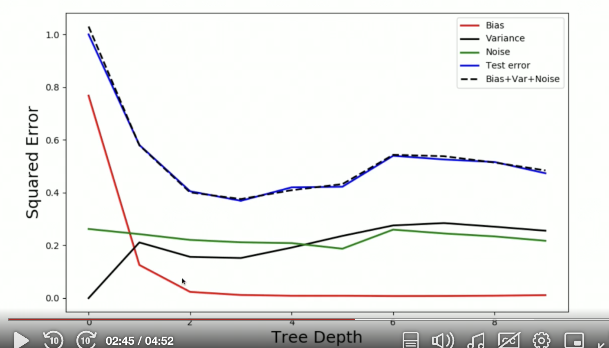
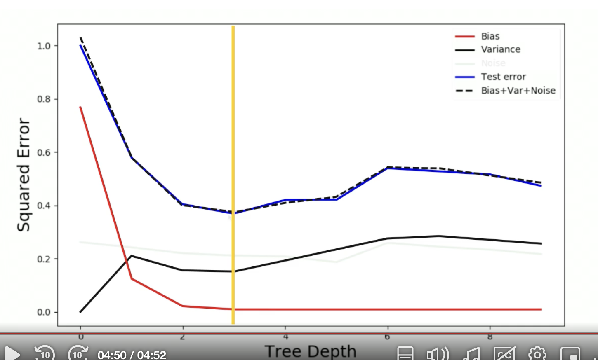
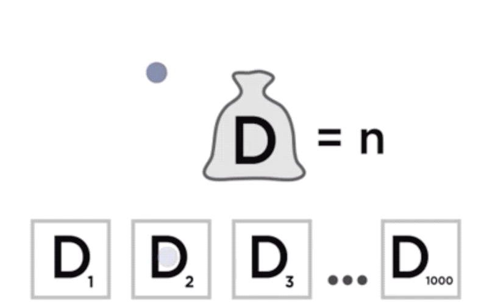
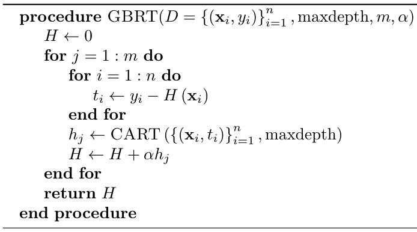
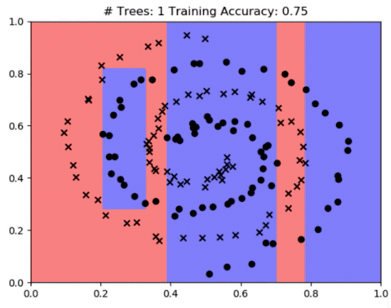

# Debugging
You have encountered linear models such as perceptron and nonlinear models such as classification trees. After training these models on a training data set and applying the model to a test data set, you obtain the test error. If the test error is reasonably small, then you are all set. However, what do you do if the test error is high?

There are two main reasons for high test error: Either your model is too simple (i.e., it cannot even learn the training data sufficiently) or your model is too complex (i.e., it is memorizing the training data). In either case, the model won't generalize to testing data. It is hard to tell whether the model is too simple or too complex by just looking at the error. You therefore need a principled way to differentiate the two settings, and that is what we are going to cover in this module: the bias-variance decomposition.

1. review of validation error
2. decomposing the error into three parts: bias, variance, and noise.
- In practice, we don't know exactly what fraction of the error is variance, what's bias, and what's noise
- rules of thumb that tell us indicators whether variance may be dominating everything or bias may be dominating everything, and then we apply methods or apply remedies to reduce
one of these terms.
- if we had knowledge of the true data distribution, then we could actually compute these terms exactly, or approximately to arbitrary exactness.
* If you have hundreds of datasets, you can train a separate regression tree on each dataset.
* To estimate **variance**, calculate how much the predictions from these different trees vary around their average prediction for each data point (viz Calculate the squared difference between each tree’s prediction and the average of all predictions). The average squared deviation is the variance.
* To estimate **bias**, first compute the average prediction across all trees, then measure the squared difference between this average prediction and the true expected output.
* To estimate **noise**, measure the squared difference between the actual labels and their expected values (the irreducible error in the data).
* Finally, you can analyze the bias-variance tradeoff by repeating this process for trees of different depths and plotting bias, variance, and noise as functions of tree depth. This shows how model complexity affects each source of error.

* So the first thing we observe is, well, the green line, the noise, is roughly constant, right? 
- So as the tree depth changes, the noise does not change, because the noise is not a function of the tree; it's just a function of the data. You see a little fluctuation here, and that's just due to
the random sampling. 
* The second thing you observe, that if we have a tree depth of zero, that's just a single node, that basically just means we predict the average label. That has zero variance — that doesn't vary at all if you sample different data sets; that makes perfect sense — but has very high bias, because it's biased to a very specific classifier which predicts the average label. As we now increase the tree depth and make our classifier more complex, you see that the bias goes down very, very nicely. Immediately it drops and essentially becomes close to zero, as the tree becomes more and more complex. However, while we're doing this, the variance creeps up, right? So initially the
variance is very, very low. As we increase the tree depth, the variance goes up, goes up,
goes up, goes up, goes up, goes up. Noise stays roughly constant. 
* The last thing we are plotting, the blue thing here is the testing error
* the dotted line — the black dotted line is bias plus variance plus noise
- And one thing you can immediately observe is that if your code is correct, the bias plus variance plus noise should pretty much match the testing error exactly.
- And the second thing you can see is that these trend lines kind of follow what's happening with bias and variance. So initially, the bias is so high that pushes the
testing error up, and you do really, really badly. Then as you keep going, the bias goes down, and your testing error goes down with it. However, eventually the variance creeps up too much, and the testing error goes back up. And the best, probably, setting in this specific data set is a tree depth of 3, where the testing error is the lowest. This is the best tradeoff
between bias and variance.

Best tree depth would be:


## Validate the Error
how off are your assumptions? 

- for example assume that the problem is linear and use a linear regression algorithm, it doesn't matter how much data you have, right? You will always be wrong if your data is not actually linear, right? You cannot possibly capture this. So the **bias** is the error that you will always have even if you have unlimited amount of data. 
- The **variance** is the error that you get because you trained on one specific data set and not infinite amounts. The variance says, how much do our classifiers vary if we train them on different data sets? So we basically say if we train our data set classifier hD on data set D, how different is that prediction from the average prediction or the expected prediction you would get if we had infinite amount of data? So what we are measuring here is, how much does the classifier essentially overfit to a specific data set? If this varies a lot, then we have high variance.
- And the **noise** is the error that you get because your data is not very clean or some labels are wrong
or there's some attributes, some factors in the data that you just don't represent in your feature vectors and you couldn't possibly get right.


## Decomposing the Error
A prediction model might not get an exact label due to training (e.g. vector x might describe a house (nu rooms, sq. footage) and label y for price).  e.g. to identically described (per x) homes could sell for different prices.  So, instead of saying "a 3-bedroom house costs $400,000" say "given these features there is a probability distribution over possible prices"; mathematically for any given feature vector x there is a conditional distribution P(y|x) over possible labels.  Therefore define the "expected label" is simply an average of that distribution, the notation is y bar of x $\bar{y}(x) = \mathbb{E}[y|x]$ 

y = actual observed label (including randomness)
y_bar = the true expected label produced by the data-generating process
h = one trained regression tree
h_bar = the avg prediction of many regression trees

### Calculate Y bar

```
def compute_ybar(xTe, OFFSET):
    """
    Computes the expected label ybar for a set of inputs xTe,
    generated from two normal distributions:
    1. the first with mean [0, 0] and standard deviation I, and
    2. the second with mean [OFFSET, OFFSET] and standard deviation I

    Input:
        xTe: Data matrix of shape nx2
        OFFSET: The OFFSET passed into the toyData function. The difference in the
                mu of normal distributions for points with labels class1 and class2.

    Output:
        ybar: nx1 vector of the expected labels for each vector in xTe
    """
    n, d = xTe.shape
    ybar = np.empty(n)  # Initialize variable to be returned

    # Feel free to use the following function to compute P([x]_\alpha | y)
    norm_pdf = lambda x, mu, sigma: np.exp(-0.5 * np.power((x - mu) / sigma, 2)) / (
        np.sqrt(2 * np.pi) * sigma
    )

    # YOUR CODE HERE
    for i in range(n):
        x1 = xTe[i, 0]
        x2 = xTe[i,1]
        p1 = norm_pdf(x1, 0, 1)  * norm_pdf(x2, 0,1)
        p2 = (norm_pdf(x1, OFFSET, 1) * norm_pdf(x2, OFFSET, 1))
        post1 = p1 / (p1 + p2)
        post2 = p2 / (p1 + p2)
        ybar[i] = 1 * post1 + 2 * post2
    # END OF YOUR CODE

    return ybar
```

### Computer y_bar
example
```
def compute_hbar(xTe, depth, Nsmall, NMODELS, OFFSET):
    """
    Computes the prediction of the average regression tree (hbar) on dataset xTe.
    Each of the NMODELS regression trees used in the average tree should be
    trained using data from toy_data(OFFSET, Nsmall).

    Input:
        xTe: Data matrix of shape nx2
        depth: Depth of each regression tree to be trained
        Nsmall: Number of points in the dataset that each tree is trained on
        NMODELS: Number of regression trees to train
        OFFSET: The OFFSET passed into the toyData function. The difference in the
                mu of normal distributions for points with labels class1 and class2.
    Output:
        hbar: a nx1 vector of the expected labels for each vector in xTe
    """
    n = xTe.shape[0]
    hbar = np.zeros(n)  # Initialize variable to be returned

    # YOUR CODE HERE
    for model in range(NMODELS):
        xTr, yTr = toy_data(OFFSET, Nsmall)
        # Create a regression tree
        tree = RegressionTree(depth=depth)
        # Fit/train the regression tree
        tree.fit(xTr, yTr)
        # Use trained regression tree to make predictions
        pred = tree.predict(xTe)
        hbar += pred
    hbar /= NMODELS
    # END OF YOUR CODE

    return hbar
```

### Bias
What is the inherent error that you obtain from your hypothesis function even with infinite training data; i.e., from your average hypothesis? This is due to your hypothesis function being "biased" to a particular kind of solution (e.g., linear classifier). In other words, bias is inherent to your model.  Tells us whether our model is making incorrect assumptions about the data distribution (underfitting)


For example: 
see that the difference between training error and test error is small (no overfitting) but both the errors are rather high. This is a sign of underfitting or high bias
```
train_error = np.mean(np.sign(tree.predict(xTrSpiral)) != yTrSpiral)
test_error = np.mean(np.sign(tree.predict(xTeSpiral)) != yTeSpiral)
print(f"Training Error: {100 * train_error:.2f}%")
print(f"Test Error: {100 * test_error:.2f}%")
```
Training Error: 31.33%
Test Error: 33.33%


**Remedies**
- Use more complex models
- Add featurese
- Boosting

Bias = (h_bar - y_bar)^2

example:
```
def compute_bias(xTe, depth, Nsmall, NMODELS, OFFSET):
    """
    Computes the bias for data set xTe.
    Each of the NMODELS regression trees used in the average tree should be
    trained using data from toy_data(OFFSET, Nsmall).

    Input:
        xTe: Data matrix of shape nx2
        depth: Depth of each regression tree to be trained
        Nsmall: Number of points in the dataset that each tree is trained on
        NMODELS: Number of regression trees to train
        OFFSET: The OFFSET passed into the toyData function.
                The difference in the mu of normal distributions
                for points with labels class1 and class2.

    Output:
        bias: Scalar representing the bias component of the error of xTe
    """
    bias = None  # Initialize variable to be returned

    # YOUR CODE HERE
    hbar = compute_hbar(xTe, depth, Nsmall, NMODELS, OFFSET)
    ybar = compute_ybar(xTe, OFFSET)
    bias = np.mean((hbar - ybar)**2)
    # END OF YOUR CODE
    return bias
```

### Variance
captures how much your hypothesis function changes if you train on a different training set. How "overspecialized" is your hypothesis to a particular training set? If we have the best possible model for our training data, how far off are we from the average hypothesis?


variance is (h - h_bar)^2

example:
```
def compute_variance(xTe, depth, hbar, Nsmall, NMODELS, OFFSET):
    """
    Computes variance of classifiers trained on datasets from toy_data(OFFSET, Nsmall).
    The prediction of the average classifier is assumed to be stored in hbar.

    Input:
        xTe: Data matrix of shape nx2
        depth: Depth of each regression tree to be trained
        hbar: nx1 vector of the predictions of hbar on the inputs xTe
        Nsmall: Number of points in the dataset that each tree is trained on
        NMODELS: Number of regression trees to train
        OFFSET: The OFFSET passed into the toyData function.
                The difference in the mu of normal distributions
                for points with labels class1 and class2.

    Output:
        variance: Scalar representing the bias component of the error of xTe
    """
    n = xTe.shape[0]
    vbar = np.zeros(n)
    variance = None  # Initialize variable to be returned

    # YOUR CODE HERE
    for model in range(NMODELS):
        xTr, yTr = toy_data(OFFSET, Nsmall)
        # Create a regression tree
        tree = RegressionTree(depth=depth)
        # Fit/train the regression tree
        tree.fit(xTr, yTr)
        # Use trained regression tree to make predictions
        pred = tree.predict(xTe)
        vbar += (pred-hbar)**2
    vbar /= NMODELS
    variance = np.mean(vbar)
    # END OF YOUR CODE

    return variance
```

#### Manual Variance Calculation
Educational to show the math behind variance
```
# Sample model outputs
values = [80, 85, 90, 95, 100]

# Step 1: Calculate the mean
mean = sum(values) / len(values)

# Step 2: Calculate squared differences from the mean
squared_diffs = [(x - mean) ** 2 for x in values]

# Step 3: Calculate variance
variance = sum(squared_diffs) / len(values)

print(f"Mean: {mean}")
print(f"Variance: {variance}")
```

**Remedies**
- Add more training data
- Reduce model complexity (complex models, like PHI, are more prone to high variance)
- Bagging

### Noise

Noise refers to intrinsic variation in the labels that even the best classifier cannot capture, either because the features are not enough to explain the labels or due to incorrect labels.  
* Noise is the hardest of the three because, unlike bias and variance, you usually cannot directly measure true noise.
* Noise is the random variation in the data that no model can reasonably learn.
** Examples:
** Sensor inaccuracies
** User typos
** Missing context
** Random market fluctuations
** Measurement errors

Noise is (y - y_hat)^2

Example:
```
def compute_noise(xTe, yTe, OFFSET):
    """
    Computes the noise (i.e., square mean of ybar - y) for a
    set of inputs (xTe, yTe) generated with toyData using OFFSET.

    Input:
        xTe    : Data matrix of shape nx2
        yTe    : n-dimensional array of true labels
        OFFSET : The OFFSET passed into the toyData function.
                 The difference in the mu of normal distributions
                 for points with labels class1 and class2.

    Output:
        noise  : Scalar representing the noise component
                 of the error of xTe.
    """
    noise = None  # Initialize variable to be returned

    # YOUR CODE HERE
    y_bar = compute_ybar(xTe, OFFSET)
    residuals = y_bar - yTe
    noise = np.mean(residuals ** 2)
    # END OF YOUR CODE

    return noise
```


### Example all together
```
# Mean value of training and testing datasets
OFFSET = 1.75

# Size of small training dataset
Nsmall = 75

# Size of large testing dataset (approx. infinity)
Nbig = 7500

# Number of models used for computations
NMODELS = 100

# Depths to use for the models
depths = [0, 1, 2, 3, 4, 5, 6, np.inf]

# Initialize variables
Ndepths = len(depths)
lbias = np.zeros(Ndepths)
lvariance = np.zeros(Ndepths)
lnoise = np.zeros(Ndepths)
lsum = np.zeros(Ndepths)
lerror = np.zeros(Ndepths)

# Evaluate classifier models of different depths
for i in range(Ndepths):
    depth = depths[i]
    
    # Dataset to use as an approximation of the true test dataset
    xTe, yTe = toy_data(OFFSET, Nbig)

    # Estimate variance
    hbar = compute_hbar(xTe, depth, Nsmall, NMODELS, OFFSET)
    variance = compute_variance(xTe, depth, hbar, Nsmall, NMODELS, OFFSET)

    # Estimate bias
    bias = compute_bias(xTe, depth, Nsmall, NMODELS, OFFSET)

    # Estimate noise
    noise = compute_noise(xTe, yTe, OFFSET)

    # Estimate generalized error (average mean squared error)
    error = 0
    
    for j in range(NMODELS):
        xTr2, yTr2 = toy_data(OFFSET, Nsmall)
        model = RegressionTree(depth=depth)
        model.fit(xTr2, yTr2)
        error += np.mean((model.predict(xTe) - yTe) ** 2)
    
    error /= NMODELS

    # Store results for bias, variance, noise, and error
    lbias[i] = bias
    lvariance[i] = variance
    lnoise[i] = noise
    lsum[i] = lbias[i] + lvariance[i] + lnoise[i]
    lerror[i] = error

    # Print results for bias, variance, noise, and error
    if np.isinf(depths[i]):
        print(
            f"Depth infinite - Var: {lvariance[i]:.4f}, Bias: {lbias[i]:.4f}, ",
            f"Noise: {lnoise[i]:.4f}, Var+Bias+Noise: {lsum[i]:.4f}, ",
            f"Error: {lerror[i]:.4f}",
        )
    else:
        print(
            f"Depth {depths[i]} - Var: {lvariance[i]:.4f}, Bias: {lbias[i]:.4f}, ",
            f"Noise: {lnoise[i]:.4f}, Var+Bias+Noise: {lsum[i]:.4f}, ",
            f"Error: {lerror[i]:.4f}",)
```

visualize results
```
plt.figure(figsize=(9, 6))

plt.plot(lvariance[:Ndepths], "*", linestyle="-", linewidth=2, label="Variance (Var)")
plt.plot(lbias[:Ndepths], "*", linestyle="-", linewidth=2, label="Bias")
plt.plot(lnoise[:Ndepths], "*", linestyle="-.", linewidth=2, label="Noise")
plt.plot(lerror[:Ndepths], "*", linestyle="-", linewidth=2, label="Error")
plt.plot(lsum[:Ndepths], "*", c="black", linestyle="dotted", linewidth=2, label="Var+Bias+Noise")

plt.legend(loc="upper right")
plt.xlabel("Depth", fontsize=12)
plt.ylabel("Mean Squared Error", fontsize=12)
plt.xticks([i for i in range(Ndepths)], depths);
```


## Mitigating Errors
### Issues of Variance: Bagging
Stands for **b**ootstrap **agg**regat**ing**
* Used to reduce high variance
* Also known as bootstrap aggregating
* Method to create an ensemble of classifiers that typically have very low variance
The weak law of large numbers tells us that the sample mean of a random variable approaches the population mean as the number of samples goes to infinity.  We apply this to classifiers and average many classifiers trained on different data sets. If the data sets were truly sampled independently from the original data distribution, the variance term would reduce to 0.  As we do not have access to the underlying data distribution, we sample bootstraps instead. Although the resulting training sets are not independent, the resulting averaged classifier still has much reduced variance.
* Allows to train classifiers in parallel

1. Bootstrap data
2. Train a classifier on each dataset
3. Generate h_hat as the average results of all these classifiers (this won't quite equal h_hat because we are using bootstrapping)
- - Bagging doesn't usually increase bias
* This average is the bagged classifier (not the ensemble classifier because the training sets D_subscript_i are not i.i.d. (independent and identically distributed) from P^n).

**Out-of-Bag (OOB) Estimation**
* Bootstrap creates datasets with replacement; some points excluded from each subset
* For each data point, identify classifiers NOT trained on it (out-of-bag classifiers)
* Ensemble only those OOB classifiers to estimate validation error for that point
* Average all OOB errors to get true validation error estimate
* Advantage: Train on full dataset while getting free validation error estimate (no cross-validation needed)
* Use OOB error to determine when to stop bagging (monitor until plateau)

CART works very well for bagging, (Random Forest)[random_forest.md] even more so.
A Random Forest is bagging applied to regression trees

#### Bootstrapping
* Can use boostrapping to estimate the variance of a classifier
* If you know how much of your error is variance you know your error is at least *x* high.
- - Can tell you if it's worth applything methods to reduce variance


Regular way to figure variance:
* It would be easy if you had many different data sets, right? So imagine you, for example, had a thousand different data sets all drawn from the original data distribution. Then you could just train a classifier on each one of these thousand data sets. You have a thousand classifiers, you average their predictions; now you get the expected classifier — an approximation thereof — and you can compute the average squared difference of a prediction with the average classifier. Unfortunately, you can't do this because you don't have a thousand data sets; in practice, you typically only have one data set.

Can apply boostrapping
1. Start with a dataset containing N data points (original data distribution is unknown)
2. Generate new datasets by resampling with replacement from the original dataset.
- - Think of the dataset as a bag of data points
3. Randomly pick one data point.
4. Put this data point in your new dataset and return it back to the original too
5. Repeat until N points have been selected

**Properties of a Bootstrap Dataset**
* Has the same size (N) as the original dataset.
* Is not identical to the original dataset because:
- - Some data points appear multiple times.
- - Some data points may not appear at all.
* Contains only data points from the original dataset.



**Repeating the Process**
* Create many bootstrap datasets (e.g., 100, 1000, or more).
* Each bootstrap dataset is a different resampled version of the original data.

**Estimating Variance**
* Train a classifier on each bootstrap dataset.
* This results in many classifiers (e.g., 1000 classifiers).
* Use the variation in their predictions to estimate the variance of the learning algorithm.

**Important Limitation**
* Bootstrap estimates are not exact.
* They generally provide a lower-bound estimate of the true variance:
- - Estimated variance is usually slightly lower than the actual variance.

**Why It Is Useful**
* Helps determine how much prediction error is due to variance.
* Provides insight into the uncertainty of the classifier.
* If bootstrap estimates a certain variance:
- - The true variance is likely at least that much, and probably more.
- - The classifier's uncertainty is at least as large as the bootstrap estimate.

### Issues with Bias:  Boosting
* Gradient Boosted Regression Trees (GBRT): 
- Each new tree is trained to fix the mistakes made by all previous trees
- - Each correction is gbased on the remaining error, not on the original target
- combines trees in ensembles, similar to bagging, however, instead of using full trees (with high variance and low bias), here we train trees of very limited depth (with low variance and high bias)
- Especially popular in web search engines (where multiple features describe a page, query, and releationship between the two and prediciton if end-user will select it or not)
- very fast algorithm
- GBRT is boosting applied to regression trees
- Reduces bias
- GBRT learns an ensemble of trees, and each tree is trained to correct the residual (the remaining error) of the existing ensemble
- approach is very similar to gradient descent, except that in each iteration we update the ensemble instead of the model parameters

pseudo GBRT code


Visualization


#### Gradient Descent in Functional Space
* highly related to gradient descent
* In each iteration of boosting, we add a weak learner that adjusts the training predictions to be closer to the true labels.
* Boosting is a very general concept with many instantiations, some of which have specialized names such as GBRT, LogitBoost, and AdaBoost. 
* there are two loss functions being considered in gradient boosting:
- - global loss function *L* that the ensemble classifier *H* is minimizing
- - The loss that the weak learner *h_sub_j* is minimizing

1. Model starts that predicts 0 for everything (this will be horrible results compatred to the actual training label resutls)
2. Compute the errors (target = actual - prediction)
3. Fit the tree to the residuals
```
tree = RegressionTreee(maxdepth)
tree.fix(xTr, truth) # where truth are the residuals (actual - prediciton)
```
4. Save the tree to a list of trees
5. Save the alpha to a list of alphas
- Hyperparameter in garadient boosting
- Determins how much each new treee is allowed to change the overal model
- - Model's learning rate/step size
- - - Large alpha learns quickly but is easier to overfix and mistakes are amplified
- - - Small alpha is more stable and generalizes better but needs more trees
- Alpha number is not learned from data but chosen by person training the model
**Common Values**
1.0 (rarely used)
0.3 (sometimes used)
0.1 (very common)
0.05 (Common for larger models, ex 600 trees)
0.01 (very conservative; requires many trees, ex. 3,000)
6. Evaluate the two (evalboosforest function)
```
def evalboostforest(trees, X, alphas=None):
    """
    Evaluates data points X using trees using weights alphas (optional).

    Input:
        trees: List of length m of RegressionTree decision trees
        X: nxd matrix of data points
        alphas: m-dimensional weight vector for the ensemble's prediction

    Output:
        pred: n-dimensional vector of predictions
    """
    m = len(trees)
    n, _ = X.shape

    if alphas is None:
        alphas = np.ones(m) / len(trees)

    pred = np.zeros(n)
    for tree, alpha in zip(trees, alphas):
        pred += alpha * tree.predict(X)
    return pred
```
7. Compute new residuals from results returned from step 6.  (e.g. truth = yTr - pred)
8. Repeat until model is extremely accurate
```
def GBRT(xTr, yTr, m, maxdepth=4, alpha=0.1):
    """
    An implementation of Gradient Boosted Regression Trees with m trees of depth=maxdepth.

    Input:
        xTr: n x d matrix of data points
        yTr: n-dimensional vector of labels
        m: Number of trees in the forest
        maxdepth: Maximum depth of tree
        alpha: Learning rate for the GBRT (also the weight for each tree in the ensemble)


    Output:
        trees, alphas
        trees: List of decision trees of length m
        alphas: Weights of each tree
    """
    trees = []   # Initialize list for storing trees
    alphas = []  # Initialize list for storing alphas (weights)

    # Ensemble tree H = 0 right now; therefore, t_i = y_i for all i.
    # Make a copy of the ground truth label; this will be the initial
    # ground truth for the first GBRT.
    truth = np.copy(yTr)

    # For each iteration:
    # - Create a tree, fit to xTr and truth
    # - Append this tree to list of trees
    # - Append alpha to list of alphas
    # - Generate sum of weighted predictions of all trees with given alphas
    # - Calculate new truth values by subtracting weighted predictions from yTr
    # - Return list of trees and list of alphas

    # YOUR CODE HERE
    for i in range(m):
        tree = RegressionTree(maxdepth)
        tree.fit(xTr, truth)
        trees.append(tree)
        alphas.append(alpha)
        pred = evalboostforest(trees, xTr, alphas)
        truth = yTr - pred
    # END OF YOUR CODE

    return trees, alphas
```

---

# Extended Derivations & Python Lab

The sections above cover the concepts and code recipes at a working-data-scientist level. This appendix adds (1) the formal derivations from the CIS535 PDF that are worth doing on paper at least once, and (2) runnable NumPy / scikit-learn code that lets you *see* every idea work end-to-end.

## A. Extended Derivations from the PDF

### A.1 Setup and notation

Let the data distribution be $P(\mathbf{x}, y)$ and a training set $D = \{(\mathbf{x}_1, y_1), \ldots, (\mathbf{x}_n, y_n)\}$ be drawn i.i.d. from $P^n$. A learning algorithm $\mathcal{A}$ produces a hypothesis $h_D = \mathcal{A}(D)$. Define:

$$\bar y(\mathbf{x}) \;=\; \mathbb{E}_{y \sim P(y|\mathbf{x})}[\,y\,] \;=\; \int y\, P(y \mid \mathbf{x})\, dy \quad\text{(expected label)},$$

$$\bar h(\mathbf{x}) \;=\; \mathbb{E}_{D \sim P^n}[\,h_D(\mathbf{x})\,] \;=\; \int h_D(\mathbf{x})\, P^n(D)\, dD \quad\text{(expected hypothesis)}.$$

The **generalization error** of the algorithm is

$$\epsilon(\bar h) \;=\; \mathbb{E}_{\mathbf{x},y,D}\big[(h_D(\mathbf{x}) - y)^2\big].$$

### A.2 The bias–variance–noise identity (line-by-line)

Insert $-\bar h(\mathbf{x}) + \bar h(\mathbf{x}) - \bar y(\mathbf{x}) + \bar y(\mathbf{x})$ inside the square:

$$
(h_D(\mathbf{x}) - y)^2
\;=\;
\big(\underbrace{h_D(\mathbf{x}) - \bar h(\mathbf{x})}_{A} \;+\; \underbrace{\bar h(\mathbf{x}) - \bar y(\mathbf{x})}_{B} \;+\; \underbrace{\bar y(\mathbf{x}) - y}_{C}\big)^2.
$$

Expanding gives $A^2 + B^2 + C^2 + 2AB + 2AC + 2BC$. Taking expectations, **all three cross terms vanish**:

- $\mathbb{E}_D[A] = \mathbb{E}_D[h_D - \bar h] = 0$, so $\mathbb{E}[AB] = B \cdot \mathbb{E}_D[A] = 0$ and $\mathbb{E}[AC] = 0$ (since $A$ depends only on $D$ and $C$ only on $y \mid \mathbf{x}$, and they are conditionally independent).
- $\mathbb{E}_{y \mid \mathbf{x}}[C] = \mathbb{E}[y \mid \mathbf{x}] - \bar y(\mathbf{x}) = 0$, so $\mathbb{E}[BC] = 0$.

We are left with the clean decomposition:

$$
\boxed{\;\underbrace{\mathbb{E}\!\big[(h_D(\mathbf{x}) - y)^2\big]}_{\text{Generalization error}}
\;=\;
\underbrace{\mathbb{E}\!\big[(h_D(\mathbf{x}) - \bar h(\mathbf{x}))^2\big]}_{\text{Variance}}
\;+\;
\underbrace{(\bar h(\mathbf{x}) - \bar y(\mathbf{x}))^2}_{\text{Bias}^2}
\;+\;
\underbrace{\mathbb{E}\!\big[(\bar y(\mathbf{x}) - y)^2\big]}_{\text{Noise}}.\;}
$$

Three key consequences:

1. **Noise is a floor.** No algorithm can drive the total error below the noise.
2. **Bias is independent of $|D|$.** Even with infinite data, a wrong hypothesis class stays biased.
3. **Variance shrinks as classifiers become "more averaged."** This is exactly why bagging works.

### A.3 The dart-board mental model, made precise

| Setting | Bias | Variance | Picture |
|---|---|---|---|
| Ideal | low | low | tight cluster on bullseye |
| Overfit | low | **high** | scattered around bullseye |
| Underfit | **high** | low | tight cluster off bullseye |
| Broken | high | high | scattered off bullseye |
| Noisy labels | — | — | bullseye is shaking (dartboard moves) |

### A.4 Why the bagged classifier does *not* fully reach $\bar h$

The weak law of large numbers says that if $D_1, \ldots, D_m$ were **i.i.d. from $P^n$**, then

$$\tilde h(\mathbf{x}) = \tfrac{1}{m}\sum_{i=1}^m h_{D_i}(\mathbf{x}) \;\xrightarrow{m\to\infty}\; \bar h(\mathbf{x}),$$

which would drive variance to $0$. In bagging we only have one $D$, so we substitute **bootstrap samples** $D_i \sim Q^n$ where $Q$ is uniform-with-replacement over $D$. The bootstraps are **not independent** of each other (they all come from the same $D$), so

$$\hat h_D(\mathbf{x}) = \tfrac{1}{m}\sum_{i=1}^m h_{D_i}(\mathbf{x}) \;\not\to\; \bar h(\mathbf{x}).$$

Empirically, bagging still slashes variance dramatically because a large fraction of the variance of $h_D$ comes from *which specific points* are in the training set — exactly what bootstrapping resamples.

### A.5 The 63.2% bootstrap fact

For a bootstrap of size $n$ drawn from a set of size $n$, the probability a specific point is **not** selected is

$$\left(1 - \tfrac{1}{n}\right)^n \;\xrightarrow{n\to\infty}\; e^{-1} \approx 0.368.$$

So in expectation each bootstrap contains **$\approx 63.2\%$ of the unique original points**, and the remaining ~36.8% are the **out-of-bag (OOB)** samples used as a "free" validation set.

### A.6 Boosting as functional gradient descent

Think of the ensemble $H$ evaluated at the $n$ training points as an $n$-dimensional vector $H = (H(\mathbf{x}_1), \ldots, H(\mathbf{x}_n))$. For a differentiable loss $\mathcal{L}(H)$, the vector gradient is

$$G_i \;=\; \frac{\partial \mathcal{L}}{\partial H(\mathbf{x}_i)}.$$

**Squared loss** $\mathcal{L} = \tfrac{1}{2}\sum_i (y_i - H(\mathbf{x}_i))^2$ gives

$$G_i = H(\mathbf{x}_i) - y_i, \qquad -G_i = y_i - H(\mathbf{x}_i) \;=\; r_i \;\;\text{(the residual)}.$$

We can't literally subtract a vector from a function, so we fit a weak learner $h_j$ to *mimic* $-G$ on the training points:

$$h_j \;=\; \arg\min_{h \in \mathcal{H}} \sum_{i=1}^n \big(h(\mathbf{x}_i) - r_i\big)^2,$$

then update $H \leftarrow H + \alpha h_j$. This is why GBRT with squared loss reduces to **"fit a regression tree to the current residual."**

For **logistic loss** $\mathcal{L} = \sum_i \log(1 + e^{-y_i H(\mathbf{x}_i)})$ (LogitBoost), the negative gradient is $t_i = y_i / (1 + e^{y_i H(\mathbf{x}_i)})$ — a "soft residual." For **exponential loss** (AdaBoost), $t_i = y_i e^{-y_i H(\mathbf{x}_i)}$ — samples the current ensemble misclassifies get exponentially larger weights.

### A.7 Why bagging + trees is a match made in heaven

Trees are ideal weak learners for **bagging** because they are:
- **High variance, low bias** at full depth (they memorize the training set).
- **Fast to train and evaluate** — a thousand of them still runs cheaply.
- **Invariant to feature scaling** — no preprocessing headaches.

Trees are ideal weak learners for **boosting** because a shallow tree (depth 3–5) is a **high-bias, low-variance** learner — exactly what boosting is designed to combine.

---

## B. Python Lab

All snippets are self-contained NumPy / scikit-learn. Copy any block into a notebook.

### B.1 Bias / variance / noise estimated on a toy Gaussian dataset

Reproduces the PDF's demo where the true distribution is known.

```python
import numpy as np
from sklearn.tree import DecisionTreeRegressor

OFFSET = 1.75

def toy_data(offset, n, rng=None):
    rng = rng or np.random.default_rng()
    n1 = n // 2
    n2 = n - n1
    X1 = rng.normal(0.0,    1.0, size=(n1, 2))
    X2 = rng.normal(offset, 1.0, size=(n2, 2))
    X  = np.vstack([X1, X2])
    y  = np.concatenate([np.ones(n1), 2*np.ones(n2)])   # labels 1 and 2
    return X, y

def compute_ybar(X, offset):
    """True expected label E[y|x] given the known Gaussian mixture."""
    def npdf(z, mu): return np.exp(-0.5*((z - mu)**2)) / np.sqrt(2*np.pi)
    p1 = npdf(X[:,0], 0.0)    * npdf(X[:,1], 0.0)
    p2 = npdf(X[:,0], offset) * npdf(X[:,1], offset)
    post1 = p1 / (p1 + p2)
    post2 = p2 / (p1 + p2)
    return 1*post1 + 2*post2

def bvn_decomposition(depths, Nsmall=75, Nbig=5000, NMODELS=50, offset=OFFSET):
    rng = np.random.default_rng(0)
    Xte, yte = toy_data(offset, Nbig, rng)
    ybar = compute_ybar(Xte, offset)

    out = {}
    for d in depths:
        preds = np.zeros((NMODELS, Nbig))
        errs  = np.zeros(NMODELS)
        for m in range(NMODELS):
            Xtr, ytr = toy_data(offset, Nsmall, rng)
            tree = DecisionTreeRegressor(max_depth=None if d == np.inf else d,
                                         random_state=m).fit(Xtr, ytr)
            preds[m] = tree.predict(Xte)
            errs[m]  = np.mean((preds[m] - yte)**2)

        hbar     = preds.mean(axis=0)
        variance = np.mean((preds - hbar)**2)
        bias2    = np.mean((hbar - ybar)**2)
        noise    = np.mean((ybar - yte)**2)
        error    = errs.mean()
        out[d]   = dict(bias2=bias2, variance=variance, noise=noise,
                        sum=bias2+variance+noise, error=error)
    return out

results = bvn_decomposition([1, 2, 3, 4, 6, 10, np.inf])
for d, r in results.items():
    print(f"depth={str(d):>5}  bias2={r['bias2']:.3f}  var={r['variance']:.3f}  "
          f"noise={r['noise']:.3f}  sum={r['sum']:.3f}  error={r['error']:.3f}")
```

You should see:
- **Noise ≈ constant** across depths (it's a property of the data, not the tree).
- **Bias² dominates at shallow depths** and drops fast.
- **Variance grows** with depth.
- **`sum ≈ error`** — the identity is verified numerically.

### B.2 Plot the classic bias–variance U-curve

```python
import matplotlib.pyplot as plt
import numpy as np

depths = [1, 2, 3, 4, 5, 6, 8, 10, 15]
r = bvn_decomposition(depths, NMODELS=40)

x     = list(range(len(depths)))
bias2 = [r[d]['bias2']    for d in depths]
var   = [r[d]['variance'] for d in depths]
noise = [r[d]['noise']    for d in depths]
err   = [r[d]['error']    for d in depths]
tot   = [r[d]['sum']      for d in depths]

plt.plot(x, bias2, 'o-', label='Bias²')
plt.plot(x, var,   'o-', label='Variance')
plt.plot(x, noise, 'o-.',label='Noise')
plt.plot(x, err,   'o-', label='Test error', linewidth=2)
plt.plot(x, tot,   'k:', label='Bias²+Var+Noise')
plt.xticks(x, depths); plt.xlabel('max_depth'); plt.ylabel('MSE'); plt.legend()
plt.title('Bias–Variance–Noise decomposition (toy Gaussians)')
```

The `Test error` curve should sit essentially on top of the `Bias²+Var+Noise` curve — that's the sanity check.

### B.3 Learning curves to diagnose bias vs variance in practice

When you don't know the true distribution, use a **learning curve** (training vs validation error as a function of training-set size):

- **Gap between them is large, validation error decreasing** → **high variance** (add data / regularize / bag).
- **Both curves flat and high**, gap is small → **high bias** (add features / more complex model / boost).

```python
import numpy as np, matplotlib.pyplot as plt
from sklearn.datasets import load_breast_cancer
from sklearn.model_selection import learning_curve
from sklearn.tree import DecisionTreeClassifier

X, y = load_breast_cancer(return_X_y=True)

fig, axes = plt.subplots(1, 2, figsize=(12, 4), sharey=True)
for ax, (label, model) in zip(axes, [
    ('High-bias (depth=1)',     DecisionTreeClassifier(max_depth=1, random_state=0)),
    ('High-variance (depth=None)', DecisionTreeClassifier(random_state=0)),
]):
    sizes, tr, va = learning_curve(model, X, y, cv=5,
                                   train_sizes=np.linspace(0.1, 1.0, 8))
    ax.plot(sizes, 1 - tr.mean(axis=1), 'o-', label='train error')
    ax.plot(sizes, 1 - va.mean(axis=1), 'o-', label='val error')
    ax.set_title(label); ax.set_xlabel('training set size'); ax.legend()
axes[0].set_ylabel('error')
```

### B.4 Bootstrap variance estimation from a single dataset

```python
import numpy as np
from sklearn.datasets import load_breast_cancer
from sklearn.model_selection import train_test_split
from sklearn.tree import DecisionTreeClassifier

X, y = load_breast_cancer(return_X_y=True)
X_tr, X_te, y_tr, y_te = train_test_split(X, y, test_size=0.3, random_state=0)

B = 200
rng = np.random.default_rng(0)
preds = np.zeros((B, len(X_te)))
for b in range(B):
    idx = rng.integers(0, len(X_tr), len(X_tr))
    clf = DecisionTreeClassifier(random_state=b).fit(X_tr[idx], y_tr[idx])
    preds[b] = clf.predict_proba(X_te)[:, 1]      # probability of class 1

mean_pred = preds.mean(axis=0)
per_point_var = ((preds - mean_pred)**2).mean(axis=0)
print(f"Estimated (lower-bound) variance across test points: {per_point_var.mean():.4f}")
print(f"Highest-variance test points (least confident):",
      np.argsort(-per_point_var)[:5])
```

Points with high bootstrap variance are exactly where **the classifier is unsure** — very useful for active learning and safe deployment.

### B.5 Bagging vs a single tree — measure the variance drop

```python
import numpy as np
from sklearn.datasets import load_breast_cancer
from sklearn.model_selection import train_test_split
from sklearn.tree import DecisionTreeClassifier
from sklearn.ensemble import BaggingClassifier

X, y = load_breast_cancer(return_X_y=True)

def repeat_test_error(model_factory, trials=30, test_size=0.3):
    errs = []
    for seed in range(trials):
        X_tr, X_te, y_tr, y_te = train_test_split(X, y, test_size=test_size,
                                                   random_state=seed)
        model = model_factory(seed).fit(X_tr, y_tr)
        errs.append(1 - model.score(X_te, y_te))
    return np.array(errs)

single = repeat_test_error(lambda s: DecisionTreeClassifier(random_state=s))
bagged = repeat_test_error(lambda s: BaggingClassifier(
             DecisionTreeClassifier(), n_estimators=100, random_state=s))
print(f"Single tree   mean err={single.mean():.3f}  var={single.var():.5f}")
print(f"Bagged trees  mean err={bagged.mean():.3f}  var={bagged.var():.5f}")
```

Both the mean error **and** the variance across trials should drop — that's bagging doing its job.

### B.6 Out-of-bag (OOB) error for "free" validation

```python
from sklearn.datasets import load_breast_cancer
from sklearn.ensemble import RandomForestClassifier

X, y = load_breast_cancer(return_X_y=True)

rf = RandomForestClassifier(n_estimators=500, oob_score=True,
                            n_jobs=-1, random_state=0).fit(X, y)
print(f"Training accuracy: {rf.score(X, y):.3f}")
print(f"OOB accuracy:      {rf.oob_score_:.3f}   <- free validation estimate")
```

Trained on **100%** of the data, yet the OOB score is a legitimate validation estimate.

### B.7 Random Forest hyperparameter rules of thumb, verified

```python
import numpy as np
from sklearn.datasets import load_breast_cancer
from sklearn.model_selection import cross_val_score
from sklearn.ensemble import RandomForestClassifier

X, y = load_breast_cancer(return_X_y=True)
d = X.shape[1]

# Sweep m (n_estimators) — "more is better, then plateau"
print("Effect of m (n_estimators):")
for m in [1, 5, 10, 50, 100, 500, 1000]:
    s = cross_val_score(RandomForestClassifier(
        n_estimators=m, max_features='sqrt', random_state=0, n_jobs=-1),
        X, y, cv=5).mean()
    print(f"  m={m:4d}  cv acc={s:.3f}")

# Sweep k (max_features) — sqrt(d) rule of thumb
print(f"\nEffect of k (max_features), d={d}, sqrt(d)≈{int(np.sqrt(d))}:")
for k in [1, 2, 5, int(np.sqrt(d)), d // 2, d]:
    s = cross_val_score(RandomForestClassifier(
        n_estimators=200, max_features=k, random_state=0, n_jobs=-1),
        X, y, cv=5).mean()
    print(f"  k={k:2d}  cv acc={s:.3f}")
```

### B.8 GBRT from scratch, matching sklearn on a regression problem

```python
import numpy as np
from sklearn.tree import DecisionTreeRegressor

def gbrt_fit(X, y, n_estimators=200, max_depth=3, alpha=0.1):
    """Textbook GBRT with squared loss: fit trees to residuals."""
    trees, init = [], y.mean()
    pred = np.full_like(y, init, dtype=float)
    for _ in range(n_estimators):
        residual = y - pred
        tree = DecisionTreeRegressor(max_depth=max_depth).fit(X, residual)
        pred += alpha * tree.predict(X)
        trees.append(tree)
    return init, trees, alpha

def gbrt_predict(init, trees, alpha, X):
    p = np.full(X.shape[0], init, dtype=float)
    for t in trees:
        p += alpha * t.predict(X)
    return p

# Compare to sklearn on a synthetic curve
rng = np.random.default_rng(0)
X = rng.uniform(-3, 3, size=(300, 1))
y = np.sin(X).ravel() + 0.2 * rng.normal(size=300)

init, trees, alpha = gbrt_fit(X, y, n_estimators=300, max_depth=3, alpha=0.05)
mine_mse = ((gbrt_predict(init, trees, alpha, X) - y)**2).mean()

from sklearn.ensemble import GradientBoostingRegressor
skl = GradientBoostingRegressor(n_estimators=300, max_depth=3,
                                learning_rate=0.05, random_state=0).fit(X, y)
skl_mse = ((skl.predict(X) - y)**2).mean()
print(f"scratch GBRT train MSE = {mine_mse:.4f}")
print(f"sklearn GBRT train MSE = {skl_mse:.4f}")
```

The two numbers should be extremely close.

### B.9 Watch the residual shrink iteration by iteration

```python
import numpy as np, matplotlib.pyplot as plt
from sklearn.tree import DecisionTreeRegressor

rng = np.random.default_rng(0)
X = np.sort(rng.uniform(-3, 3, 200)).reshape(-1, 1)
y = np.sin(X).ravel() + 0.1*rng.normal(size=200)

pred = np.zeros_like(y); alpha = 0.3
fig, axes = plt.subplots(1, 4, figsize=(16, 3.5), sharey=True)
for ax, m in zip(axes, [1, 5, 20, 100]):
    pred = np.zeros_like(y)
    for _ in range(m):
        r = y - pred
        pred += alpha * DecisionTreeRegressor(max_depth=3).fit(X, r).predict(X)
    ax.scatter(X, y, s=10, alpha=0.4)
    ax.plot(X, pred, lw=2, label=f'{m} trees')
    ax.set_title(f'{m} boosting rounds'); ax.legend()
```

Each frame shows the ensemble closing the gap to the true labels — the visualization from the PDF's GBRT video.

### B.10 Bagging vs Boosting — head-to-head comparison

```python
from sklearn.datasets import load_breast_cancer
from sklearn.model_selection import cross_val_score
from sklearn.ensemble import (RandomForestClassifier,
                              GradientBoostingClassifier,
                              BaggingClassifier)
from sklearn.tree import DecisionTreeClassifier

X, y = load_breast_cancer(return_X_y=True)
models = {
    'single tree, depth=1 (high bias)  ': DecisionTreeClassifier(max_depth=1, random_state=0),
    'single tree, full (high variance) ': DecisionTreeClassifier(random_state=0),
    'bagging (100 full trees)          ': BaggingClassifier(
            DecisionTreeClassifier(), n_estimators=100, random_state=0),
    'random forest (500)               ': RandomForestClassifier(
            n_estimators=500, random_state=0, n_jobs=-1),
    'gradient boosting (200 x depth=3) ': GradientBoostingClassifier(
            n_estimators=200, max_depth=3, learning_rate=0.05, random_state=0),
}
for name, m in models.items():
    s = cross_val_score(m, X, y, cv=5)
    print(f"{name} cv acc = {s.mean():.3f} ± {s.std():.3f}")
```

You should see: bagging fixes the *high-variance* single tree, and gradient boosting outperforms the *high-bias* stump.

---

## C. Common pitfalls (memorize these)

1. **More data does not fix high bias.** Adding training data only tightens the gap between train and validation error; it will not push a fundamentally under-specified model below your target $\epsilon$.
2. **More features do not fix high variance.** Adding features (or model capacity) *increases* variance. Do the opposite: regularize, prune, bag.
3. **Bootstrap variance is a lower bound.** Bootstraps aren't independent of $D$, so the reported variance is optimistic. If bootstrap says variance = 0.05, the true variance is *at least* 0.05, probably more.
4. **OOB error is not free lunch when data is tiny.** With very small $n$, some points may land OOB in only a handful of trees — the OOB estimate becomes noisy.
5. **Bagging doesn't help low-variance models.** Bagging a linear model or a shallow tree barely moves the needle. It's designed for **high-variance / low-bias** learners.
6. **Boosting can and does overfit.** Unlike bagging, `n_estimators` is a real hyperparameter — monitor validation error and use early stopping (`n_iter_no_change` in sklearn).
7. **Learning rate ↔ n_estimators tradeoff.** Halving $\alpha$ roughly requires doubling `n_estimators`. Small $\alpha$ + many trees ≈ better generalization but slower training.
8. **Random Forest feature importances are biased toward high-cardinality features.** Use `sklearn.inspection.permutation_importance` for honest importance scores.
9. **Class imbalance breaks default residuals.** In GBRT for classification, if 99% of `y` is class 0, the initial residuals are tiny for the majority class — use `class_weight` or a loss like `deviance` explicitly (sklearn does this correctly, but from-scratch code often doesn't).
10. **Ensemble ≠ interpretability.** You traded a single interpretable tree for hundreds. Use `plot_tree` on the base estimator, SHAP values, or partial dependence plots to inspect what the ensemble actually learned.
11. **Set `random_state` everywhere.** Splits, bootstrap indices, and feature subsampling are all random — without a seed, "the same code" gives different answers every run.