# Minimize Empirical Risk (EMR)

Empirical risk minimization (ERM) is a general framework for machine learning that includes many popular machine learning models under one umbrella. (e.g. SVMs, logistic regression, linear regression), by stating each model as a minimization problem of a loss function and a regularizer. 

An SVM learns by balancing accuracy on the training data (loss) against simplicity of the model (regularization), with the parameter λ\lambdaλ controlling how much importance is given to each.

## Overview
* Soft-Margin SVM minimizes both prediction error and model complexity.
* The prediction is computed as:
* * wTx+bw^T x + bwTx+b
* The loss function measures prediction mistakes.
* The regularizer measures model complexity.
* Empirical Risk Minimization (ERM) combines:
* * Average Loss+λ×Regularization\text{Average Loss} + \lambda \times \text{Regularization}Average Loss+λ×Regularization
* Large λ\lambdaλ favors simpler models.
* Small λ\lambdaλ favors fitting the data more closely.
* Regularization helps prevent overfitting.
* SVM is one specific example of the broader ERM framework.

** Lambda

Loss tries to:
* Improve training accuracy
* Reduce prediction errors

Regularization tries to:
* Simplify the model
* Improve generalization
* Reduce overfitting

**Lambda decides the balance.**


This can be simiplified to 
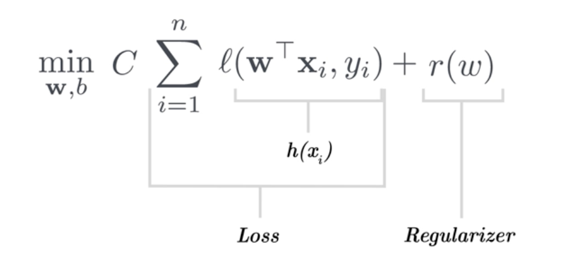

If C is very large we care a lot about the loss and less about the regularizer.  
Typically this is moved to be put in front of the regularizer, and called **lambda** and if it's large care more about the regularizer than the loss.
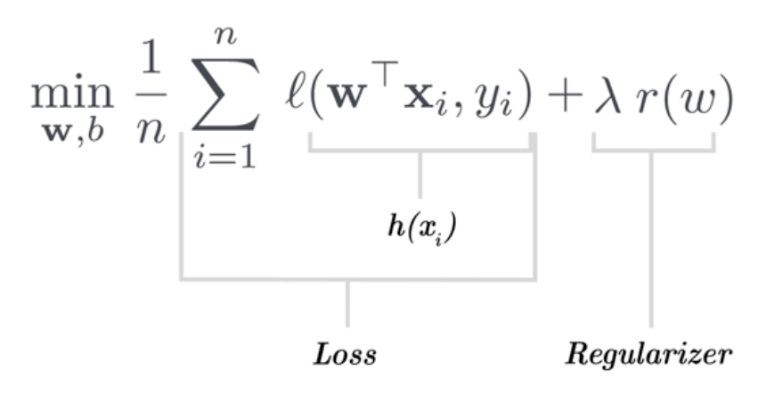

Regularizers penalize w that are overly complex.  Make lambda larger when there is overfitting.  Make small with large data sets to give classifier as much capacity as possible

# Understanding Soft-Margin SVM and Empirical Risk Minimization (ERM)

This lecture explains how a Soft-Margin Support Vector Machine (SVM) can be viewed as a special case of a more general machine learning framework called **Empirical Risk Minimization (ERM)**.

---

## 1. The Main Goal

In machine learning, we want to find a model that makes accurate predictions on unseen data.

For a linear classifier, the prediction is:

\[
\hat{y} = w^T x + b
\]

Where:

- \(x\) = input features
- \(w\) = weights (parameters to learn)
- \(b\) = bias/intercept

Training means finding the best values of \(w\) and \(b\).

---

## 2. Soft-Margin SVM Objective

The Soft-Margin SVM can be written as an optimization problem:

\[
\text{Loss} + \text{Regularization}
\]

This means we want a model that:

1. Makes as few mistakes as possible.
2. Remains as simple as possible.

These two goals often compete with each other.

---

## 3. The Loss Function

A **loss function** measures how wrong the model's predictions are.

For SVMs, the loss function is the **hinge loss**:

\[
\max(0, 1 - y_i(w^T x_i + b))
\]

### Intuition

- Correct prediction with a large margin → Loss = 0
- Correct prediction but close to the boundary → Small loss
- Incorrect prediction → Large loss

The total loss is calculated across all training examples.

---

## 4. The Regularizer

A **regularizer** measures the complexity of the model.

For SVMs:

\[
R(w) = \|w\|^2
\]

This is the squared length of the weight vector.

### Intuition

- Large weights → More complex model
- Small weights → Simpler model

The regularizer encourages the model to keep weights small.

---

## 5. Why Regularization Matters

Without regularization, a model may memorize the training data instead of learning general patterns.

This problem is called **overfitting**.

### Overfitting Example

Suppose you only have 10 training examples.

A highly flexible model might memorize all 10 examples perfectly.

Result:

- Excellent training accuracy
- Poor performance on new data

Regularization helps prevent this.

---

## 6. Empirical Risk Minimization (ERM)

The lecture generalizes SVMs into a broader framework called:

### Empirical Risk Minimization (ERM)

The general objective function is:

\[
\frac{1}{n}
\sum_{i=1}^{n}
l(w^T x_i + b, y_i)
+
\lambda R(w)
\]

Where:

- \(n\) = number of training examples
- \(l(\cdot)\) = loss function
- \(R(w)\) = regularizer
- \(\lambda\) = regularization parameter

---

## 7. Why Divide by \(n\)?

The factor

\[
\frac{1}{n}
\]

computes the **average loss** rather than the total loss.

Benefits:

- Easier to interpret
- Comparable across datasets of different sizes
- Loss values stay on a similar scale

---

## 8. Components of ERM

### Loss Function

Measures how inaccurate the predictions are.

Different algorithms use different losses:

- SVM → Hinge Loss
- Linear Regression → Squared Error Loss
- Logistic Regression → Logistic Loss

The loss depends on:

\[
(w^T x_i + b,\ y_i)
\]

which means:

- Model prediction
- True label

---

### Regularizer

Measures model complexity.

The regularizer depends only on the model parameters:

\[
R(w)
\]

It does **not** depend on the data.

Its purpose is to discourage overly complex solutions.

---

## 9. Understanding Lambda (\(\lambda\))

The parameter \(\lambda\) controls the tradeoff between:

- Fitting the data
- Keeping the model simple

### Large \(\lambda\)

When \(\lambda\) is large:

\[
\lambda R(w)
\]

becomes more important.

Effects:

- Strong regularization
- Simpler model
- Smaller weights
- Less overfitting
- Risk of underfitting

Think:

> "Keep the model simple."

---

### Small \(\lambda\)

When \(\lambda\) is small:

The loss term becomes more important.

Effects:

- Weak regularization
- More flexible model
- Better training fit
- Higher risk of overfitting

Think:

> "Prioritize fitting the training data."

---

## 10. Relationship to Dataset Size

### Small Dataset

When there are only a few training examples:

- Overfitting becomes more likely
- Use a larger \(\lambda\)
- Stronger regularization

Reason:

The model could otherwise memorize the training data.

---

### Large Dataset

When there are many training examples:

- Overfitting is less likely
- Use a smaller \(\lambda\)
- Allow more model flexibility

Reason:

The large amount of data naturally helps constrain the model.

---

## 11. Visual Summary

```text
                    MACHINE LEARNING OBJECTIVE

               Average Prediction Error
                          +
               Model Complexity Penalty

          1/n Σ Loss(prediction, label)
                          +
                    λ Regularizer
```

# Exploring Loss Functions for Classification

Different classification loss functions define how much the model cares about mistakes: hinge loss encourages large margins, log loss provides smooth probability-based learning, exponential loss aggressively corrects errors, and zero-one loss simply measures whether predictions are right or wrong.

---

## 1. Why Loss Functions Matter

In the Empirical Risk Minimization (ERM) framework, we typically minimize:

\[
\frac{1}{n}\sum_{i=1}^{n} L(h(x_i), y_i) + \lambda R(w)
\]

Where:

- \(L(\cdot)\) = loss function
- \(R(w)\) = regularization term
- \(\lambda\) = regularization strength
- \(h(x_i)\) = model prediction
- \(y_i\) = true label

The loss function determines how prediction mistakes are penalized.

Different loss functions:

- Punish mistakes differently
- React differently to noisy data
- Have different optimization properties
- Can produce different classifiers

---

## 2. Classification Margin

Many classification loss functions are defined using:

\[
h(x_i)y_i
\]

This quantity is called the **margin**.

### Interpretation

#### Positive Margin

\[
h(x_i)y_i > 0
\]

The prediction and label agree.

The point is classified correctly.

---

#### Negative Margin

\[
h(x_i)y_i < 0
\]

The prediction and label disagree.

The point is misclassified.

---

#### Large Positive Margin

The classifier is confident and correct.

---

#### Large Negative Margin

The classifier is confident but wrong.

---

## 3. Hinge Loss

The hinge loss is the loss used by Support Vector Machines (SVMs).

### Formula

\[
L_{hinge} =
\max(0, 1 - h(x_i)y_i)
\]

---

### Shape of the Hinge Loss

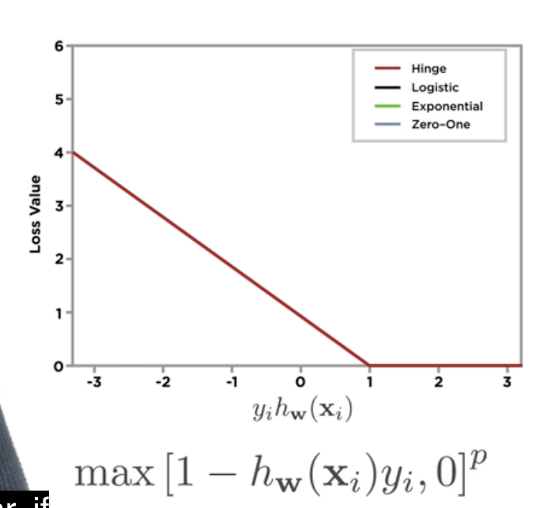
It resembles a door hinge, which is where the name comes from.

---

### Behavior

### Correct Classification with Large Margin

Example:

\[
h(x_i)y_i = 3
\]

Loss:

\[
0
\]

The point is correctly classified and far from the decision boundary.

No penalty.

---

### Correct But Close to the Boundary

Example:

\[
0 < h(x_i)y_i < 1
\]

Loss becomes positive.

The classifier is encouraged to move the point farther from the decision boundary.

---

### Misclassified Point

Example:

\[
h(x_i)y_i < 0
\]

Loss increases linearly.

The farther the point is on the wrong side, the larger the penalty.

---

### Key Intuition

Hinge loss doesn't just care about correctness.

It also cares about confidence.

It wants points to be:

- Correctly classified
- Far away from the decision boundary

This is why SVMs maximize the margin.

---

## 4. Squared Hinge Loss

A variation of hinge loss is:

\[
L_{sq\_hinge}
=
\max(0,1-h(x_i)y_i)^2
\]

---

### Advantages

The loss is smoother.

Optimization is often easier because the objective behaves more nicely.

---

### Disadvantages

Misclassified points receive much stronger penalties.

Because the loss grows quadratically:

```text
distance from boundary: 2x
penalty:                4x

distance from boundary: 3x
penalty:                9x
```

---

### Impact of Noisy Data

Suppose one training point is mislabeled.

The squared hinge loss will try very hard to fix that point.

As a result:

- The decision boundary may move significantly
- Other points may suffer

Because of this, squared hinge loss can be more sensitive to outliers.

---

## 5. Log Loss (Logistic Loss)

Log loss is used in Logistic Regression.

### Formula

\[
L_{log}
=
\log(1 + e^{-h(x_i)y_i})
\]

---

### Shape

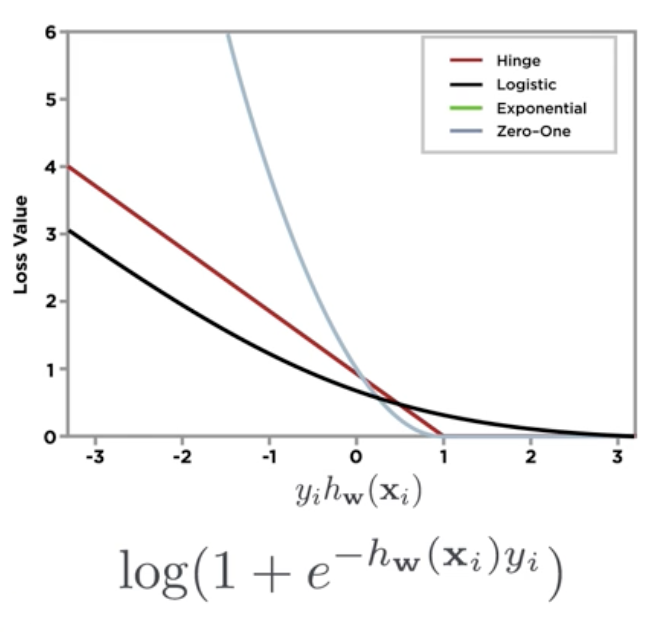

The curve is smooth everywhere.

There are no sharp corners.

---

### Major Advantages

#### 1. Produces Probabilities

Logistic regression converts its outputs into probabilities.

Example:

```text
P(Class = Positive) = 0.95
```

This is often easier to interpret than a simple yes/no answer.

---

#### 2. Smooth and Differentiable

Unlike hinge loss:

- No sharp corner
- Continuous gradient everywhere
- Easy for gradient-based optimization algorithms

---

### Behavior on Misclassified Points

When:

\[
h(x_i)y_i
\]

becomes strongly negative,

the loss grows approximately linearly.

This means:

```text
Wrong by twice as much
≈ twice the penalty
```

---

### Why This Is Useful

Suppose some points are mislabeled.

Log loss does not overreact to them.

Instead, it increases the penalty steadily.

This makes logistic regression more robust to noisy datasets than methods that use exponential penalties.

---

## 6. Exponential Loss

Exponential loss is used by AdaBoost.

### Formula

\[
L_{exp}
=
e^{-h(x_i)y_i}
\]

---

### Shape

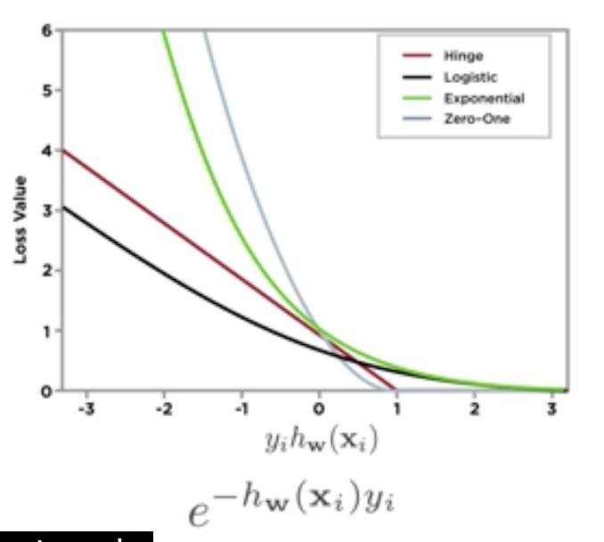

For misclassified points, the curve shoots upward rapidly.

---

### Why AdaBoost Works So Well

AdaBoost repeatedly emphasizes incorrectly classified examples.

The exponential loss heavily penalizes those mistakes.

As a result:

- Learning happens rapidly
- Misclassified points get lots of attention
- Strong classifiers can be created quickly

The aggressive behavior of exponential loss is often described as AdaBoost's "secret sauce."

---

### Disadvantage

The same aggressiveness can become a problem.

Suppose a point is mislabeled.

The loss grows exponentially:

\[
e^{-h(x_i)y_i}
\]

The farther away the point is:

- The larger the penalty
- The stronger the pull on the classifier

As a result:

- A single bad point can strongly affect the decision boundary
- Performance may degrade when data contains noise

---

### Summary

Exponential loss is:

✅ Aggressive

✅ Fast learning

❌ Sensitive to noise

❌ Sensitive to outliers

---

## 7. Zero-One Loss

The most intuitive loss function is the zero-one loss.

### Formula

\[
L_{0/1}
=
\begin{cases}
0 & \text{correct prediction}\\
1 & \text{incorrect prediction}
\end{cases}
\]

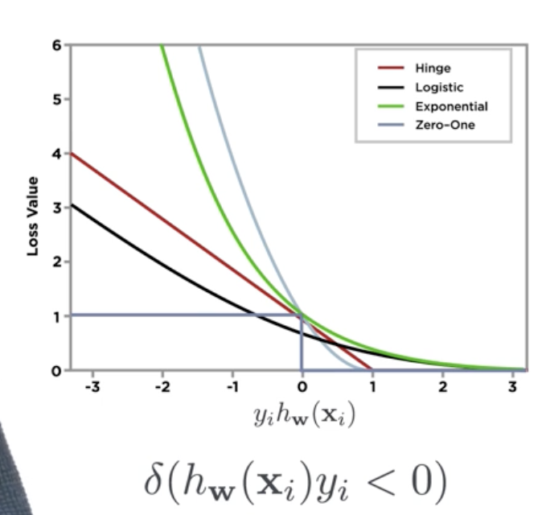
---

### Interpretation

Simply ask:

> Did the classifier get the prediction right?

If yes:

\[
Loss = 0
\]

If no:

\[
Loss = 1
\]

---

### Example

```text
Prediction = Positive
Label      = Positive

Loss = 0
```

```text
Prediction = Positive
Label      = Negative

Loss = 1
```

---

### Why It Isn't Usually Optimized

The problem is that the zero-one loss is not differentiable.

The optimization landscape is:

```text
0 0 0 0 0 1 1 1 1 1
```

There is no useful gradient information.

Gradient-based optimization algorithms cannot easily minimize it.

---

### Where It Is Used

Even though it is difficult to optimize directly, it is very useful for evaluation.

It corresponds directly to:

#### Training Error

\[
\frac{\text{Number of mistakes}}
{\text{Total examples}}
\]

#### Testing Error

\[
\frac{\text{Number of mistakes}}
{\text{Total examples}}
\]

So zero-one loss is often used as a performance metric rather than a training objective.

---

## 8. Comparison of Loss Functions

| Loss Function | Used By | Smooth? | Penalty for Large Errors | Robust to Noise? |
|---------------|----------|----------|-------------------------|------------------|
| Hinge Loss | SVM | No | Linear | Moderate |
| Squared Hinge Loss | SVM Variants | Mostly | Quadratic | Less Robust |
| Log Loss | Logistic Regression | Yes | Approximately Linear | Good |
| Exponential Loss | AdaBoost | Yes | Exponential | Poor |
| Zero-One Loss | Evaluation | No | Constant | N/A |

---

## 9. Visual Intuition

```text
Penalty on Misclassified Points

Zero-One       : Constant
Hinge          : Linear
Log Loss       : Roughly Linear
Squared Hinge  : Quadratic
Exponential    : Exponential
```

As you move down this list, the algorithm becomes more aggressive about fixing mistakes.

More aggressive penalties:

- Learn faster
- Focus heavily on hard examples
- Become more sensitive to outliers and incorrect labels

**Key Takeaways**

1. A loss function determines how prediction errors are penalized.
2. Hinge loss is used by SVMs and promotes large margins.
3. Squared hinge loss penalizes mistakes more aggressively.
4. Log loss is smooth, produces probabilities, and is widely used.
5. Exponential loss powers AdaBoost and emphasizes difficult examples.
6. Exponential loss is highly sensitive to noisy or mislabeled data.
7. Zero-one loss directly measures classification error.
8. Zero-one loss is useful for evaluation but difficult to optimize.
9. Choosing a loss function involves balancing:
   - optimization ease,
   - robustness to noise,
   - interpretability,
   - and sensitivity to mistakes.


# Regression Loss Functions for Regression

Square loss strongly penalizes large errors and predicts the mean, absolute loss is more resistant to outliers and predicts the median, and Huber loss combines both approaches by acting like square loss for small mistakes and absolute loss for large mistakes.

Three common regression loss functions:
1. Square Loss
2. Absolute Loss
3. Huber Loss

Each loss function measures prediction error differently and has different strengths and weaknesses.

---

## 1. Regression in ERM

In regression, the goal is to predict a continuous numeric value.

Examples:

- House prices
- Stock prices
- Temperature
- Sales revenue

A model produces a prediction:

\[
h(x_i)
\]

The true value is:

\[
y_i
\]

The prediction error is:

\[
h(x_i) - y_i
\]

A loss function converts that error into a penalty.

---

## 2. What Makes a Good Regression Loss?

A good loss function should:

- Penalize inaccurate predictions
- Be easy to optimize
- Be robust to noisy data
- Not overreact to unusual examples (outliers)

Different loss functions achieve these goals differently.

---

## 3. Square Loss

The most common regression loss is the **Square Loss**.

### Formula

\[
L_{square}
=
(h(x_i)-y_i)^2
\]

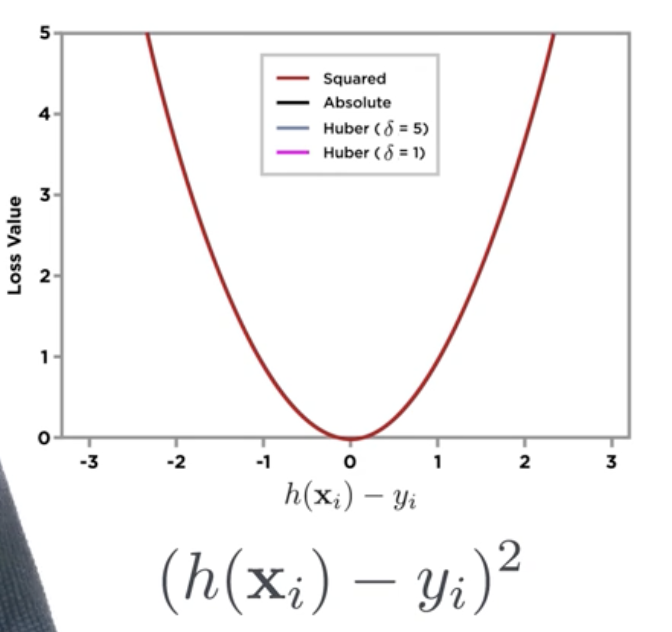
---

### Intuition

1. Compute the prediction error:

\[
h(x_i)-y_i
\]

2. Square the error.

Examples:

```text
Error = 2
Loss = 4

Error = 5
Loss = 25

Error = 10
Loss = 100
```

The penalty grows very quickly as the error increases.


---

### Advantages

#### 1. Smooth and Differentiable

The square loss is differentiable everywhere.

This makes optimization easy.

Many machine learning algorithms rely on gradients, and square loss provides smooth gradients everywhere.

---

#### 2. Encourages Mean Predictions

Suppose the labels contain noise.

For example, many similar houses may sell for slightly different prices because of factors not captured by the model.

A model trained with square loss tends to predict:

\[
\text{Mean (Average)}
\]

of the possible labels.

---

### House Price Example

Suppose similar houses sold for:

```text
$190,000
$200,000
$210,000
```

The square loss tends to push the prediction toward:

```text
$200,000
```

which is the average.

---

## 4. Problem with Square Loss

The major weakness of square loss is:

### It Punishes Large Errors Extremely Hard

Because the error is squared:

```text
Error = 10
Loss = 100

Error = 100
Loss = 10,000
```

A large mistake can dominate the entire optimization process.

---

### Outlier Example

Imagine we are predicting house prices.

Most houses sell near:

```text
$100,000
```

But one unusual house is sold to a spouse for:

```text
$1
```

for tax or legal reasons.

The model predicts:

```text
$100,000
```

which is reasonable based on the available features.

Error:

```text
99,999
```

Loss:

```text
99,999²
≈ 10 billion
```

This enormous penalty may cause the model to distort itself trying to fit that one unusual data point.

---

### Key Disadvantage

Square loss is:

✅ Easy to optimize

❌ Very sensitive to outliers

❌ Very sensitive to noisy labels

---

## 5. Absolute Loss

To reduce the impact of outliers, we can use the **Absolute Loss**.

### Formula

\[
L_{absolute}
=
|h(x_i)-y_i|
\]

---

### Intuition

The penalty is simply the absolute value of the prediction error.

Examples:

```text
Error = 2
Loss = 2

Error = 5
Loss = 5

Error = 10
Loss = 10
```

The loss increases linearly.

---

### Shape of Absolute Loss

```text
Loss
 ^
 |    /
 |   /
 |  /
 | /
 |/
 |\
 | \
 |  \
 +---------------------> Error
```

The graph forms a V shape.

---

### Advantages

#### Robust to Outliers

Since the penalty grows linearly:

```text
Error = 10
Loss = 10

Error = 100
Loss = 100
```

Large errors do not dominate training nearly as much as with square loss.

---

#### More Resistant to Noisy Labels

If there are strange or incorrect labels in the dataset, absolute loss will not allow those examples to dominate the learning process.

---

### Median Prediction Property

When trained using absolute loss, the model tends to predict the:

\[
\text{Median}
\]

rather than the mean.

---

### Example

Suppose observed values are:

```text
1
2
3
4
200
```

Mean:

```text
42
```

Median:

```text
3
```

Because of the outlier (200), the mean gets pulled away from the typical values.

Absolute loss prefers the median, making it more robust.

---

## 6. Problem with Absolute Loss

Absolute loss has one important drawback.

### Not Differentiable at Zero

At:

\[
h(x_i)-y_i = 0
\]

the graph has a sharp corner.

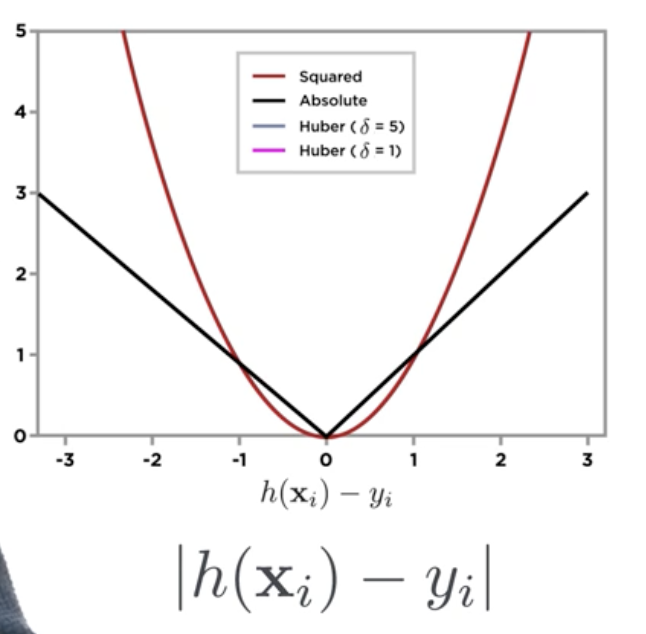

The slope changes abruptly.

Many optimization algorithms prefer smooth functions and can struggle with this point.

---

### Practical Impact

The issue is usually manageable.

Modern optimization methods can handle absolute loss, but it is generally more challenging than square loss.

---

### Summary

Absolute loss is:

✅ Robust to outliers

✅ Robust to noisy labels

✅ Predicts the median

❌ Not differentiable at zero

---

## 7. Huber Loss

The **Huber Loss** combines the strengths of square loss and absolute loss.

---

### Main Idea

Use:

#### Square Loss

when the error is small.

\[
(h(x_i)-y_i)^2
\]

---

#### Absolute Loss

when the error is large.

\[
|h(x_i)-y_i|
\]

---

### Behavior

```text
Small Errors  -> Quadratic
Large Errors  -> Linear
```

The transition happens at a threshold value chosen by the practitioner.

---

### Shape of Huber Loss

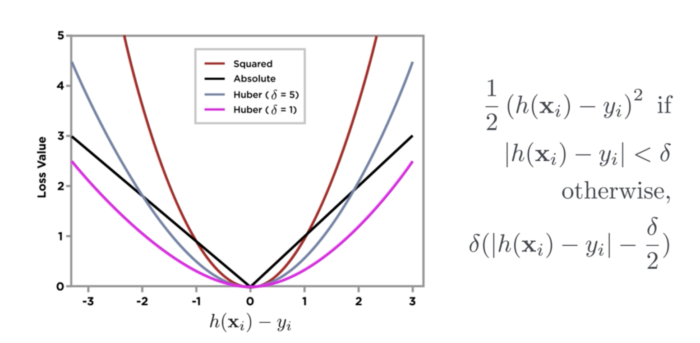

Near zero:

- Smooth parabola

Far from zero:

- Linear growth

---

## 8. Why Huber Loss Works Well

The Huber loss gets the best features of both approaches.

### From Square Loss

- Smooth near zero
- Differentiable
- Easy optimization

### From Absolute Loss

- Resistant to outliers
- Robust to noisy labels
- Large errors do not dominate

---

### Intuition

For predictions that are close to correct:

> Behave like square loss.

For predictions that are very wrong:

> Behave like absolute loss.

This prevents extreme data points from overwhelming the model.

---

## Comparison of Regression Loss Functions
* If data is noisy squared loss will predict the mean label
* If the data is noisy absolute loss will predict the median label
* Huber Loss combines teh squared loss and absolute loss to get the best of both worldsx

| Loss Function | Shape | Differentiable Everywhere? | Sensitive to Outliers? | Predicts |
|---------------|--------|---------------------------|-----------------------|-----------|
| Square Loss | Quadratic | Yes | High | Mean |
| Absolute Loss | Linear / V-shaped | No | Low | Median |
| Huber Loss | Quadratic + Linear | Mostly Smooth | Moderate to Low | Between Mean and Median |


```text
Penalty Growth for Large Errors

Absolute Loss     : Linear
Huber Loss        : Linear after threshold
Square Loss       : Quadratic
```

As prediction error increases:

```text
Square Loss
    grows fastest

Huber Loss
    grows moderately

Absolute Loss
    grows steadily
```

---

### When to Use Each Loss

#### Square Loss

Best when:

- Data is relatively clean
- Few outliers
- Optimization speed is important

Used in:

- Linear Regression
- Many least-squares methods

---

#### Absolute Loss

Best when:

- Data contains outliers
- Labels are noisy
- Robustness is important

---

#### Huber Loss

Best when:

- Some outliers exist
- You want smooth optimization
- You want a compromise between robustness and efficiency

---

**Key Takeaways**

1. Regression loss functions measure the difference between predictions and true values.
2. Square loss penalizes errors quadratically.
3. Square loss is smooth and easy to optimize.
4. Square loss tends to predict the mean.
5. Square loss is highly sensitive to outliers.
6. Absolute loss penalizes errors linearly.
7. Absolute loss tends to predict the median.
8. Absolute loss is robust to noisy labels and outliers.
9. Huber loss combines the strengths of square and absolute loss.
10. Huber loss is smooth for small errors and robust for large errors.


# Compare Regularizers
There are many types of regularizers used in empirical risk minimization.  
This lecture explains how regularization works geometrically and compares the two most common regularizers:

1. L2 Regularization (Ridge)
2. L1 Regularization (Lasso)

The key idea is that regularizers limit model complexity by restricting how large the weight vector can become.  L2 regularization keeps all weights small and spreads importance across many features, while L1 regularization drives many weights to exactly zero, producing sparse and highly interpretable models.

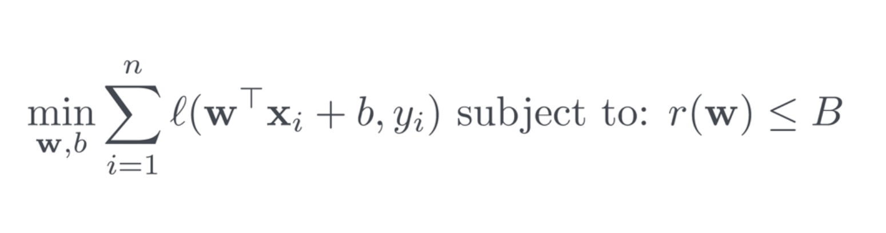
Loss function is constrained by the regularizer
where B is budget
---

## 1. Two Equivalent Views of Regularization

In Empirical Risk Minimization (ERM), we typically write the objective as:

\[
\text{Loss} + \lambda \times \text{Regularizer}
\]

More formally:

\[
\min_w L(w) + \lambda R(w)
\]

where:

- \(L(w)\) = training loss
- \(R(w)\) = regularizer
- \(\lambda\) = regularization strength

---

### Alternative Formulation

The exact same optimization problem can be rewritten as:

\[
\min_w L(w)
\]

subject to:

\[
R(w) \le B
\]

where:

- \(B\) is a budget
- The regularizer acts as a constraint

---

### Important Idea

For every value of:

\[
\lambda
\]

there exists a corresponding:

\[
B
\]

that produces the same solution.

And vice versa.

The two formulations are mathematically equivalent.

---

## 2. Why Use the Constraint View?

The constraint view is often easier to visualize.

Instead of saying:

> "Pay a penalty for complex models"

we say:

> "Your solution must stay inside a permitted region."

---

### Goal

We want to:

1. Minimize training error
2. Keep the model from becoming too complex

The regularizer creates a boundary that the solution cannot leave.

---

## 3. Visualizing the Optimization Problem

Suppose we only have two weights:

\[
w = (w_1, w_2)
\]

The loss function can be visualized as a landscape.

```text
          High Loss
              ^
             /\
            /  \
           /    \
          /      \
         /        \
        /          \
       -----------------> Lower Loss
```

Optimization methods such as gradient descent attempt to move downhill until they reach the lowest point.

Without regularization:

```text
Return the global minimum
of the loss function.
```

---

## 4. What Regularization Does

Regularization adds a restriction.

Instead of being allowed to search the entire space:

```text
Anywhere
```

the solution must stay inside a limited region.

The optimizer finds:

```text
The lowest point of the loss function
that still satisfies the constraint.
```

---

## 5. L2 Regularization

The most common regularizer is the L2 regularizer.

### Formula

\[
R(w)
=
||w||^2
=
w_1^2 + w_2^2
\]

Constraint form:

\[
w_1^2 + w_2^2 \le B
\]

---

## 6. Geometric Interpretation of L2

The equation

\[
w_1^2 + w_2^2 = B
\]

defines a circle.

---

### L2 Constraint Region

```text
          w2
           ^
           |
       ***** 
     **     **
    *         *
    *    •    *
    *         *
     **     **
       *****
           |
           +------------> w1
```

The dot at the center is:

\[
(0,0)
\]

the all-zero weight vector.

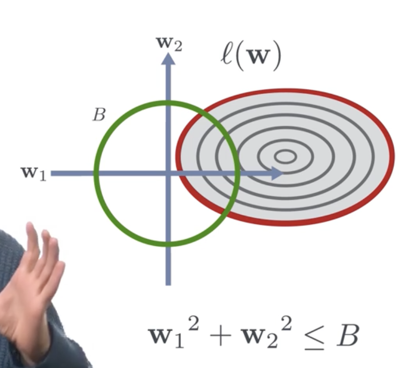
---

### What Does This Mean?

L2 regularization assumes:

> The simplest model is the one with all weights equal to zero.

The regularizer encourages solutions to remain close to the origin.

---

### Understanding the Budget B

The budget controls the radius of the circle.

#### Large B

```text
Large Circle
```

The optimizer can travel far from the origin.

Regularization has little effect.

---

#### Small B

```text
Small Circle
```

The optimizer must stay close to zero.

Strong regularization.

---

#### B = 0

Only one solution is allowed:

\[
w = 0
\]

the all-zero model.

---

## 7. The Tradeoff Created by Regularization

Without regularization:

```text
Focus entirely on minimizing training error.
```

Risk:

```text
Overfitting
```

---

With regularization:

```text
Accept slightly higher training error
in exchange for a simpler model.
```

Benefit:

```text
Better generalization
```

to unseen data.

---

## 8. L1 Regularization

The second common regularizer is L1.

### Formula

\[
R(w)
=
|w_1| + |w_2|
\]

Constraint form:

\[
|w_1| + |w_2| \le B
\]

---

## 9. Geometric Interpretation of L1

The L1 constraint produces a diamond.

---

### L1 Constraint Region

```text
            w2
             ^
             |
             *
            * *
           *   *
          *     *
         *       *
        *         *
         *       *
          *     *
           *   *
            * *
             *
             |
             +------------> w1
```

The size of the diamond is controlled by:

\[
B
\]

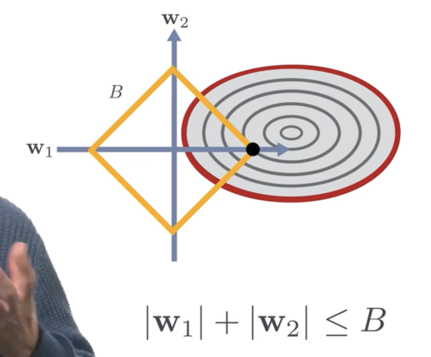
---

## 10. Why the Diamond Matters

The diamond has sharp corners.

Those corners create an important effect.

When optimization searches for the lowest point inside the diamond, it often lands on one of these corners.

---

### What Happens at the Corners?

At a corner:

```text
One or more weights are exactly zero.
```

Example:

```text
(w1, w2)

(3,0)
(0,2)
(-4,0)
(0,-5)
```

Notice:

```text
One coefficient is zero.
```

---

## 11. Sparsity

This tendency toward zero weights is called:

### Sparsity

A sparse model has:

```text
Many weights = 0
Few weights ≠ 0
```

---

### High-Dimensional Example

Suppose we have:

```text
10,000 features
```

L1 regularization might produce:

```text
9,950 weights = 0

50 weights ≠ 0
```

Only a small subset of features remains active.

---

## 12. Why Sparsity Is Valuable

Imagine a biology problem.

Each feature represents a gene.

Goal:

```text
Predict whether a person is prone to smoking.
```

The classifier might perform well.

But scientists often care less about the prediction itself and more about understanding:

> Which genes matter?

---

### With L1 Regularization

Many weights become:

```text
0
```

Those genes are effectively ignored by the classifier.

Only a small number of genes receive non-zero weights.

These become candidate genes for further biological study.

---

### Interpretation Benefit

L1 regularization helps answer:

```text
Which features are important?
```

rather than merely:

```text
Can I make accurate predictions?
```

---

## 13. L2 vs L1 Behavior

### L2 Regularization

Typically produces:

```text
Small weights everywhere
```

Example:

```text
0.3
0.1
0.05
0.2
0.12
```

Most features stay active.

Weights are simply reduced.

---

### L1 Regularization

Typically produces:

```text
0
0
0
0.7
0
1.3
0
```

Many features disappear completely.

---

## 14. Intuition

Think of a fixed budget.

### L2

Spreads the budget over many features.

```text
Many small weights
```

---

### L1

Concentrates the budget on a few features.

```text
Few large weights
Many zeros
```

---

## Comparison

| Property | L2 Regularization | L1 Regularization |
|-----------|-----------|-----------|
| Constraint Shape | Circle (Sphere) | Diamond |
| Weight Behavior | Shrinks weights | Eliminates weights |
| Sparse Solutions | Rare | Common |
| Feature Selection | No | Yes |
| Interpretability | Moderate | High |
| Most Common Use | General-purpose models | Feature selection |

**When to Use L2**

L2 regularization is often preferred when:

- Prediction accuracy is the primary goal
- Most features may contain useful information
- Interpretability is less important
- You want stable solutions

Examples:

- Support Vector Machines
- Logistic Regression
- Neural Networks

**When to Use L1**

L1 regularization is often preferred when:

- There are many features
- Only a few features are truly important
- Interpretability matters
- Feature selection is desired

Examples:

- Gene analysis
- Medical research
- Text classification
- Scientific discovery

**Key Takeaways**

1. Regularization can be viewed as either a penalty term or a constraint.
2. The constraint view restricts solutions to a geometric region.
3. L2 regularization creates a circular (spherical) constraint region.
4. L2 encourages small weights but usually keeps all features.
5. L1 regularization creates a diamond-shaped constraint region.
6. L1 often produces sparse solutions with many weights equal to zero.
7. Sparse solutions make models easier to interpret.
8. L2 is generally used when prediction performance is most important.
9. L1 is especially useful when identifying important features matters.
10. Both regularizers trade off training accuracy against model complexity.

# Combining Loss Functions and Regularizers
Many machine learning algorithms are simply different combinations of a loss function and a regularizer: Lasso uses **MSE + L1** to select important features, Ridge uses **MSE + L2** to create stable models, and Elastic Net combines both approaches to achieve sparsity and uniqueness.

Empirical risk minimization is so flexible that you can pick almost any loss and regularizer, minimize them, and create your own model.  

| Model                   | Loss Function | Regularizer    |
| ----------------------- | ------------- | -------------- |
| Linear Regression (OLS) | L2 Loss (MSE) | None           |
| Ridge Regression        | L2 Loss (MSE) | L2             |
| Lasso                   | L2 Loss (MSE) | L1             |
| Elastic Net             | L2 Loss (MSE) | L1 + L2        |
| Logistic Regression     | Logistic Loss | Often L1 or L2 |
| Linear SVM              | Hinge Loss    | Often L1 or L2 |

Many well-known machine learning algorithms can be understood as specific combinations of:

1. A **loss function** (measures prediction error)
2. A **regularizer** (controls model complexity)

The Empirical Risk Minimization (ERM) framework is extremely flexible because you can mix and match different losses and regularizers depending on your goals.

---

## 1. The General ERM Framework

Most supervised learning algorithms can be written as:

\[
\text{Loss} + \lambda \times \text{Regularizer}
\]

More formally:

\[
\frac{1}{n}\sum_{i=1}^{n}L(h(x_i),y_i) + \lambda R(w)
\]

Where:

- \(L\) = loss function
- \(R(w)\) = regularizer
- \(\lambda\) = regularization strength
- \(h(x_i)\) = model prediction
- \(y_i\) = true label

---

## 2. Two Design Choices

When designing a machine learning model, we choose:

### Loss Function

Determines:

> How prediction errors are penalized.

Examples:

- Mean Squared Error (MSE)
- Absolute Loss
- Logistic Loss
- Hinge Loss
- Exponential Loss

---

### Regularizer

Determines:

> How model complexity is penalized.

Examples:

- No regularization
- L1 regularization
- L2 regularization

---

## 3. Why Different Combinations Exist

Different applications require different properties.

Sometimes we want:

- Maximum predictive accuracy

Sometimes we want:

- Simpler models
- Feature selection
- Interpretability

Sometimes we want:

- Stable, unique solutions

Different combinations of losses and regularizers provide these different characteristics.

---

## 4. Ordinary Least Squares (OLS)

Also known as:

### Linear Regression

---

#### Components

**Loss Function**

\[
(h(x)-y)^2
\]

Mean Squared Error (MSE)

**Regularizer**

None

---

### Objective

\[
\min_w
\sum_i
(h(x_i)-y_i)^2
\]

---

### Interpretation

The model focuses entirely on fitting the training data.

There is no penalty for large weights.

---

### Advantages

✅ Simple

✅ Fast

✅ Easy to understand

✅ Closed-form solution exists

---

### Disadvantages

❌ Can overfit

❌ Sensitive to outliers

❌ No complexity control

---

## 5. Ridge Regression

Ridge Regression combines:

### L2 Loss Function (MSE)

\[
(h(x)-y)^2
\]

with

### L2 Regularization

\[
||w||^2
\]

---

### Objective

\[
\min_w
\sum_i
(h(x_i)-y_i)^2
+
\lambda ||w||^2
\]

---

### What L2 Regularization Does

L2 regularization shrinks weights toward zero.

Example:

```text
Before Ridge

5.2
4.1
3.3
2.4
```

After Ridge

```text
2.6
2.0
1.7
1.1
```

All features remain active, but their influence is reduced.

---

### Main Idea

Ridge regression:

```text
Keeps all features
but makes their coefficients smaller.
```

---

### Benefits

✅ Reduces overfitting

✅ Stable solutions

✅ Works well when many features are useful

---

## 6. Lasso

Lasso stands for:

### Least Absolute Shrinkage and Selection Operator

Lasso is especially popular in:

- Biology
- Neuroscience
- Life sciences

where understanding *which features matter* is often as important as prediction accuracy.  It prioritizes sparse weights over small dense weights, helping pick out features in the data representation that best explain the labels.

---

#### Components

**L2 Loss Function (Mean Squared Error)**

\[
(h(x)-y)^2
\]

plus

**L1 Regularization**

\[
|w_1|+|w_2|+\cdots+|w_d|
\]

---

#### Objective

\[
\min_w
\sum_i
(h(x_i)-y_i)^2
+
\lambda ||w||_1
\]

---

## 7. What Makes Lasso Special?

L1 regularization encourages:

### Sparse Solutions

Meaning:

```text
Many weights = 0
Few weights ≠ 0
```

---

### Example

Suppose we have 10 features.

Lasso might produce:

```text
0
0
0
1.8
0
-0.9
0
0
0
0
```

Only two features remain active.

---

### Why Scientists Like Lasso

Imagine:

- Each feature is a gene.
- The goal is predicting disease risk.

Researchers often ask:

> Which genes are important?

Lasso automatically removes many irrelevant features.

The few remaining non-zero weights indicate potential biological importance.

---

### Advantages

✅ Automatic feature selection

✅ Sparse models

✅ Easy to interpret

---

### Disadvantages

❌ Can produce non-unique solutions

❌ Struggles with highly correlated features

---

## 8. The Correlated Feature Problem

Suppose two features contain identical information.

Example:

```text
Feature A = Income
Feature B = Same Income Data
```

Both are equally useful.

---

### With Lasso

One solution could be:

```text
Weight A = 10
Weight B = 0
```

Another equally good solution:

```text
Weight A = 0
Weight B = 10
```

Lasso may arbitrarily choose one.

Therefore:

```text
Multiple optimal solutions may exist.
```

---

## 9. Elastic Net

Elastic Net combines:

- Lasso (L1)
- Ridge (L2)

---

### Components

#### L2 Loss Function (MSE)

\[
(h(x)-y)^2
\]

plus

#### L1 Regularization

\[
||w||_1
\]

plus

#### L2 Regularization

\[
||w||^2
\]

---

### Objective

\[
\min_w
\sum_i
(h(x_i)-y_i)^2
+
\lambda_1 ||w||_1
+
\lambda_2 ||w||^2
\]

---

## 10. Why Elastic Net Is Useful

Elastic Net combines:

### Sparsity

from L1 regularization

with

### Stability

from L2 regularization

---

### Strong Convexity

The lecture emphasizes that Elastic Net is:

#### Strongly Convex

Meaning:

```text
There is one unique optimal solution.
```

This avoids some of the ambiguity found in pure Lasso models.

---

### Common Practice in Life Sciences

Researchers often use:

```text
Strong L1 penalty
Small L2 penalty
```

This provides:

1. Feature selection
2. Sparsity
3. A unique solution

---

## 11. Logistic Regression

Logistic Regression is a classification algorithm.

---

### Components

#### Logistic Loss

\[
\log(1+e^{-yh(x)})
\]

plus

#### Optional Regularization

- L1
- L2

---

### Common Variants

#### Logistic Regression + L2

Produces:

```text
Stable solutions
Good generalization
```

---

#### Logistic Regression + L1

Produces:

```text
Sparse models
Feature selection
```

---

### Major Benefit

Logistic regression outputs:

```text
Probabilities
```

which are easy to interpret.

Example:

```text
P(Spam) = 0.92
```

---

## 12. Linear SVM

Support Vector Machines use:

### Hinge Loss

or

### Squared Hinge Loss

along with regularization.

---

#### General Form

\[
\text{Hinge Loss}
+
\lambda R(w)
\]

---

## 13. Linear SVM + L2

### Components

Hinge Loss

+

L2 Regularization

---

### Result

This is the classic SVM.

It produces:

#### Maximum-Margin Classifiers

The decision boundary is chosen to maximize the separation between classes.

---

### Benefits

✅ Strong theoretical foundations

✅ Good generalization

✅ Stable solutions

---

## 14. Linear SVM + L1

### Components

Hinge Loss

+

L1 Regularization

---

### Result

Produces:

#### Sparse Weight Vectors

Many coefficients become exactly zero.

---

### Tradeoff

Benefits:

✅ Feature selection

✅ Interpretability

✅ Sparsity

Cost:

❌ No longer strictly maximizes the margin

The classifier may sacrifice some margin to obtain sparsity.

---

## Summary of Popular Model Combinations

| Model | Loss Function | Regularizer |
|----------|----------|----------|
| Linear Regression (OLS) | L2 Loss (MSE) | None |
| Ridge Regression | L2 Loss (MSE) | L2 |
| Lasso | L2 Loss (MSE) | L1 |
| Elastic Net | L2 Loss (MSE) | L1 + L2 |
| Logistic Regression | Logistic Loss | Often L1 or L2 |
| Linear SVM | Hinge Loss | Often L1 or L2 |

**Choosing the Right Combination**

* If Prediction Accuracy Is the Priority

Common choices:

```text
Ridge Regression
Logistic Regression + L2
Linear SVM + L2
```

These produce stable, reliable models.

* If Feature Selection Is Important

Common choices:

```text
Lasso
Elastic Net
Logistic Regression + L1
Linear SVM + L1
```

These naturally eliminate irrelevant features.

---

* If You Want Sparsity and Stability

Choose:

```text
Elastic Net
```

This is one of the most popular approaches in scientific and biological applications.

---

**Key Takeaways**

1. ERM allows arbitrary combinations of loss functions and regularizers.
2. Many famous machine learning algorithms are simply specific loss/regularizer combinations.
3. Linear Regression = MSE Loss + No Regularization.
4. Ridge Regression = MSE Loss + L2 Regularization.
5. Lasso = MSE Loss + L1 Regularization
6. Elastic Net = MSE Loss + L1 + L2 Regularization.
7. Logistic Regression uses Logistic Loss and often L1 or L2 regularization.
8. SVMs use Hinge Loss and often L2 regularization.
9. L1 regularization encourages sparsity and feature selection.
10. L2 regularization encourages small, stable weights.
11. Elastic Net combines the benefits of both.

---


# [Choosing Loss Functions and Regularizers](picking_loss_function_and_regularizer.md)

# Kernelization
Have data but classes are not linearly dividable
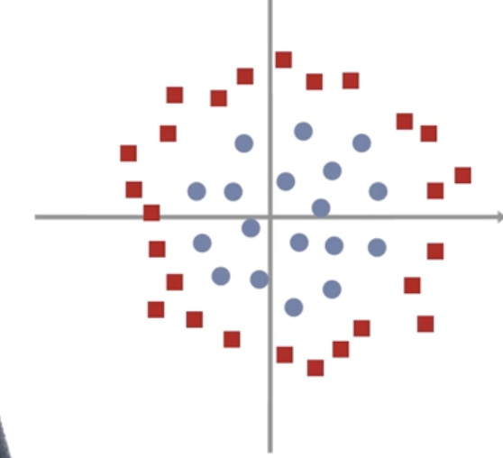

Can try to add extra dimension by x 2/1 + x 2/2
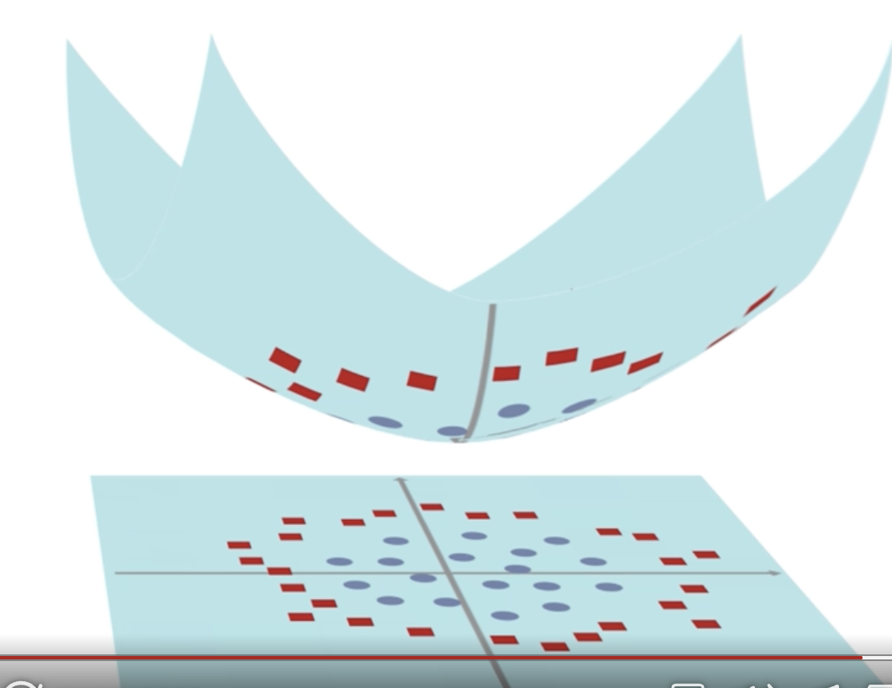
This can, however, make things too high dimensional and can slow down the training algorithm

The answer is the **Kernel Trick**.  The Kernel Trick allows an SVM to learn complex nonlinear decision boundaries by replacing ordinary dot products with kernel functions that implicitly operate in extremely high-dimensional feature spaces, avoiding the huge computational cost of explicit feature expansion.


## 1. The Problem with Linear Models

A linear classifier learns a decision boundary of the form:

\[
w^T x + b
\]

This works well when the classes can be separated by a straight line (or hyperplane).

Example:

```text
Class A      |      Class B
oooooooo     |     xxxxxxxx
oooooooo     |     xxxxxxxx
```

A straight line can separate the two classes.

---

### The Problem

Real datasets are rarely this simple.

Many datasets contain:

- Curved boundaries
- Feature interactions
- Complex patterns

Example:

```text
       o o o
     o       o
    o   xxx   o
     o       o
       o o o
```

A straight line cannot separate these classes.

---

## 2. Feature Expansion

One solution is:

### Create More Features

Suppose the original feature vector is:

\[
x = (x_1,x_2)
\]

We can create additional features:

\[
x_1^2
\]

\[
x_2^2
\]

\[
x_1x_2
\]

etc.

---

### Mapping into a New Space

We define:

\[
\phi(x)
\]

called a **feature expansion** or **feature mapping**.

Example:

Original features:

\[
(x_1,x_2)
\]

Expanded features:

\[
\phi(x)
=
(x_1,x_2,x_1^2,x_2^2,x_1x_2)
\]


So, if we have *d* dimensions there is 2^d dimensional space since each feature can or cannot be included in the new space.  Way too big.  Kernel trick lets us can pretend did map whole thing by computing the exact inner product between two data points. 

Example with a small example
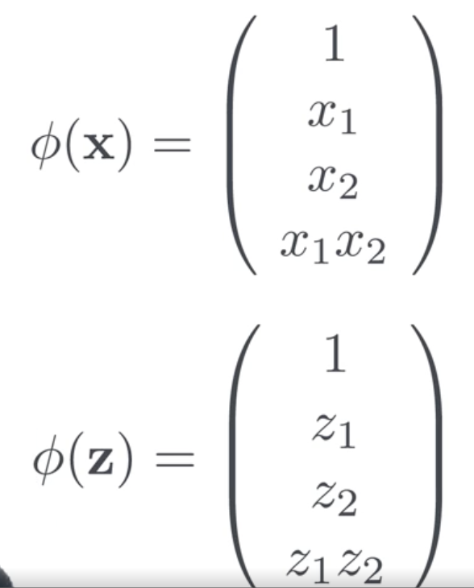
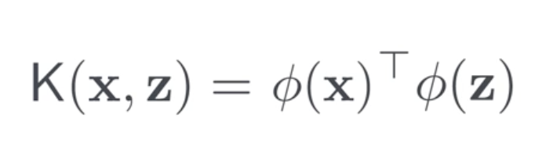


This can be
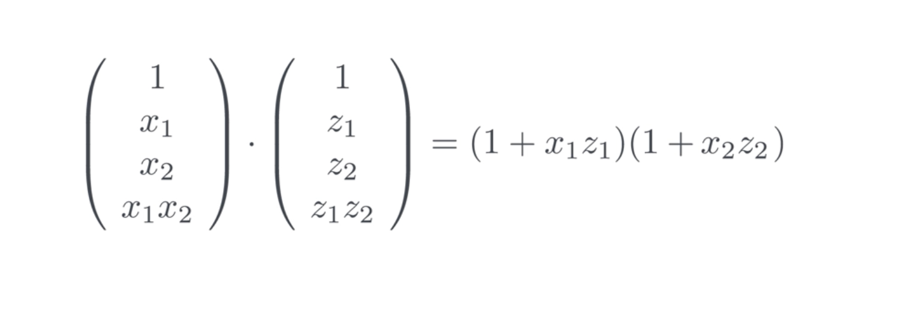

ergo


python
```
import numpy as np

def kernel(x, z):
    x = np.asarray(x)
    z = np.asarray(z)
    return np.prod(1 + x * z)

# Example
x = np.array([1, 2, 3])
z = np.array([4, 5, 6])

print(kernel(x, z))


########
## More explicitly
########
def kernel(x, z):
    result = 1.0
    for xj, zj in zip(x, z):
        result *= (1 + xj * zj)
    return result
```
---

### Why This Helps

A linear classifier in the expanded space becomes a nonlinear classifier in the original space.

The classifier is still linear in:

\[
\phi(x)
\]

but appears nonlinear in:

\[
x
\]

---

## 3. The New Problem

Feature expansion can become enormous.

Imagine:

```text
100 original features
```

Creating:

```text
all pairwise interactions
all cubic interactions
all quartic interactions
...
```

You might end up with:

```text
Millions
or

Billions
of features
```

---

### Computational Cost

Everything becomes expensive:

- Storage
- Memory
- Training
- Prediction

An SVM operating directly in this gigantic feature space would be extremely slow.

---

## 4. Enter Optimization Theory

Optimization researchers discovered that many optimization problems have:

### A Primal Form

and

### A Dual Form

---

#### Primal

The original optimization problem.

Example:

```text
Standard SVM objective
```

---

#### Dual

A different optimization problem.

Important fact:

```text
Same solution
Different formulation
```

Both produce exactly the same classifier.

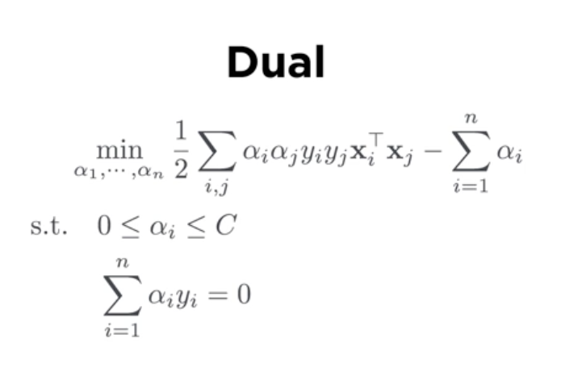

---

## 5. Why the Dual Matters

When researchers wrote the SVM dual problem, they noticed something interesting.

The data appears only through:

\[
x_i^T x_j
\]

which is an:

### Inner Product

between two data points.
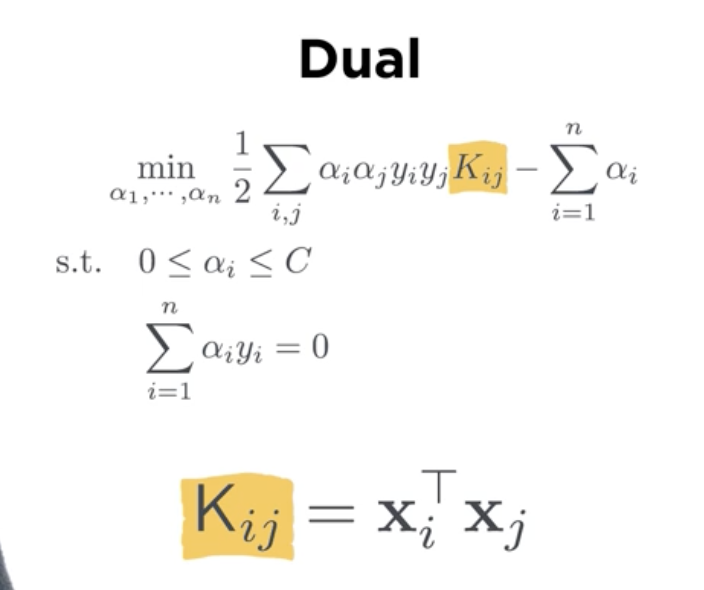
---

## Astonishing Observation

The optimization doesn't care about the individual vectors directly.

It only cares about:

```text
Pairwise inner products
```

between examples.

This observation leads directly to the Kernel Trick.

---

## 6. Inner Products Refresher

An inner product (dot product) is:

\[
x_i^T x_j
\]

Example:

\[
(1,2)\cdot(3,4)
=
1(3)+2(4)
=
11
\]

This measures similarity between vectors.

---

## 7. The Kernel Trick

Instead of explicitly mapping data into a huge feature space:

\[
\phi(x)
\]

we directly compute:

\[
\phi(x_i)^T\phi(x_j)
\]

using a special function:

\[
K(x_i,x_j)
\]

called a:

### Kernel Function

---

### Key Idea

Rather than computing:

```text
Expanded features first
Then their dot product
```

we compute the dot product directly.

---

#### Naive Method

```text
x
 ↓
Feature Expansion
 ↓
Millions of Features
 ↓
Dot Product
```

Very expensive.

---

#### Kernel Trick

```text
x
 ↓
Kernel Function
 ↓
Inner Product Result
```

Same answer.

Much faster.

---

## 8. What the Kernel Function Does

A kernel function:

\[
K(x_i,x_j)
\]

behaves exactly as if we had mapped the data into a huge feature space.

But we never actually construct those features.

---

### Intuition

Imagine:

```text
Original Space
    2 dimensions

Expanded Space
    1 million dimensions
```

The kernel lets us compute results as though we were working in the million-dimensional space.

Without ever creating those million dimensions.

---

## 9. Why This Is So Powerful

Suppose explicit expansion requires:

```text
1,000,000 features
```

Then:

```text
Training
Storage
Memory
```

would be impractical.

The kernel trick allows us to obtain the same result by computing only a relatively simple kernel function.

---

## 10. Kernel SVM

A Kernel SVM is simply:

1. 

Use the dual form of the SVM.

2. 

Replace the standard dot product:

\[
x_i^T x_j
\]

with

\[
K(x_i,x_j)
\]

---
3. 

The optimization algorithm stays almost unchanged.

The only modification is:

```text
Different similarity function
```

---

## 11. Effect of Using a Kernel

Standard Linear SVM:

```text
Straight-line boundary
```

```text
------------
```

---

Kernel SVM:

```text
Curved boundary
```

```text
    /~~~~\
   /      \
  /        \
```

---

The classifier becomes dramatically more expressive.

---

## 12. Common Intuition

Think of kernels as a way to secretly create more features.

Instead of explicitly telling the model:

```text
Use:
x²
y²
xy
x³
...
```

the kernel automatically behaves as if these features exist.

---

## 13. Why the Kernel Trick Is Considered Elegant

**Without kernels**:

```text
Create millions of features
Train on millions of features
Store millions of features
```


**With kernels**:

```text
Change one function
Get the same result
```

This is one of the classic "beautiful tricks" in machine learning.

---

## 14. Relationship to Earlier Lectures

Previously we learned:

### Linear SVM

\[
\text{Hinge Loss}
+
\lambda ||w||^2
\]

creates a linear decision boundary.

---

Kernel SVM:

```text
Same SVM framework
Same optimization idea
```

but uses a kernelized similarity measure.

Result:

```text
Highly nonlinear classifier
```

---

## Visual Summary

```text
Linear SVM

Data
 ↓
Linear Boundary


Kernel SVM

Data
 ↓
Implicit High-Dimensional Expansion
 ↓
Linear Boundary in Expanded Space
 ↓
Nonlinear Boundary in Original Space
```

---
## Notes
### If the lecture says:

```text
Linear classifier isn't powerful enough
```

Think:

```text
Feature Expansion
```

---

### If the lecture says:

```text
Feature space becomes enormous
```

Think:

```text
Kernel Trick
```

---

### If the lecture says:

```text
Dual formulation
Inner products only
```

Think:

```text
Kernel SVM
```

---

### If the lecture says:

```text
Nonlinear decision boundaries
without explicit feature expansion
```

Think:

```text
Kernel Trick
```

---

### If the lecture says:

```text
Replace dot product
with another similarity function
```

Think:

```text
Kernel Function
```

---

## Key Takeaways

1. Feature expansion makes linear models capable of learning nonlinear patterns.
2. Explicit feature expansion can create extremely high-dimensional spaces.
3. SVMs have both a primal and a dual formulation.
4. In the dual formulation, data appears only through inner products.
5. The kernel trick replaces those inner products with a kernel function.
6. A kernel behaves as if data were mapped into a huge feature space.
7. The classifier gains nonlinear decision boundaries without explicitly creating new features.
8. Kernel SVMs are therefore powerful nonlinear classifiers.
9. The computational savings come from avoiding explicit feature expansion.
10. The only required change is replacing the standard dot product with a kernel function.

gradient descent

gradient is always a linear combination  of the data points x1 to xn 
Because the weight vector is a linear combination of x_loweri s we can rewrite the weight vector as:
so 
Every ERM algorithm can be kernelized


## Common Kernel Functions for Kernel SVMs
A kernel defines how similarity is measured between data points: the **Linear Kernel** produces linear classifiers, the **Polynomial Kernel** captures polynomial feature interactions, and the **RBF Kernel** creates highly flexible nonlinear decision boundaries while remaining computationally efficient through the Kernel Trick.
After learning the **Kernel Trick**, the natural next question is:

> What kernel function should we use?

[Different kernels](kernel_comparison.md) produce different notions of similarity and therefore different decision boundaries.  

---

## 1. What Is a Kernel?

Recall that a kernel function:

\[
K(x,z)
\]

computes the similarity between two data points.

In Kernel SVMs, we replace the standard dot product:

\[
x^T z
\]

with:

\[
K(x,z)
\]

This allows us to implicitly operate in a much higher-dimensional feature space without explicitly creating those features.

---

## 2. Linear Kernel

The simplest kernel is:

## Linear Kernel

### Formula

\[
K(x,z)=x^Tz
\]

---

### What Does It Do?

Nothing fancy.

It is simply the ordinary Euclidean dot product that we've been using all along.

---

### Interpretation

Two vectors are considered similar when their dot product is large.

---

### Example

\[
x=(1,2)
\]

\[
z=(3,4)
\]

Then:

\[
K(x,z)=1(3)+2(4)=11
\]

---

### What Happens in an SVM?

If you use:

```text
Kernel SVM
+
Linear Kernel
```

you get:

```text
Ordinary Linear SVM
```

No nonlinear behavior is introduced.

---

### Why Use It?

Sometimes:

- The data is approximately linear
- You want a simple model
- You are debugging your implementation
- Interpretability matters

---

### Exam Keywords

```text
Linear Kernel
```

Think:

```text
No feature expansion
Ordinary dot product
Linear decision boundary
```

---

## 3. RBF Kernel (Radial Basis Function)

The most popular kernel is:

### RBF Kernel

Also called:

### Gaussian Kernel

---

#### Formula

\[
K(x,z)
=
\exp\left(
-\frac{||x-z||^2}{2\sigma^2}
\right)
\]

You don't need to memorize the exact formula.

Focus on the intuition.

---

## 4. Intuition Behind the RBF Kernel

The RBF kernel measures:

### Distance-Based Similarity

---

#### Very Close Points

If two points are nearly identical:

\[
x \approx z
\]

then:

\[
K(x,z)\approx1
\]

Maximum similarity.

---

#### Far-Away Points

If two points are very different:

\[
||x-z||
\]

becomes large.

Then:

\[
K(x,z)\approx0
\]

Very low similarity.

---

### Visualization

```text
Similarity
1.0 |\
    | \
    |  \
    |   \
    |    \
0.0 +-----\-------->
          Distance
```

As distance increases:

```text
Similarity decreases
```

---

## 5. Why Is the RBF Kernel So Popular?

The RBF kernel is extremely powerful.

It can model:

- Curved boundaries
- Complex patterns
- Highly nonlinear relationships

without requiring manual feature engineering.

---

### Universal Approximator

One of the most important theoretical properties of the RBF kernel is:

#### Universal Approximation

Meaning:

> Given enough data, an RBF kernel can approximate virtually any smooth function to arbitrary accuracy.

---

### Intuition

Even if the true relationship is:

```text
Very complicated
Very curved
Very nonlinear
```

an RBF kernel can usually learn it.

---

### Why Practitioners Love It

Because it works well on many datasets without needing much domain knowledge.

---

### Exam Keywords

```text
Most popular kernel

Very powerful

Nonlinear relationships

Universal approximator
```

→ **RBF Kernel**

---

## 6. Polynomial Kernel

Another common kernel is:

### Polynomial Kernel

#### Formula

\[
K(x,z)
=
(x^Tz+c)^d
\]

where:

- \(d\) = polynomial degree
- \(c\) = constant

---

## 7. Intuition Behind Polynomial Kernels

The polynomial kernel behaves as though we explicitly created polynomial features.

Example:

Original features:

\[
x_1, x_2
\]

---

Implicitly creates terms like:

\[
x_1^2
\]

\[
x_2^2
\]

\[
x_1x_2
\]

\[
x_1^3
\]

etc.

---

### Example

Degree 2 polynomial kernel acts similarly to:

\[
(x_1,x_2)
\rightarrow
(x_1,x_2,x_1^2,x_2^2,x_1x_2)
\]

without explicitly creating those features.

---

### Why Use It?

When you believe:

```text
Feature interactions matter
```

Examples:

```text
x²
xy
x³
```

may be useful.

---

### Exam Keywords

```text
Feature expansion

Polynomial features

x²

x³

Interaction terms
```

→ **Polynomial Kernel**

---

## 8. Comparing the Three Most Common Kernels

| Kernel | Similarity Based On | Decision Boundary |
|----------|----------|----------|
| Linear | Dot product | Linear |
| Polynomial | Polynomial feature interactions | Moderately nonlinear |
| RBF | Distance similarity | Highly nonlinear |

---

## 9. Can We Create Our Own Kernels?

Yes.

An important property of kernels is:

### Kernels Can Be Combined

If:

\[
K_1
\]

and

\[
K_2
\]

are valid kernels, then we can construct new kernels.

---

#### Scale Kernels

\[
aK_1
\]

where

\[
a>0
\]

---

#### Add Kernels

\[
K_1+K_2
\]

---

#### Combine Multiple Kernels

\[
3K_1+2K_2
\]

etc.

---

### Why Do This?

Different kernels capture different notions of similarity.

Combining kernels allows us to incorporate multiple types of structure into a model.

---

## 10. Is Every Function a Valid Kernel?

No.

This is one of the most important concepts in kernel theory.

---

### Not Every Similarity Function Is a Kernel

To be a valid kernel:

```text
The kernel matrix must be
Positive Semi-Definite (PSD)
```

---

## 11. Kernel Matrix

Suppose we have:

\[
n
\]

training examples.

Construct:

\[
K
\]

where:

\[
K_{ij}
=
K(x_i,x_j)
\]

---

### Matrix Form

```text
      x1   x2   x3

x1   K11  K12  K13

x2   K21  K22  K23

x3   K31  K32  K33
```

This matrix is called:

### Gram Matrix

or

### Kernel Matrix

---

## 12. Positive Semi-Definite (PSD)

A kernel is valid if its kernel matrix is PSD.

---

### Definition 1

For every vector:

\[
v
\]

\[
v^TKv \ge 0
\]

---

### Interpretation

No matter what vector you choose:

```text
The quadratic form
can never be negative.
```

---

## 13. Equivalent PSD Definitions

The lecture gives two other equivalent characterizations.

---

### Definition 2

A matrix is PSD if:

\[
K=L^TL
\]

for some real matrix:

\[
L
\]

---

### Definition 3

A matrix is PSD if:

\[
\text{All eigenvalues}
\ge 0
\]

---

## 14. Why PSD Matters

The PSD condition guarantees:

```text
A valid geometric interpretation

A valid inner product

A valid kernel trick
```

Without PSD:

```text
The math breaks
```

and the optimization problem may no longer be valid.

---

## 15. Practical Reality

Although kernel theory allows infinitely many kernels, practitioners usually use only a few.

The lecture notes that most people primarily use:

### Linear Kernel

or

### RBF Kernel

---

### Why?

The RBF kernel is:

```text
Powerful
Flexible
Easy to use
Works on many datasets
```

while the Linear Kernel is:

```text
Fast
Simple
Effective for linear problems
```

---

## Visual Summary

```text
Kernel Choices

Linear Kernel
    ↓
Linear Decision Boundary

Polynomial Kernel
    ↓
Polynomial Feature Interactions

RBF Kernel
    ↓
Highly Nonlinear Decision Boundaries
```

---

## Exam Cheat Sheet

### If the question says:

```text
Ordinary dot product
```

Answer:

```text
Linear Kernel
```

---

### If the question says:

```text
Most commonly used nonlinear kernel
```

Answer:

```text
RBF Kernel
```

---

### If the question says:

```text
Universal approximator
```

Answer:

```text
RBF Kernel
```

---

### If the question says:

```text
Implicit polynomial feature expansion
```

Answer:

```text
Polynomial Kernel
```

---

### If the question says:

```text
x², x³, interaction terms
```

Answer:

```text
Polynomial Kernel
```

---

### If the question says:

```text
Kernel validity
```

Answer:

```text
Kernel matrix must be PSD
```

---

### If the question says:

```text
All eigenvalues nonnegative
```

Answer:

```text
Positive Semi-Definite Matrix
```

---

### Key Takeaways

1. Kernels define similarity between data points.
2. The Linear Kernel is just the ordinary dot product.
3. Using a Linear Kernel in a Kernel SVM produces a standard Linear SVM.
4. The RBF Kernel measures similarity based on distance.
5. Nearby points have similarity close to 1 under the RBF kernel.
6. Far-apart points have similarity close to 0 under the RBF kernel.
7. The RBF kernel is a universal approximator and is the most widely used nonlinear kernel.
8. Polynomial kernels implicitly create polynomial feature expansions.
9. Kernels can be combined to build new kernels.
10. A valid kernel must generate a Positive Semi-Definite kernel matrix.
11. Equivalent PSD tests include checking eigenvalues or verifying \(K=L^TL\).
12. In practice, Linear and RBF kernels are the most commonly used choices.

**A kernel is called "well deviined" if:
* it corresponds to an inner-product function of mappings of feature vectors theta(x) and theta(z)
* the corresponding kernel matrix K is "positive semidefinite"
* * All eigenvalues of K are non-negative
* * There exists a real matrix L such that K = L^TL
* * v^TKv>= 0 for all real vectors