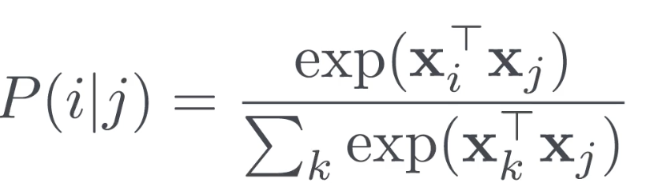
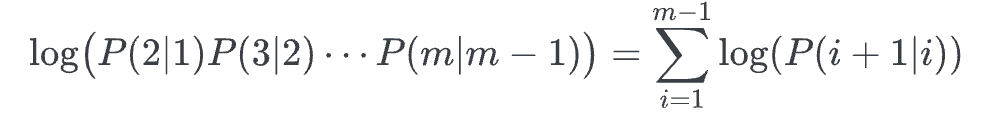
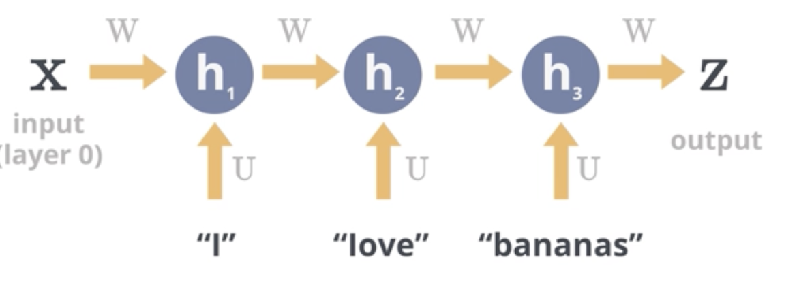
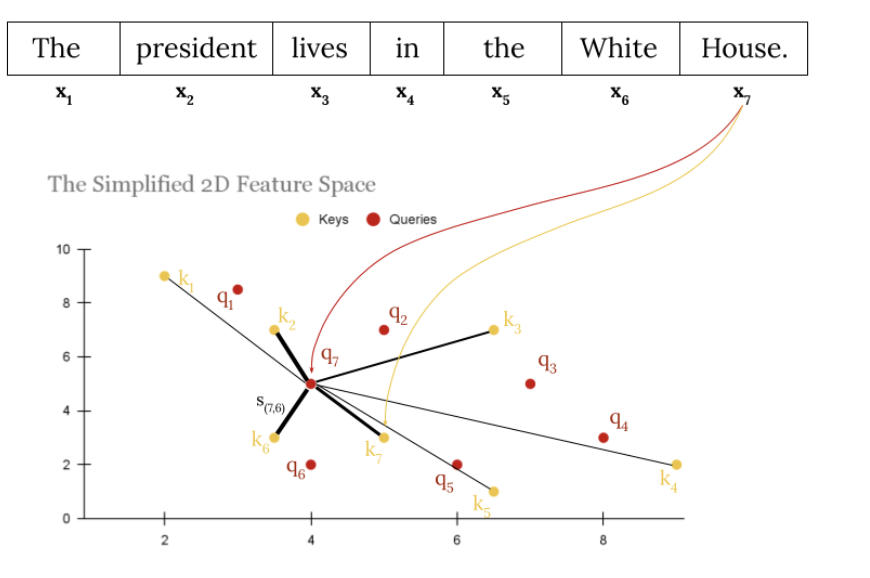
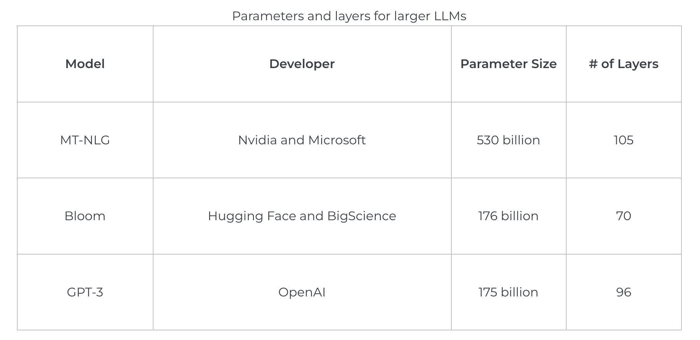

# Deep Averaging Network

another data modality that is very common is sequence data. Sequence data could include things like written text (sequence of words) or biological structures (e.g., DNA sequences). Bag of Word vectors are very high dimensional and hence noce so great for multiplayer perceptrons, same with images.  Similar to the way ConvNets incorporate special aspects of 2D images, we can also adapt neural networks to take advantage of the sequential structure of data.

## Sequence to Sequence Models
Examples:
* Language translation (input lang x output lang y)
* doc find (input long doc and output answer found in that doc)
* input long text output short summary
* dialog systems (question output: answer)

Process:
1. Input sequence
2. Sequence is encoded ito a finite dimensional vector
3. Vector passed to decoder
4. Decoder does something specific to the task and generates a sequence from it

## Word Embedding
Word embeddings are words mapped to vectors that convey the meaning of a word.

### Overview
Word embeddings are generating by ingesting massive amounts of text data and determining probabilistic relationships between any given words and surrounding words. Typically, the inner product of two word vectors is used as input to a likelihood function to estimate how likely it is that these two words co-occur. 
Word embeddings map words to finite-dimensional vectors (e.g., 128 dimensions) that capture semantic meaning. The key insight is that words appearing in similar contexts have similar vector representations.

Word embeddings are generated by:
1. Ingesting massive amounts of text data from the web (Wikipedia, news articles, etc.)
2. Determining probabilistic relationships between words and their surrounding context
3. Using the inner product of two word vectors as a measure of co-occurrence likelihood

### The Skip-gram Model

The core approach is to use a **context window**: given a middle word, predict the surrounding words (or vice versa). This is formalized as:

**Given middle word $j$, predict the surrounding words (context) within a window of size $k$.**

Since it cannot include all words ever used in a given language, there can be a special “word” that represents all the other words not in your dictionary. So if you have a dictionary of size *n* and you want to represent each word as a vector of size *d*, then your word embedding is essentially an *n X d* matrix where each row corresponds to a word.

The problem we have now is how to learn this dictionary. The intuition to learn a word embedding is simple: Words that appear in similar contexts should have similar word vectors. For example, the words "ship" and "boat" probably appear in almost identical contexts and should be very similar in representation. The words "ship" and "water" should probably be closer together than "ship" and "philosophy."

use Softmax to turn anything into a probability


Now, given a sequence of *m* words, the log-likelihood of observing this sequence is


Note that the log-likelihood function is a function of the word embeddings.

With the probability and log-likelihood defined, what we need to do is download a large corpus of data from the internet then maximize the log-likelihood function, or equivalently minimize the negative log-likelihood function, by using SGD. The model thus finds the word embeddings that best explain the corpus.

#### Mathematical Formulation

For a word sequence, we want to maximize the probability of context words appearing around a middle word. The probability that word $i$ appears in the context of word $j$ is:

$$P(i \mid j) = \frac{\exp(\mathbf{v}_i \cdot \mathbf{v}_j)}{\sum_{k=1}^{V} \exp(\mathbf{v}_k \cdot \mathbf{v}_j)}$$

Where:
- $\mathbf{v}_i$ and $\mathbf{v}_j$ are the embedding vectors for words $i$ and $j$
- $V$ is the vocabulary size
- The denominator is the **softmax** normalization, which ensures probabilities sum to 1

The inner product $\mathbf{v}_i \cdot \mathbf{v}_j$ is large when words should co-occur frequently, and small otherwise.

#### Loss Function

Given a context window of 5 words (middle word + 2 before + 2 after), the likelihood for a single training example is:

$$L = \prod_{m \in \text{context}} P(w_m \mid w_{\text{center}})$$

To optimize, we convert to negative log-likelihood (NLL):

$$\mathcal{L} = -\sum_{\text{corpus}} \sum_{m \in \text{context}} \log P(w_m \mid w_{\text{center}})$$

This loss is minimized using **stochastic gradient descent (SGD)**: randomly sample sentences and take gradient steps with respect to word embeddings.

#### Why This Works

The beauty of this approach:
- **Scalability**: Word2Vec is computationally efficient, allowing training on billions of sentences
- **Semantic Capture**: The learned embeddings capture semantic relationships
- **Surprising Patterns**: Analysis reveals that embeddings capture structured relationships (see examples below)

### Emergent Properties

Analysis of trained word embeddings reveals surprising semantic structure:

**Example 1: Country-Capital Relationships**
The direction between country and capital pairs is remarkably consistent:
- France → Paris
- UK → London  
- Germany → Berlin

This suggests the embedding space encodes geographical/political relationships.

**Example 2: Analogy Relations**
Vector arithmetic works with word embeddings:
$$\text{king} - \text{man} + \text{woman} \approx \text{queen}$$

This demonstrates that the embeddings capture meaningful semantic transformations.

### Python Implementation Example

```python
import numpy as np
from scipy.special import softmax

class Word2VecSimple:
    """
    Simplified Word2Vec implementation demonstrating skip-gram with softmax.
    This is educational code - production systems use optimized versions (negative sampling, etc.)
    """
    
    def __init__(self, vocab_size, embedding_dim=128, learning_rate=0.01):
        """
        Initialize word embeddings randomly.
        
        Args:
            vocab_size: Number of unique words in vocabulary
            embedding_dim: Dimension of each word vector (default 128)
            learning_rate: Learning rate for gradient descent
        """
        self.vocab_size = vocab_size
        self.embedding_dim = embedding_dim
        self.learning_rate = learning_rate
        
        # Initialize embeddings randomly
        self.embeddings = np.random.randn(vocab_size, embedding_dim) * 0.01
    
    def softmax_probability(self, center_idx, context_idx):
        # softmax turns anything into a probability
        """
        Compute P(context_word | center_word) using softmax.
        
        P(i|j) = exp(v_i · v_j) / sum_k(exp(v_k · v_j))
        
        Args:
            center_idx: Index of center word
            context_idx: Index of context word to evaluate
            
        Returns:
            Probability that context_word appears given center_word
        """
        # Get embeddings
        v_center = self.embeddings[center_idx]  # shape: (embedding_dim,)
        v_context = self.embeddings[context_idx]  # shape: (embedding_dim,)
        
        # Compute inner products with all words in vocabulary
        inner_products = self.embeddings @ v_center  # shape: (vocab_size,)
        
        # Apply softmax to get probabilities
        probs = softmax(inner_products)
        
        return probs[context_idx]
    
    def negative_log_likelihood(self, center_idx, context_indices):
        """
        Compute negative log-likelihood for a context window.
        
        NLL = -sum(log P(context_word_i | center_word))
        
        Args:
            center_idx: Index of center word
            context_indices: List of indices of context words
            
        Returns:
            Negative log-likelihood (scalar)
        """
        nll = 0
        for ctx_idx in context_indices:
            prob = self.softmax_probability(center_idx, ctx_idx)
            nll -= np.log(prob + 1e-10)  # Add small epsilon to avoid log(0)
        
        return nll
    
    def gradient_step(self, center_idx, context_indices):
        """
        Perform one gradient descent step for a single context window.
        
        Computes gradient of NLL with respect to embeddings and updates them.
        
        Args:
            center_idx: Index of center word
            context_indices: List of indices of context words
        """
        # Compute probabilities
        v_center = self.embeddings[center_idx]
        inner_products = self.embeddings @ v_center
        probs = softmax(inner_products)
        
        # Gradient with respect to center embedding
        grad_center = np.zeros_like(v_center)
        
        for ctx_idx in context_indices:
            # Gradient: (p(w) - 1{w == context_word}) * v_context
            grad_center += (probs[ctx_idx] - 1.0) * self.embeddings[ctx_idx]
        
        # Update center word embedding
        self.embeddings[center_idx] -= self.learning_rate * grad_center
        
        # Update context word embeddings
        for ctx_idx in context_indices:
            grad_context = (probs[ctx_idx] - 1.0) * v_center
            self.embeddings[ctx_idx] -= self.learning_rate * grad_context
    
    def train(self, sentences, window_size=2, epochs=10):
        """
        Train the word embeddings on a corpus.
        
        Args:
            sentences: List of sentences (each sentence is a list of word indices)
            window_size: Number of words before/after center word to use as context
            epochs: Number of passes through the corpus
        """
        for epoch in range(epochs):
            total_loss = 0
            num_windows = 0
            
            for sentence in sentences:
                for center_pos in range(len(sentence)):
                    center_idx = sentence[center_pos]
                    
                    # Extract context window
                    start = max(0, center_pos - window_size)
                    end = min(len(sentence), center_pos + window_size + 1)
                    context_indices = (sentence[start:center_pos] + 
                                      sentence[center_pos+1:end])
                    
                    if context_indices:  # Only if there's a context
                        loss = self.negative_log_likelihood(center_idx, context_indices)
                        total_loss += loss
                        num_windows += 1
                        
                        self.gradient_step(center_idx, context_indices)
            
            avg_loss = total_loss / max(num_windows, 1)
            print(f"Epoch {epoch+1}/{epochs}, Avg Loss: {avg_loss:.4f}")

# Example usage:
if __name__ == "__main__":
    # Tiny corpus for demonstration
    # Word indices: 0=cat, 1=dog, 2=sat, 3=mat, 4=the, 5=on
    sentences = [
        [4, 0, 2, 3],      # "the cat sat mat"
        [4, 1, 2, 3],      # "the dog sat mat"
        [0, 2, 5, 3],      # "cat sat on mat"
    ]
    
    # Create and train model
    vocab_size = 6
    model = Word2VecSimple(vocab_size, embedding_dim=32, learning_rate=0.1)
    model.train(sentences, window_size=2, epochs=5)
    
    # After training, similar words should have similar embeddings
    # Example: compute similarity between "cat" and "dog"
    cat_vec = model.embeddings[0]
    dog_vec = model.embeddings[1]
    similarity = np.dot(cat_vec, dog_vec) / (np.linalg.norm(cat_vec) * np.linalg.norm(dog_vec))
    print(f"\nSimilarity between 'cat' and 'dog': {similarity:.4f}")
```

### Key Insights

1. **Representation Learning**: Word embeddings automatically learn meaningful representations without manual feature engineering
2. **Distributional Hypothesis**: Words that appear in similar contexts have similar meanings
3. **Efficiency**: Despite training on billions of sentences, Word2Vec is fast (using tricks like negative sampling in practice)
4. **Transfer Learning**: Pre-trained embeddings from large corpora (like GloVe or BERT embeddings) transfer well to downstream tasks
5. We can train the word embeddings using stochastic gradient descent with backpropagation

---

# Sentiment Analysis via Deep Averaging Networks

## Overview

Sentiment analysis is the task of determining whether a piece of text (like a review or social media post) expresses a positive or negative sentiment. This has numerous practical applications.  One way to approach this task is to use a deep averaging network. A deep averaging network consists of two components: a word embedding and a traditional neural network (sometimes even a linear classifier, which is a neural network without hidden layers).  A deep averaging network (DAN) can be trained using SGD. Training a DAN is almost identical to training a standard neural network. We use a standard cross entropy loss to predict if a sentence is, for example, positive or negative. When we do back-propagation, we update the weights of the neural network. However, we do one additional step: We also take a gradient update with respect to the word embeddings. This gradient can easily be computed with the chain rule using the back-propagation algorithm. 

Deep averaging networks are one of the simplest neural sequence models. In this case, the averaging operation is the encoder (it produces a vector representation of the sequence) and the neural network is the decoder (the output is a simple scalar).

### Applications

1. **Product Reviews**: Given customer reviews with star ratings (1-5 stars), predict sentiment to understand customer satisfaction
2. **Stock Market Analysis**: Monitor social media and news to detect positive/negative sentiment about companies and make trading decisions
3. **Political Analysis**: Politicians analyze constituency opinions on proposals and bills
4. **Brand Monitoring**: Companies track public perception of new products and services

## Deep Averaging Network (DAN)

The **Deep Averaging Network** is an elegant and surprisingly effective approach to sentiment analysis that leverages pre-trained word embeddings.

### Key Intuition

Rather than treating reviews as sequences, we:
1. Look up the word embedding for each word in the review
2. **Average** all the word embeddings to get a single fixed-size vector
3. Feed this averaged vector into a neural network for classification

This simple approach works remarkably well because the averaged embedding captures the overall semantic content of the review.

### Steps
1. Input a sequence of words
2. Convert these words to word embeddings based on the network’s internal word embedding 
3. Average all the word embeddings to get a vector representation of the sequence
4. Pass the vector *v* to the neural network to determine whether the sequence is positive or negative

### Mathematical Formulation

Given a review with words $w_1, w_2, \ldots, w_n$, we:

**Step 1: Embed each word**
$$\mathbf{e}_i = \text{Embedding}(w_i) \in \mathbb{R}^d$$

where $d$ is the embedding dimension (e.g., 128).

**Step 2: Average the embeddings**
$$\mathbf{r} = \frac{1}{n} \sum_{i=1}^{n} \mathbf{e}_i$$

This gives us a single vector $\mathbf{r}$ that summarizes the entire review.

**Step 3: Classification with neural network**
$$\text{logits} = W \mathbf{r} + b$$

$$\text{prediction} = \text{softmax}(\text{logits})$$

For binary sentiment (positive/negative), we can also use:
$$p(\text{positive}) = \sigma(W \mathbf{r} + b)$$

where $\sigma$ is the sigmoid function.

**Step 4: Loss function (binary cross-entropy)**
$$\mathcal{L} = -\left[ y \log(p) + (1-y) \log(1-p) \right]$$

where $y \in \{0, 1\}$ is the true label (0=negative, 1=positive).

### Training Strategies

There are two approaches to training:

#### Option 1: Freeze Embeddings
- Only update the weights $W$ and bias $b$ of the classification layer
- Use pre-trained embeddings (e.g., from Word2Vec trained on a general corpus)
- Faster training, works well when embeddings are good

#### Option 2: End-to-End Learning (Fine-tuning)
- Backpropagate through the averaging layer all the way to the word embeddings
- Update both the neural network weights AND the embeddings
- **Benefit**: The model learns which words are important for sentiment classification
- Words with positive sentiment move slightly closer together in embedding space
- Words with negative sentiment also cluster together
- More parameters to learn, but often produces better task-specific embeddings

The gradient flow for end-to-end learning:

$$\frac{\partial \mathcal{L}}{\partial W} = \frac{\partial \mathcal{L}}{\partial \text{prediction}} \cdot \frac{\partial \text{prediction}}{\partial \text{logits}} \cdot \frac{\partial \text{logits}}{\partial W}$$

$$\frac{\partial \mathcal{L}}{\partial \mathbf{e}_i} = \frac{\partial \mathcal{L}}{\partial \mathbf{r}} \cdot \frac{\partial \mathbf{r}}{\partial \mathbf{e}_i} = \frac{1}{n} \cdot \frac{\partial \mathcal{L}}{\partial \mathbf{r}}$$

The embeddings receive equal gradient contributions from the averaging operation.

### Python Implementation

```python
import numpy as np
from scipy.special import softmax

class DeepAveragingNetwork:
    """
    Deep Averaging Network for sentiment analysis.
    
    This model:
    1. Averages word embeddings for a review
    2. Passes the averaged vector through a simple neural network
    3. Predicts positive (1) or negative (0) sentiment
    """
    
    def __init__(self, embedding_dim, learning_rate=0.01, fine_tune_embeddings=False):
        """
        Initialize the DAN model.
        
        Args:
            embedding_dim: Dimension of pre-trained word embeddings (e.g., 128)
            learning_rate: Learning rate for SGD
            fine_tune_embeddings: If True, update embeddings during training
        """
        self.embedding_dim = embedding_dim
        self.learning_rate = learning_rate
        self.fine_tune_embeddings = fine_tune_embeddings
        
        # Classification layer: maps embedding_dim -> 1 (binary classification)
        # In practice, we'd use embedding_dim -> 2 and softmax for multi-class
        self.W = np.random.randn(1, embedding_dim) * 0.01
        self.b = 0.0
    
    def sigmoid(self, z):
        """Sigmoid activation function."""
        return 1 / (1 + np.exp(-np.clip(z, -500, 500)))
    
    def sigmoid_derivative(self, z):
        """Derivative of sigmoid: σ'(z) = σ(z) * (1 - σ(z))"""
        s = self.sigmoid(z)
        return s * (1 - s)
    
    def average_embeddings(self, word_embeddings_list):
        """
        Average a list of word embeddings.
        
        Args:
            word_embeddings_list: List of embedding vectors, shape [(embedding_dim,), ...]
            
        Returns:
            Averaged embedding vector, shape (embedding_dim,)
        """
        if not word_embeddings_list:
            return np.zeros(self.embedding_dim)
        return np.mean(word_embeddings_list, axis=0)
    
    def forward(self, word_embeddings_list):
        """
        Forward pass: average embeddings -> neural network -> prediction.
        
        Args:
            word_embeddings_list: List of word embedding vectors for a review
            
        Returns:
            Dictionary with intermediate values and prediction
        """
        # Step 1: Average embeddings
        review_vector = self.average_embeddings(word_embeddings_list)
        
        # Step 2: Neural network forward pass
        logit = np.dot(self.W, review_vector) + self.b
        prediction = self.sigmoid(logit)
        
        return {
            'review_vector': review_vector,
            'logit': logit,
            'prediction': prediction,
            'num_words': len(word_embeddings_list)
        }
    
    def backward(self, forward_result, true_label, word_embeddings_list):
        """
        Backward pass: compute gradients and update parameters.
        
        Args:
            forward_result: Output from forward pass
            true_label: Ground truth (0 or 1)
            word_embeddings_list: Original word embeddings (for fine-tuning)
            
        Returns:
            Dictionary with gradients and loss
        """
        pred = forward_result['prediction']
        review_vector = forward_result['review_vector']
        logit = forward_result['logit']
        num_words = forward_result['num_words']
        
        # Compute loss: binary cross-entropy
        loss = -(true_label * np.log(pred + 1e-10) + 
                (1 - true_label) * np.log(1 - pred + 1e-10))
        
        # Gradient of loss w.r.t prediction
        grad_pred = (-true_label / pred) + (1 - true_label) / (1 - pred + 1e-10)
        
        # Gradient of prediction w.r.t logit: dσ/dz = σ(z) * (1 - σ(z))
        grad_logit = grad_pred * self.sigmoid_derivative(logit)
        
        # Gradient of logit w.r.t W and b
        grad_W = grad_logit * review_vector
        grad_b = grad_logit
        
        # Update W and b
        self.W -= self.learning_rate * grad_W
        self.b -= self.learning_rate * grad_b
        
        # If fine-tuning embeddings, compute their gradients too
        grad_embeddings = None
        if self.fine_tune_embeddings and num_words > 0:
            # Gradient of loss w.r.t review_vector
            grad_review_vector = grad_logit * self.W[0]
            
            # Gradient flows equally to each word embedding due to averaging
            grad_embeddings = (grad_review_vector / num_words)
        
        return {
            'loss': float(loss),
            'grad_W': grad_W,
            'grad_b': grad_b,
            'grad_embeddings': grad_embeddings
        }
    
    def train_epoch(self, training_data, embedding_storage=None):
        """
        Train for one epoch.
        
        Args:
            training_data: List of tuples (word_embeddings, label)
                where word_embeddings is a list of embedding vectors
            embedding_storage: Optional dict to update embeddings {word_id: embedding}
                               Used for end-to-end fine-tuning
            
        Returns:
            Average loss for the epoch
        """
        total_loss = 0
        
        for word_embeddings_list, true_label in training_data:
            # Forward pass
            forward_result = self.forward(word_embeddings_list)
            
            # Backward pass
            backward_result = self.backward(forward_result, true_label, 
                                          word_embeddings_list)
            
            total_loss += backward_result['loss']
            
            # Update embeddings if fine-tuning and if available
            if (self.fine_tune_embeddings and embedding_storage is not None and 
                backward_result['grad_embeddings'] is not None):
                for i, word_id in enumerate(getattr(training_data, 'word_ids', [])):
                    if word_id in embedding_storage:
                        embedding_storage[word_id] -= (self.learning_rate * 
                                                      backward_result['grad_embeddings'])
        
        return total_loss / len(training_data)
    
    def predict(self, word_embeddings_list):
        """
        Predict sentiment for a review.
        
        Args:
            word_embeddings_list: List of word embeddings for the review
            
        Returns:
            Prediction: 1.0 for positive, 0.0 for negative
        """
        forward_result = self.forward(word_embeddings_list)
        return 1 if forward_result['prediction'] > 0.5 else 0
    
    def predict_proba(self, word_embeddings_list):
        """
        Get probability prediction.
        
        Returns:
            Probability of positive sentiment (0.0 to 1.0)
        """
        forward_result = self.forward(word_embeddings_list)
        return forward_result['prediction']


# Example usage:
if __name__ == "__main__":
    # Simulated pre-trained word embeddings
    # In practice, you'd load these from Word2Vec, GloVe, or other sources
    embeddings_dict = {
        'great': np.array([0.5, 0.3, 0.1]),
        'amazing': np.array([0.6, 0.4, 0.2]),
        'terrible': np.array([-0.6, -0.4, -0.1]),
        'awful': np.array([-0.5, -0.3, -0.2]),
        'good': np.array([0.4, 0.2, 0.0]),
        'bad': np.array([-0.4, -0.2, 0.0]),
        'movie': np.array([0.1, 0.1, 0.1]),
        'film': np.array([0.1, 0.1, 0.1]),
    }
    
    # Training data: (list of word embeddings, sentiment label)
    training_data = [
        ([embeddings_dict['great'], embeddings_dict['movie']], 1),      # "great movie"
        ([embeddings_dict['terrible'], embeddings_dict['film']], 0),    # "terrible film"
        ([embeddings_dict['amazing'], embeddings_dict['movie']], 1),    # "amazing movie"
        ([embeddings_dict['awful'], embeddings_dict['film']], 0),       # "awful film"
    ]
    
    # Create and train model
    embedding_dim = 3
    dan = DeepAveragingNetwork(embedding_dim, learning_rate=0.1, 
                              fine_tune_embeddings=False)
    
    # Train for multiple epochs
    for epoch in range(20):
        avg_loss = dan.train_epoch(training_data)
        if (epoch + 1) % 5 == 0:
            print(f"Epoch {epoch+1}, Loss: {avg_loss:.4f}")
    
    # Test predictions
    print("\n--- Test Predictions ---")
    test_review_positive = [embeddings_dict['great'], embeddings_dict['movie']]
    test_review_negative = [embeddings_dict['terrible'], embeddings_dict['film']]
    
    prob_pos = dan.predict_proba(test_review_positive)
    prob_neg = dan.predict_proba(test_review_negative)
    
    print(f"'great movie' -> P(positive) = {prob_pos:.4f}, " 
          f"Prediction: {'POSITIVE' if prob_pos > 0.5 else 'NEGATIVE'}")
    print(f"'terrible film' -> P(positive) = {prob_neg:.4f}, " 
          f"Prediction: {'POSITIVE' if prob_neg > 0.5 else 'NEGATIVE'}")
```


### Why Deep Averaging Networks Work

1. **Simplicity**: No need for recurrent networks or attention mechanisms
2. **Word Order Independence**: Averaging treats all words equally (order doesn't matter)
3. **Effectiveness**: Despite the simplicity, averaging embeddings captures enough semantic information
4. **Computational Efficiency**: Forward and backward passes are very fast
5. **Interpretability**: The model is straightforward—hard to go wrong

### Limitations

1. **Word Order Loss**: Sentences with different word orders get the same representation
   - Example: "Good, not bad" vs "Bad, not good" have similar averaged embeddings
2. **Long-range Dependencies**: Cannot capture dependencies between distant words
3. **Context Sensitivity**: A word has the same embedding regardless of surrounding context

### Extensions

For more sophisticated sentiment analysis, consider:
- **RNNs/LSTMs**: Preserve word order and capture sequential dependencies
- **Attention Mechanisms**: Dynamically weight words based on their importance
- **Transformer Models** (BERT, etc.): Context-dependent embeddings and attention
- **Hierarchical Models**: Handle multiple sentences or documents

---

# Recurrent Neural Networks (RNNs)
A recurrent neural network (RNN) is a neural network that is applied at each element of the sequence but which keeps track of a hidden state vector and uses it to encode and decode sequential information. 


Use stochastic gradient descent (SGD) to train recurrent neural networks.

## Overview

**Recurrent Neural Networks (RNNs)** are a fundamental architecture for processing sequential data. While Deep Averaging Networks lose all information about word order by averaging embeddings, RNNs preserve the sequential structure of the input, making them essential for tasks where order matters—such as machine translation, language modeling, and time series prediction.

### When to Use RNNs vs Deep Averaging Networks

| Task | Best Model | Why |
|------|-----------|-----|
| Sentiment Analysis | Deep Averaging Network | Fast, effective, order doesn't matter much |
| Machine Translation | RNN | Word order is critical for translation |
| Language Modeling | RNN | Need to predict next word based on history |
| Time Series | RNN | Sequential dependencies are important |

## RNNs vs Multilayer Perceptrons (MLPs)

### Multilayer Perceptron Architecture

In a standard MLP:
```
Input → Layer 1 → Layer 2 → ... → Layer L → Output
  X       h1        h2              hL        y
```

Each layer applies a transformation:
$$\mathbf{h}_\ell = \sigma(W_\ell \mathbf{h}_{\ell-1} + \mathbf{b}_\ell)$$

where:
- $\mathbf{h}_\ell$ is the hidden state of layer $\ell$
- $W_\ell$ are layer-specific weight matrices
- Each layer processes its input independently

### Recurrent Neural Network Architecture

RNNs add **three key modifications**:

#### Modification 1: Shared Weights Across Time

All layers use the **same weight matrices** $W$ and $U$. This allows the network to process sequences of arbitrary length without requiring different layer-specific parameters.

#### Modification 2: Every Layer Gets Sequential Input

Instead of feeding input only to the first layer, **every position in the sequence gets the input**:

$$\mathbf{h}_t = \sigma(W \mathbf{h}_{t-1} + U \mathbf{x}_t + \mathbf{b})$$

where:
- $\mathbf{h}_{t-1}$ is the hidden state from the previous time step
- $\mathbf{x}_t$ is the input at time step $t$
- $W$ is the hidden-to-hidden weight matrix (same across all time steps)
- $U$ is the input-to-hidden weight matrix (same across all time steps)
- $\sigma$ is a nonlinearity (typically tanh or ReLU)

#### Modification 3: Outputs at Every Time Step

While MLPs have output only at the final layer, RNNs can produce **outputs at every time step**:

$$\mathbf{y}_t = V \mathbf{h}_t + \mathbf{c}$$

where $V$ is the hidden-to-output weight matrix.

### Mathematical Formulation of RNN

Given an input sequence $\mathbf{x}_1, \mathbf{x}_2, \ldots, \mathbf{x}_T$:

**Step 1: Initialize hidden state**
$$\mathbf{h}_0 = \mathbf{0} \text{ (or learned initialization)}$$

**Step 2: Process each time step**
$$\mathbf{h}_t = \sigma(W \mathbf{h}_{t-1} + U \mathbf{x}_t + \mathbf{b})$$

**Step 3: Compute output at each time step**
$$\mathbf{y}_t = V \mathbf{h}_t + \mathbf{c}$$

**Step 4: Forward through entire sequence**

Process all $T$ time steps, accumulating information in the hidden state $\mathbf{h}_t$.

### Key Insight: Hidden State as Memory

The hidden state $\mathbf{h}_t$ acts as a **memory** of the sequence:
- It contains information from all previous inputs: $\mathbf{x}_1, \mathbf{x}_2, \ldots, \mathbf{x}_{t-1}$
- It is updated at each time step with new information from $\mathbf{x}_t$
- It is passed to the next time step to influence future predictions

## Encoder-Decoder Architecture for Sequence-to-Sequence Tasks

For tasks like machine translation where both input and output are sequences, we use an **encoder-decoder** architecture:

```
Input Sequence (English)
        ↓
   [ENCODER RNN]  ← Processes input sequence
        ↓
   Context Vector (h_T) ← Final hidden state encodes input
        ↓
   [DECODER RNN]  ← Generates output sequence
        ↓
Output Sequence (German)
```

### Encoder

The encoder processes the input sequence and produces a **context vector** (the final hidden state):

$$\mathbf{h}_t^{enc} = \sigma(W^{enc} \mathbf{h}_{t-1}^{enc} + U^{enc} \mathbf{x}_t + \mathbf{b}^{enc})$$

After processing all $T$ input steps, we have:
$$\mathbf{c} = \mathbf{h}_T^{enc}$$

This context vector $\mathbf{c}$ is a fixed-size representation of the entire input sequence.

### Decoder

The decoder uses the context vector and generates the output sequence one word at a time:

$$\mathbf{h}_t^{dec} = \sigma(W^{dec} \mathbf{h}_{t-1}^{dec} + U^{dec} \mathbf{y}_{t-1} + \mathbf{b}^{dec})$$

$$\mathbf{p}_t = \text{softmax}(V^{dec} \mathbf{h}_t^{dec} + \mathbf{c}^{dec})$$

**Initialization**: Use the context vector as the initial hidden state:
$$\mathbf{h}_0^{dec} = \mathbf{c}$$

**Start token**: Feed a special `<START>` token to generate the first word.

**At each step**:
1. Compute hidden state using previous word embedding and hidden state
2. Apply softmax to get probability distribution over vocabulary
3. Sample or take argmax to select next word
4. Use that word's embedding as input to next step

### Example: "I love bananas" → "Ich liebe Bananen"

**Encoder**:
1. Input "I" → hidden state $\mathbf{h}_1$
2. Input "love" → hidden state $\mathbf{h}_2$
3. Input "bananas" → context vector $\mathbf{c} = \mathbf{h}_3$

**Decoder**:
1. Initialize: $\mathbf{h}_0^{dec} = \mathbf{c}$
2. Feed `<START>` → generate "Ich" (I) with high probability
3. Feed "Ich" embedding → generate "liebe" (love) with high probability
4. Feed "liebe" embedding → generate "Bananen" (bananas) with high probability
5. Generate `<END>` token and stop

## Python Implementation

```python
import numpy as np
from scipy.special import softmax

class SimpleRNN:
    """
    Simple RNN for sequence-to-sequence learning.
    Demonstrates the core concepts of RNNs.
    """
    
    def __init__(self, input_dim, hidden_dim, output_dim, learning_rate=0.01):
        """
        Initialize RNN parameters.
        
        Args:
            input_dim: Dimension of input embeddings
            hidden_dim: Dimension of hidden state
            output_dim: Dimension of output (vocabulary size)
            learning_rate: Learning rate for gradient descent
        """
        self.input_dim = input_dim
        self.hidden_dim = hidden_dim
        self.output_dim = output_dim
        self.learning_rate = learning_rate
        
        # Weight matrices (same across all time steps)
        self.W = np.random.randn(hidden_dim, hidden_dim) * 0.01  # Hidden to hidden
        self.U = np.random.randn(hidden_dim, input_dim) * 0.01   # Input to hidden
        self.V = np.random.randn(output_dim, hidden_dim) * 0.01  # Hidden to output
        
        # Biases
        self.b_h = np.zeros((hidden_dim, 1))  # Hidden bias
        self.b_y = np.zeros((output_dim, 1))  # Output bias
    
    def tanh(self, x):
        """Tanh activation function."""
        return np.tanh(x)
    
    def tanh_derivative(self, x):
        """Derivative of tanh: tanh'(x) = 1 - tanh^2(x)"""
        return 1 - np.tanh(x) ** 2
    
    def forward(self, input_sequence):
        """
        Forward pass through RNN.
        
        Args:
            input_sequence: List of input embeddings [x_1, x_2, ..., x_T]
                           Each x_t is shape (input_dim, 1)
        
        Returns:
            Dictionary with outputs and hidden states at each time step
        """
        T = len(input_sequence)
        
        # Initialize hidden state
        h = np.zeros((self.hidden_dim, 1))
        
        # Store hidden states and outputs for all time steps
        hidden_states = [h]
        outputs = []
        
        # Forward pass through sequence
        for t in range(T):
            x_t = input_sequence[t]  # Current input
            
            # Compute hidden state: h_t = tanh(W*h_{t-1} + U*x_t + b_h)
            h_input = self.W @ hidden_states[-1] + self.U @ x_t + self.b_h
            h = self.tanh(h_input)
            hidden_states.append(h)
            
            # Compute output: y_t = softmax(V*h_t + b_y)
            logits = self.V @ h + self.b_y
            probs = softmax(logits.flatten())
            outputs.append(probs)
        
        return {
            'outputs': outputs,
            'hidden_states': hidden_states,
            'sequence_length': T
        }
    
    def compute_loss(self, forward_result, target_sequence):
        """
        Compute cross-entropy loss.
        
        Args:
            forward_result: Output from forward pass
            target_sequence: List of target word indices
                           (0 to output_dim - 1)
        
        Returns:
            Total loss and per-timestep losses
        """
        outputs = forward_result['outputs']
        T = forward_result['sequence_length']
        
        total_loss = 0
        losses = []
        
        for t in range(T):
            probs = outputs[t]
            target_idx = target_sequence[t]
            
            # Cross-entropy loss: -log(p_target)
            loss = -np.log(probs[target_idx] + 1e-10)
            losses.append(loss)
            total_loss += loss
        
        return total_loss, losses
    
    def backward(self, forward_result, target_sequence):
        """
        Backward pass (simplified version, not full BPTT).
        
        For brevity, we show gradient computation for one time step.
        A full implementation would do Backpropagation Through Time (BPTT).
        
        Args:
            forward_result: Output from forward pass
            target_sequence: List of target word indices
        """
        outputs = forward_result['outputs']
        hidden_states = forward_result['hidden_states']
        T = forward_result['sequence_length']
        
        # Initialize gradients
        dW = np.zeros_like(self.W)
        dU = np.zeros_like(self.U)
        dV = np.zeros_like(self.V)
        db_h = np.zeros_like(self.b_h)
        db_y = np.zeros_like(self.b_y)
        
        dh_next = np.zeros((self.hidden_dim, 1))
        
        # Backpropagate through time
        for t in reversed(range(T)):
            probs = outputs[t]
            target_idx = target_sequence[t]
            h_t = hidden_states[t + 1]
            h_prev = hidden_states[t]
            
            # Gradient of loss w.r.t. logits
            probs_copy = probs.copy()
            probs_copy[target_idx] -= 1
            dlogits = probs_copy.reshape(-1, 1)
            
            # Gradient of logits w.r.t. V and b_y
            dV += dlogits @ h_t.T
            db_y += dlogits
            
            # Gradient of loss w.r.t. hidden state
            dh = self.V.T @ dlogits + dh_next
            
            # Gradient through tanh
            dh_raw = dh * self.tanh_derivative(self.W @ h_prev + self.U @ forward_result['input'][t] + self.b_h)
            
            # Gradients for W, U, b_h
            dW += dh_raw @ h_prev.T
            dU += dh_raw @ forward_result['input'][t].T
            db_h += dh_raw
            
            # Gradient to pass to previous time step
            dh_next = self.W.T @ dh_raw
        
        # Update parameters
        self.W -= self.learning_rate * dW
        self.U -= self.learning_rate * dU
        self.V -= self.learning_rate * dV
        self.b_h -= self.learning_rate * db_h
        self.b_y -= self.learning_rate * db_y


class SequenceToSequenceRNN:
    """
    Encoder-Decoder RNN for sequence-to-sequence tasks.
    Example: Machine translation.
    """
    
    def __init__(self, input_dim, hidden_dim, output_dim, learning_rate=0.01):
        """
        Initialize encoder and decoder RNNs.
        
        Args:
            input_dim: Dimension of input embeddings
            hidden_dim: Dimension of hidden states
            output_dim: Vocabulary size (output dimension)
            learning_rate: Learning rate for training
        """
        self.encoder = SimpleRNN(input_dim, hidden_dim, output_dim, learning_rate)
        self.decoder = SimpleRNN(input_dim, hidden_dim, output_dim, learning_rate)
        self.hidden_dim = hidden_dim
    
    def encode(self, input_sequence):
        """
        Encode input sequence to context vector.
        
        Args:
            input_sequence: List of input embeddings
        
        Returns:
            Context vector (final hidden state)
        """
        forward_result = self.encoder.forward(input_sequence)
        context = forward_result['hidden_states'][-1]
        return context
    
    def decode(self, context, start_token_embedding, target_length):
        """
        Decode from context vector to output sequence.
        
        Args:
            context: Context vector from encoder (initial hidden state)
            start_token_embedding: Embedding for START token
            target_length: Length of sequence to generate
        
        Returns:
            Generated word indices and probabilities
        """
        # Initialize decoder with context
        h = context
        generated_words = []
        probabilities = []
        
        current_input = start_token_embedding
        
        for t in range(target_length):
            # Compute hidden state
            h_input = self.decoder.W @ h + self.decoder.U @ current_input + self.decoder.b_h
            h = self.decoder.tanh(h_input)
            
            # Compute output probabilities
            logits = self.decoder.V @ h + self.decoder.b_y
            probs = softmax(logits.flatten())
            probabilities.append(probs)
            
            # Select word with highest probability
            word_idx = np.argmax(probs)
            generated_words.append(word_idx)
            
            # Use generated word for next step (teacher forcing could use ground truth)
            # For simplicity, we'll use the top prediction
            current_input = np.zeros((self.decoder.input_dim, 1))
            current_input[word_idx] = 1.0  # One-hot encoding
        
        return generated_words, probabilities


# Example usage:
if __name__ == "__main__":
    # Simple character-level example
    # Input vocabulary: ['a', 'b', 'c', '<START>', '<END>']
    # Task: Learn a simple pattern
    
    input_dim = 5
    hidden_dim = 8
    output_dim = 5
    
    rnn = SimpleRNN(input_dim, hidden_dim, output_dim, learning_rate=0.01)
    
    # Create simple training data
    # Input: one-hot encoded sequence
    x1 = np.zeros((input_dim, 1))
    x1[0] = 1  # 'a'
    
    x2 = np.zeros((input_dim, 1))
    x2[1] = 1  # 'b'
    
    x3 = np.zeros((input_dim, 1))
    x3[2] = 1  # 'c'
    
    input_seq = [x1, x2, x3]
    target_seq = [1, 2, 4]  # ['b', 'c', '<END>']
    
    # Forward pass
    forward_result = rnn.forward(input_seq)
    forward_result['input'] = input_seq  # Add input for backward pass
    
    # Compute loss
    total_loss, losses = rnn.compute_loss(forward_result, target_seq)
    
    print(f"Initial loss: {total_loss:.4f}")
    print(f"Per-timestep losses: {[f'{l:.4f}' for l in losses]}")
    
    # One training step (simplified)
    rnn.backward(forward_result, target_seq)
    
    # Forward pass again to see improvement
    forward_result = rnn.forward(input_seq)
    forward_result['input'] = input_seq
    total_loss, losses = rnn.compute_loss(forward_result, target_seq)
    
    print(f"\nLoss after one update: {total_loss:.4f}")
```

## Training RNNs for Machine Translation

### Loss Function

For sequence-to-sequence models, we compute cross-entropy loss at each output time step and sum them:

$$\mathcal{L} = -\sum_{t=1}^{T_{\text{tgt}}} \log P(y_t^* \mid y_1^*, \ldots, y_{t-1}^*, \mathbf{c})$$

where $y_t^*$ is the ground truth target word at step $t$ and $\mathbf{c}$ is the context vector.

### Backpropagation Through Time (BPTT)

Training RNNs requires **Backpropagation Through Time (BPTT)**:

1. Forward pass through entire input sequence to get context vector
2. Forward pass through entire output sequence using ground truth (teacher forcing)
3. Compute loss at each output step
4. Backward pass through output sequence, accumulating gradients
5. Backward pass through input sequence to propagate gradients to encoder
6. Update all parameters (shared across time steps)

The word vector of the generated German word is the next input passed into the RNN. The whole process can be repeated until some stopping criterion. We can then compute the loss between the ground truth translation and the prediction made by the decoder. With this loss, we can do back-propagation and SGD to update the parameters of the encoder and decoder.

### Training Challenges

1. **Vanishing Gradients**: Gradients shrink exponentially as they backpropagate through time, making it hard to learn long-range dependencies
2. **Exploding Gradients**: Gradients can grow exponentially, causing instability
3. **Long Sequences**: Training becomes slow for very long sequences

**Solutions**:
- Use gradient clipping to prevent exploding gradients
- Use LSTM or GRU architectures to combat vanishing gradients
- Use attention mechanisms to help the model focus on relevant parts

## Key Properties of RNNs

### Advantages
- **Preserves Sequence Order**: Can model temporal dependencies
- **Variable Length Input/Output**: Handles sequences of any length
- **Shared Parameters**: Only one set of weights for entire sequence
- **Powerful for NLP**: Natural fit for language-based tasks

### Disadvantages
- **Slow Training**: BPTT requires processing entire sequences
- **Vanishing/Exploding Gradients**: Difficult to learn long-range dependencies
- **No Parallel Computation**: Must process sequence sequentially
- **Limited Memory**: Hidden state bottleneck in encoder-decoder (addressed by attention)

## Extensions and Improvements

1. **LSTMs (Long Short-Term Memory)**: Add memory cells to alleviate vanishing gradients
2. **GRUs (Gated Recurrent Units)**: Simplified version of LSTMs with fewer parameters
3. **Bidirectional RNNs**: Process sequence in both directions for better context
4. **Attention Mechanisms**: Allow decoder to focus on different parts of input
5. **Transformers**: Replace RNNs entirely with attention-based architecture (more recent, often better)

---

# Transformers
The transformer is a deep learning model architecture that has revolutionized the field of natural language processing (NLP).
The transformer relies on the attention mechanism to make contextual word embeddings based on related information in the given text. 
The attention function can be parallelized at a matrix level, making it fast and scalable for large data sets.

## Overview

**Transformers** revolutionized deep learning when introduced in the landmark 2017 paper "Attention Is All You Need" by Vaswani et al. Unlike RNNs that process sequences sequentially (word by word), transformers process entire sequences **in parallel**, enabling faster training and better handling of long-range dependencies.

### The Problem with Sequential Processing (RNNs)

RNNs have two critical limitations:

#### 1. Long-Term Dependency Problem
- As sequences get longer, RNNs struggle to remember information from the beginning
- The hidden state gets updated at every position, diluting early information
- **Example**: In a 30-word sentence, information from the first few words may be lost by the time we reach the end

#### 2. Vanishing/Exploding Gradients During Training
- **Vanishing gradients**: Gradients shrink exponentially as they backpropagate through many time steps, causing the model to learn nothing from distant words
- **Exploding gradients**: Gradients grow exponentially, causing instability and wild parameter updates
- These problems make RNNs "finicky to train" and slow to converge

#### 3. Sequential Processing Cannot Be Parallelized
- BPTT (Backpropagation Through Time) requires processing each time step sequentially
- Cannot take advantage of modern GPUs and parallel computing
- Processing a 100-word sentence requires 100 sequential steps, limiting scalability

### The Transformer Solution: Process Everything in Parallel

**Key Insight**: Instead of processing words one-by-one like humans reading (left to right), transformers process the entire sequence simultaneously. This is:
- **Faster**: All positions computed in parallel on GPUs
- **Better for long sequences**: All words directly interact, no information dilution
- **More efficient**: Matrix operations that GPUs excel at

## The Attention Mechanism

The core innovation of transformers is the **attention mechanism**, which allows words to dynamically interact with each other.

### High-Level Intuition

Think of attention like a database lookup:
- **Query (Q)**: "What am I looking for?" (current word)
- **Key (K)**: "What am I?" (other words' identities)
- **Value (V)**: "What should I contribute?" (other words' information)

Each word asks: "Which other words should influence me?" and retrieves their information.

### Example: "White Chocolate" vs "White House"

The word "white" has very different meanings depending on context:
- "white" + "chocolate" → a type of confection
- "white" + "house" → a building

The attention mechanism lets "chocolate" and "house" modify "white" differently by:
1. Each word computing Q, K, V representations
2. "white" (via its Q) searches for relevant modifiers using their K vectors
3. If "chocolate" and "white" are semantically related, their inner product is large
4. "white" then incorporates information from "chocolate" (via its V vector)



### Mathematical Formulation

Given an input sequence with word embeddings $\mathbf{x}_1, \mathbf{x}_2, \ldots, \mathbf{x}_n$:

**Step 1: Project to Query, Key, Value**

For each position $i$:
$$\mathbf{Q}_i = W^Q \mathbf{x}_i$$
$$\mathbf{K}_i = W^K \mathbf{x}_i$$
$$\mathbf{V}_i = W^V \mathbf{x}_i$$

where $W^Q$, $W^K$, $W^V$ are learned linear transformation matrices.

**Step 2: Compute Similarity Matrix**

Compute inner products between all queries and keys:
$$\text{Similarity}_{ij} = \mathbf{Q}_i \cdot \mathbf{K}_j$$

This produces an $n \times n$ matrix showing how much each position attends to every other position.

**Step 3: Normalize with Softmax**

Apply softmax across keys (for each query) to get attention weights:
$$\text{Attention}_{ij} = \frac{\exp(\text{Similarity}_{ij} / \sqrt{d_k})}{\sum_{k=1}^{n} \exp(\text{Similarity}_{ik} / \sqrt{d_k})}$$

where $d_k$ is the dimension of the key vectors (for stability).

This gives attention weights that:
- Sum to 1 for each position $i$
- Are large for similar words, small for dissimilar words
- Show which words will influence position $i$

**Step 4: Weighted Average of Values**

For each position $i$, compute a weighted sum of all value vectors:
$$\mathbf{z}_i = \sum_{j=1}^{n} \text{Attention}_{ij} \cdot \mathbf{V}_j$$

This is the **new representation** for position $i$, incorporating information from all other positions, weighted by relevance.

### Compact Matrix Notation

The entire attention computation can be written elegantly:
$$\text{Attention}(Q, K, V) = \text{softmax}\left(\frac{QK^T}{\sqrt{d_k}}\right) V$$

where:
- $Q$ is the $n \times d_k$ matrix of queries
- $K$ is the $n \times d_k$ matrix of keys
- $V$ is the $n \times d_v$ matrix of values
- The result is an $n \times d_v$ matrix of updated representations

## Why Attention is Efficient and Powerful

### 1. Parallel Computation
- All attention weights computed via matrix multiplications
- GPUs can compute all $n \times n$ similarities simultaneously
- No sequential dependencies between positions

### 2. Global Interactions
Every word can directly attend to every other word:
- RNNs: Information must "flow" through hidden states (distant words weakly connected)
- Transformers: All words have direct "shortcuts" (strongly connected)

### 3. Flexible Attention Patterns
Different attention heads can learn different interaction patterns:
- Some focus on nearby words (syntactic dependencies)
- Others attend to distant words (semantic relationships)
- The model learns which patterns matter

## Transformer Architecture

A full transformer combines:

### 1. Multi-Head Attention
Instead of one attention mechanism, use multiple "heads" in parallel:
$$\text{MultiHead}(Q, K, V) = \text{Concat}(\text{head}_1, \ldots, \text{head}_h) W^O$$

where each head:
$$\text{head}_i = \text{Attention}(Q W_i^Q, K W_i^K, V W_i^V)$$

**Benefits**:
- Each head learns different aspects of relationships
- Richer, more expressive representations
- Head 1 might focus on grammar, Head 2 on semantics, etc.

### 2. Feed-Forward Network
After attention, each word is independently transformed by a small MLP:
$$\text{FFN}(\mathbf{z}) = \max(0, \mathbf{z} W^{(1)} + \mathbf{b}^{(1)}) W^{(2)} + \mathbf{b}^{(2)}$$

Uses ReLU activation and has an intermediate "expansion" layer.

### 3. Layer Normalization
After each sub-layer, apply layer normalization for training stability:
$$\text{LayerNorm}(\mathbf{x}) = \gamma \odot \frac{\mathbf{x} - \mu}{\sigma + \epsilon} + \beta$$

### 4. Residual Connections
Residual connections help gradient flow:
$$\text{output} = \text{LayerNorm}(\mathbf{x} + \text{Attention}(\mathbf{x}))$$
$$\text{output} = \text{LayerNorm}(\mathbf{z} + \text{FFN}(\mathbf{z}))$$

### 5. Stacking Blocks
One transformer **block** = Multi-Head Attention + LayerNorm + FFN + LayerNorm

**Large language models stack many blocks** (12 blocks for BERT, 24-96 for GPT-3/4).

Each block refines the representations, extracting higher-level features.

## Python Implementation

```python
import numpy as np
from scipy.special import softmax

class AttentionHead:
    """
    Single attention head: computes self-attention over a sequence.
    """
    
    def __init__(self, dim, head_dim, learning_rate=0.01):
        """
        Args:
            dim: Input/output dimension (hidden size)
            head_dim: Dimension of queries, keys, values for this head
            learning_rate: Learning rate for parameter updates
        """
        self.dim = dim
        self.head_dim = head_dim
        self.learning_rate = learning_rate
        
        # Learned projection matrices
        self.W_Q = np.random.randn(head_dim, dim) * np.sqrt(2.0 / dim)
        self.W_K = np.random.randn(head_dim, dim) * np.sqrt(2.0 / dim)
        self.W_V = np.random.randn(head_dim, dim) * np.sqrt(2.0 / dim)
    
    def forward(self, X):
        """
        Compute self-attention.
        
        Args:
            X: Input sequence, shape (seq_len, dim)
               Each row is a word embedding
        
        Returns:
            Attention output shape (seq_len, head_dim)
            Attention weights for visualization
        """
        seq_len = X.shape[0]
        
        # Project to queries, keys, values
        Q = X @ self.W_Q.T  # shape: (seq_len, head_dim)
        K = X @ self.W_K.T  # shape: (seq_len, head_dim)
        V = X @ self.W_V.T  # shape: (seq_len, head_dim)
        
        # Compute similarity matrix: Q @ K^T
        similarities = Q @ K.T  # shape: (seq_len, seq_len)
        
        # Scale by sqrt(head_dim) for numerical stability
        similarities = similarities / np.sqrt(self.head_dim)
        
        # Apply softmax to get attention weights
        # For each row (query), softmax across all keys
        attention_weights = np.zeros_like(similarities)
        for i in range(seq_len):
            attention_weights[i] = softmax(similarities[i])
        
        # Weighted average of values
        output = attention_weights @ V  # shape: (seq_len, head_dim)
        
        return output, attention_weights
    
    def visualize_attention(self, X):
        """
        Show which words attend to which.
        """
        output, weights = self.forward(X)
        return weights


class MultiHeadAttention:
    """
    Multi-head attention: multiple attention heads computed in parallel.
    """
    
    def __init__(self, dim, num_heads, learning_rate=0.01):
        """
        Args:
            dim: Hidden dimension
            num_heads: Number of attention heads
            learning_rate: Learning rate
        """
        self.dim = dim
        self.num_heads = num_heads
        self.head_dim = dim // num_heads
        
        assert dim % num_heads == 0, "dim must be divisible by num_heads"
        
        # Create attention heads
        self.heads = [AttentionHead(dim, self.head_dim, learning_rate) 
                     for _ in range(num_heads)]
        
        # Output projection
        self.W_O = np.random.randn(dim, dim) * np.sqrt(2.0 / dim)
    
    def forward(self, X):
        """
        Args:
            X: Input sequence, shape (seq_len, dim)
        
        Returns:
            Multi-head attention output, shape (seq_len, dim)
        """
        # Compute attention for each head
        head_outputs = [head.forward(X)[0] for head in self.heads]
        
        # Concatenate head outputs
        concatenated = np.hstack(head_outputs)  # shape: (seq_len, dim)
        
        # Project concatenation back to original dimension
        output = concatenated @ self.W_O  # shape: (seq_len, dim)
        
        return output


class TransformerBlock:
    """
    Single transformer block: Multi-Head Attention + FFN + LayerNorm + Residuals
    """
    
    def __init__(self, dim, num_heads, ff_dim, learning_rate=0.01):
        """
        Args:
            dim: Hidden dimension
            num_heads: Number of attention heads
            ff_dim: Feed-forward intermediate dimension
            learning_rate: Learning rate
        """
        self.dim = dim
        self.attention = MultiHeadAttention(dim, num_heads, learning_rate)
        
        # Feed-forward network parameters
        self.W_1 = np.random.randn(ff_dim, dim) * np.sqrt(2.0 / dim)
        self.b_1 = np.zeros((ff_dim, 1))
        self.W_2 = np.random.randn(dim, ff_dim) * np.sqrt(2.0 / ff_dim)
        self.b_2 = np.zeros((dim, 1))
        
        self.learning_rate = learning_rate
    
    def layer_norm(self, X, eps=1e-6):
        """Layer normalization."""
        mean = np.mean(X, axis=1, keepdims=True)
        var = np.var(X, axis=1, keepdims=True)
        X_norm = (X - mean) / np.sqrt(var + eps)
        return X_norm
    
    def relu(self, X):
        """ReLU activation."""
        return np.maximum(0, X)
    
    def forward(self, X):
        """
        Args:
            X: Input sequence, shape (seq_len, dim)
        
        Returns:
            Transformer block output, shape (seq_len, dim)
        """
        # Multi-head attention
        attn_output = self.attention.forward(X)
        
        # Residual connection + layer norm
        X = self.layer_norm(X + attn_output)
        
        # Feed-forward network: FFN(z) = max(0, z*W1 + b1)*W2 + b2
        ff_output = self.relu(X @ self.W_1.T + self.b_1.T)  # Hidden layer
        ff_output = ff_output @ self.W_2.T + self.b_2.T      # Output layer
        
        # Residual connection + layer norm
        output = self.layer_norm(X + ff_output)
        
        return output


class SimpleTransformer:
    """
    Simple transformer for sequence processing.
    Stacks multiple transformer blocks.
    """
    
    def __init__(self, dim, num_heads, ff_dim, num_blocks, learning_rate=0.01):
        """
        Args:
            dim: Hidden dimension
            num_heads: Number of attention heads
            ff_dim: Feed-forward intermediate dimension
            num_blocks: Number of transformer blocks to stack
            learning_rate: Learning rate
        """
        self.dim = dim
        self.num_blocks = num_blocks
        
        # Stack transformer blocks
        self.blocks = [TransformerBlock(dim, num_heads, ff_dim, learning_rate)
                      for _ in range(num_blocks)]
    
    def forward(self, X):
        """
        Args:
            X: Input sequence, shape (seq_len, dim)
        
        Returns:
            Transformed sequence, shape (seq_len, dim)
        """
        # Process through all transformer blocks
        for block in self.blocks:
            X = block.forward(X)
        
        return X
    
    def extract_sequence_embedding(self, X):
        """
        Extract a fixed-size representation of the entire sequence
        by taking the mean of all token representations.
        
        Useful for classification tasks.
        """
        X_transformed = self.forward(X)
        sequence_embedding = np.mean(X_transformed, axis=0)
        return sequence_embedding


# Example usage:
if __name__ == "__main__":
    # Simple example: 4 word sentence with 8-dimensional embeddings
    seq_len = 4
    dim = 8
    
    # Create random word embeddings for: "The cat sat down"
    # In practice, these would be learned embeddings like Word2Vec or GloVe
    X = np.random.randn(seq_len, dim) * 0.1
    
    # Create a transformer
    transformer = SimpleTransformer(
        dim=dim,
        num_heads=2,          # 2 attention heads
        ff_dim=32,            # Feed-forward intermediate size
        num_blocks=2,         # 2 stacked transformer blocks
        learning_rate=0.01
    )
    
    # Forward pass
    output = transformer.forward(X)
    
    print(f"Input shape: {X.shape}")
    print(f"Output shape: {output.shape}")
    print(f"Output is same size as input: {output.shape == X.shape}")
    
    # Extract sequence embedding for classification
    sequence_embedding = transformer.extract_sequence_embedding(X)
    print(f"\nSequence embedding shape: {sequence_embedding.shape}")
    print(f"Could be used as input to a classifier for sentiment analysis, etc.")
    
    # Visualize attention from first block, first head
    first_head = transformer.blocks[0].attention.heads[0]
    attention_weights = first_head.visualize_attention(X)
    print(f"\nAttention weights shape (seq_len x seq_len): {attention_weights.shape}")
    print("Each row shows how one word attends to all positions")
```

## Key Advantages of Transformers

### vs. RNNs

| Property | RNN | Transformer |
|----------|-----|-------------|
| **Parallelization** | Sequential, slow | Fully parallel, fast |
| **Long-term dependencies** | Vanishing gradients | Direct connections |
| **Training speed** | Slow (BPTT) | Fast (matrix ops) |
| **Maximum sequence length** | Limited by memory | Limited by quadratic attention |
| **Inductive bias** | Recency (recent words weighted more) | None (learns attention patterns) |

### Why Transformers Dominated NLP

1. **Speed**: Train 10-100x faster than RNNs on GPUs
2. **Scale**: Can process longer sequences with better understanding
3. **Parallelization**: Natural fit for modern distributed computing
4. **Performance**: Better long-range reasoning, fewer vanishing gradient issues
5. **Transfer Learning**: Pre-trained transformers (BERT, GPT) transfer to many tasks

## Transformer Variants and Applications

### Architecture Variations
- **BERT**: Bidirectional encoder, pre-trained on masked language modeling
- **GPT**: Autoregressive decoder, generates sequences left-to-right
- **T5**: Encoder-decoder architecture, treats all tasks as text-to-text
- **Vision Transformers (ViT)**: Apply transformers to image patches instead of words

### Modern Improvements
1. **Sparse Attention**: Reduce quadratic complexity for very long sequences
2. **Linear Transformers**: Approximate softmax attention with linear complexity
3. **Efficient Attention**: Local attention, sliding windows, etc.
4. **Learned Positional Encodings**: Better than fixed sinusoidal encodings

## Understanding Positional Encoding

One detail we haven't covered: **how do transformers know word order?**

Since attention is permutation-invariant (order doesn't matter), we add **positional encodings**:
$$PE(pos, 2i) = \sin(pos / 10000^{2i/d})$$
$$PE(pos, 2i+1) = \cos(pos / 10000^{2i/d})$$

This is added to word embeddings before the first transformer block, allowing the model to learn position-dependent behavior.

## Summary

Transformers represent a fundamental shift from sequential to parallel processing:
- **Problem**: RNNs are slow and can't capture long-range dependencies
- **Solution**: Attention mechanism allows all positions to interact in parallel
- **Result**: Faster training, better performance, foundation for modern LLMs (GPT, Claude, etc.)

The attention mechanism is so powerful that, as the paper title says: **"Attention Is All You Need."**

---

# Large Language Models (LLMs)
Large language models, which are transformers trained on terabytes of data, contain billions of parameters.

## What is an LLM?

**Large Language Models** (LLMs) are neural networks trained to predict the next word in a sequence. Despite this seemingly simple objective, they exhibit remarkable capabilities including reasoning, translation, code generation, and knowledge synthesis. Modern LLMs like GPT-3, GPT-4, and ChatGPT have transformed AI and society.

### Definition: GPT

**GPT** stands for **"Generative Pre-trained Transformer"**:

- **Transformer**: Uses transformer blocks (attention + feed-forward networks) as the core architecture
- **Pre-trained**: Trained on a general task (next-word prediction) before fine-tuning for specific tasks
- **Generative**: Can generate new text by sampling from learned probability distributions
- **Giant**: Very large (billions to hundreds of billions of parameters)

### BERT
BERT model
BERT is one of the first few applications of transformers in natural language processing. Certain words within the sentences are masked; the model is then trained to predict those masked words by using the surrounding words within the sentence as the context. BERT has 12 transformer layers with a total of 110 million parameters. Among the large language models, it contains significantly less transformer blocks, but it serves as an essential backbone for many different tasks. Rather than using the previous words to predict the next word, also known as an autoregressive task, BERT is trained to "fill in the blank" in masked sentences; as a result, the model performs better in tasks that require an understanding of the full context of the sentences such as summarization or sentiment analysis.

"Large" language models
Post-BERT language models have progressively become larger. The reason why some language models are called "large" language models is because they have a significant number of parameters and attention blocks and are trained on an exorbitant amount of data. The table below denotes the number of parameters and number of layers for some of the largest LLMs:

### Scale of Modern LLMs

| Model | Blocks | Parameters | Training Data |
|-------|--------|-----------|---|
| **GPT-3** | 96 | 175 billion | 45 TB (Wikipedia, web, books) |
| **GPT-4** | 120+ | 1.76 trillion (estimated) | Much larger corpus |
| **BERT** | 12-24 | 110-340 million | 3.3 billion words |
| **Claude** | Proprietary | Hundreds of billions | Proprietary corpus |



GPT stands for "generative pre-trained transformer" 

GPT-3 is also known for its ability to handle different tasks without explicitly updating its parameters. This is called in-context learning. The developers of GPT-3 listed three types of in-context learning tasks: zero-shot, one-shot, and few-shot. 

**Zero-shot tasks**: The model is directly provided with a description of the task. For example, to ask GPT-3 to translate English to French, a description of this task would be given without any examples. For example, "Please translate the following sentences from English to French" can be used to prompt such a task. 
**One-shot tasks**: This task is similar to a zero-shot task except that a single example of the task is provided. Going back to the machine translation example, one example pair of English and French sentences would be provided. This further guides the model to generate a response in the format of the provided example.
**Few-shot tasks**: Instead of only having one example, few-shot tasks allow for a few examples of the target task. The model uses these examples to reinforce its understanding and behavior in accordance with the provided examples. The more examples we provide, the better context the model has for the task at hand.
These in-context learning tasks introduce examples to the model, but the model does not backpropagate and update its parameters.

## Pre-training: Language Modeling

### What is Language Modeling?

A **language model** predicts the next word given previous words. This task is:

1. **Natural**: Humans do this unconsciously while reading and learning language
2. **Easy to get data for**: Any text on the internet works (no manual labels needed)
3. **Self-supervised**: Labels come automatically from the text itself

### Language Modeling Task

Given a sequence of words $w_1, w_2, \ldots, w_t$, predict $w_{t+1}$:

$$P(w_{t+1} \mid w_1, w_2, \ldots, w_t) = \text{LLM}(w_1, \ldots, w_t)$$

**Training Loss** (cross-entropy over entire training corpus):
$$\mathcal{L} = -\sum_{\text{corpus}} \log P(w_{\text{next}} \mid w_1, \ldots, w_t)$$

**Prediction Process**: 
- Model outputs probability distribution over vocabulary
- Sample from this distribution to get next word
- Append to sequence and repeat for next position

### Tokens, Not Just Words

In practice, LLMs don't predict whole words; they predict **tokens** (subword units):

**Example**: "banana"
- Could be single token: `banana`
- Or subword tokens: `ba` + `nan` + `a`
- Or character tokens: `b` + `a` + `n` + `a` + `n` + `a`

**Advantages**:
- Reduces vocabulary size (20K-100K tokens vs millions of words)
- Handles unknown/rare words by composing from subwords
- Better compression of language

### Pre-training Data

Modern LLMs are trained on massive amounts of text:
- Wikipedia articles
- Web pages (Common Crawl)
- Books and academic papers
- Billions of words total

**Key insight**: With so much data, the model implicitly learns:
- Grammar and syntax
- Facts and knowledge
- Reasoning patterns
- Domain-specific information

## The Pre-train → Fine-tune Paradigm

### Pre-training Phase

**Goal**: Learn general language patterns and knowledge

**Task**: Predict next word on 45TB of unlabeled text

**Outcome**: A model that understands language structure but isn't optimized for any specific task

### Fine-tuning Phase

**Goal**: Adapt pre-trained model to specific downstream tasks

**Process**:
1. Take pre-trained LLM
2. Add task-specific output layer (e.g., classification head)
3. Train on small labeled dataset (thousands to millions of examples)
4. Requires only a few gradient updates

**Example tasks**:
- Sentiment analysis: Classify review as positive/negative
- Machine translation: Translate English → German
- Question answering: Answer questions about a document
- Named entity recognition: Identify people/places/organizations

**Why this works**:
- Pre-training learns language fundamentals
- Fine-tuning specializes the model for the target task
- Much less labeled data needed than training from scratch

## Emerging Abilities

One of the most surprising discoveries: LLMs trained purely on next-word prediction suddenly acquire abilities **nobody explicitly taught them**.

### Emerging Ability 1: Knowledge Memorization

**Periodic Table Example**

Input:
```
The elements in the periodic table are (in order): 
Hydrogen, Helium, Lithium, Beryllium, Boron, Carbon, 
Nitrogen, Oxygen, Fluorine, Neon, Sodium,
```

Output:
```
Magnesium, Aluminum, Silicon, Phosphorus, Sulfur, Chlorine, Argon, Potassium, ...
```

The LLM **never saw the periodic table as a labeled dataset**, but by learning language patterns in chemistry texts, it memorized the order.

### Emerging Ability 2: Arithmetic and Math

**Example Math Problem** (from transcript):

*Input*:
```
Suzanne has a lemonade stand. She has 12 lemons. 
Out of each lemon, she can make 2 glasses of lemonade. 
She paid $1.50 per lemon. 
Assuming she can sell all her lemonade, what is the 
minimum amount she needs to charge in order to make a profit? 
Show your work.
```

*Output (from ChatGPT)*:
```
Cost of lemons: 12 × $1.50 = $18
Glasses of lemonade: 12 × 2 = 24 glasses
Revenue needed per glass: $18 ÷ 24 = $0.75
She needs to charge at least $0.75 per glass to make a profit.
```

The model was **never explicitly trained on math**, but learned to:
- Identify problem structure
- Extract numbers
- Perform arithmetic
- Generate step-by-step solutions

### Emerging Ability 3: Translation

**Example** (from transcript):

*Input*:
```
Translate the sentence "I love bananas" into German.
```

*Output (ChatGPT)*:
```
Ich liebe Bananen.
```

The model learned translation patterns from multilingual text in its training data, enabling it to translate between languages despite never being explicitly trained on translation pairs.

### Emerging Ability 4: Reasoning

GPT-4 passed the **Bar Exam** (the legal exam lawyers must take to practice law), with a score in the **90th percentile**. This involves:
- Understanding complex legal scenarios
- Applying nuanced legal reasoning
- Synthesizing information across domains
- Argumentation and logic

This would have been considered impossible 5-10 years ago.

## How ChatGPT Works: Mechanically

ChatGPT is a straightforward application of language modeling:

### Step-by-Step Generation

**Prompt**: `"The other day, I was riding a rhino to work when"`

**Step 1**: Model processes all tokens, outputs probability distribution:
- P("all") = 0.15
- P("the") = 0.10
- P("suddenly") = 0.08
- P("banana") = 0.00001
- ... (10,000+ tokens)

**Step 2**: Sample from distribution (e.g., get "all")

**Prompt becomes**: `"The other day, I was riding a rhino to work when all"`

**Step 3**: Model processes new sequence, predicts next word (e.g., "of")

**Prompt becomes**: `"The other day, I was riding a rhino to work when all of"`

**Step 4**: Repeat until:
- Maximum length reached
- End-of-sequence token generated
- User stops

### Mathematical Process

At each step $t$, the model computes:

$$P(w_t \mid w_1, \ldots, w_{t-1}) = \text{softmax}(\text{LLM}_{\text{logits}}(w_1, \ldots, w_{t-1}))$$

The logits are computed by:
1. Embedding each token
2. Passing through 96-120 transformer blocks
3. Applying output projection to vocabulary size

## Intelligence Without Consciousness

### "Sparks of Intelligence"

Microsoft researchers described GPT-4 as showing "sparks of Artificial General Intelligence (AGI)" because it:
- Reasons across domains
- Solves novel problems
- Generates coherent long-form text
- Engages in philosophical discussion
- Corrects its own mistakes
- Shows meta-reasoning

### The Puzzle: How Did This Happen?

**The core mystery**: We don't fully understand *why* language modeling on massive text produces reasoning capabilities.

**Possible explanations**:

1. **Implicit Reasoning is Embedded in Language**
   - Language encodes human reasoning
   - Learning language patterns = learning reasoning patterns
   - Example: "If it rains, the ground is wet" teaches logical implication

2. **Scale and Emergence**
   - Maybe reasoning requires a threshold of scale
   - At billions of parameters and trillions of tokens, new capabilities "emerge"
   - Similar to how consciousness emerges in biological systems

3. **Compression and Abstraction**
   - Predicting the next word requires understanding concepts
   - Over time, the model develops abstract representations
   - These representations capture semantic meaning

### Intelligence Without Consciousness

LLMs exhibit **intelligent behavior** (reasoning, problem-solving, knowledge) but lack:
- Consciousness/self-awareness
- Embodied experience
- Phenomenal understanding
- True causal reasoning (only pattern matching)

This is unprecedented on Earth—intelligence without consciousness.

## Applications and Impact

### Pre-training Benefits All Downstream Tasks

Once a large LLM is pre-trained, it can be fine-tuned for:
- **NLP tasks**: sentiment analysis, NER, QA, summarization
- **Code generation**: GitHub Copilot, GPT-4 code mode
- **Content creation**: writing, editing, brainstorming
- **Reasoning tasks**: logic puzzles, math, scientific problems
- **Domain-specific applications**: medical diagnosis, legal analysis, financial forecasting

### ChatGPT as Pure Language Modeling

ChatGPT demonstrates that you can build an incredibly capable system with **just language modeling**:
- No explicit training on reasoning
- No explicit training on factual recall
- No task-specific architectures
- Just: "predict the next word"

### In-Context Learning

Modern LLMs can adapt to new tasks **without gradient updates** through "in-context learning":

*Example*:
```
Translate English to French:
cat → chat
dog → chien
elephant →
```

The model infers the translation task from examples and completes it without retraining.

## Python Conceptual Example

```python
class SimpleLLM:
    """
    Conceptual LLM that predicts next tokens.
    Demonstrates the core principle behind ChatGPT.
    """
    
    def __init__(self, vocab_size, hidden_dim, num_blocks):
        """
        Args:
            vocab_size: Number of tokens in vocabulary (e.g., 50,000)
            hidden_dim: Dimension of transformer hidden states
            num_blocks: Number of stacked transformer blocks (e.g., 96)
        """
        self.vocab_size = vocab_size
        self.hidden_dim = hidden_dim
        self.num_blocks = num_blocks
        
        # Simplified: just note we have transformer blocks
        # In reality: embedding layer + 96 transformer blocks + output projection
    
    def predict_next_token_distribution(self, input_tokens):
        """
        Given a sequence of input tokens, predict probability 
        distribution over next token.
        
        Args:
            input_tokens: List of token IDs [5, 123, 45, ...]
        
        Returns:
            Probability distribution over vocab, shape (vocab_size,)
        """
        # Process through transformer blocks
        # (conceptual - actual implementation much more complex)
        logits = self.transformer_forward(input_tokens)
        
        # Apply softmax to get probabilities
        probs = softmax(logits)
        return probs
    
    def generate_text(self, prompt_tokens, max_length=100):
        """
        Generate text by repeatedly sampling next token.
        
        Args:
            prompt_tokens: Initial sequence of token IDs
            max_length: Maximum number of tokens to generate
        
        Returns:
            Generated token sequence
        """
        generated = list(prompt_tokens)
        
        for _ in range(max_length):
            # Predict distribution over next token
            probs = self.predict_next_token_distribution(generated)
            
            # Sample from distribution
            next_token = np.random.choice(
                range(self.vocab_size), 
                p=probs
            )
            
            # Append to sequence
            generated.append(next_token)
            
            # Stop if end-of-sequence token
            if next_token == END_OF_SEQUENCE_TOKEN:
                break
        
        return generated
    
    def pre_train(self, corpus, epochs=3):
        """
        Pre-train on language modeling task.
        
        Args:
            corpus: Large text corpus (45TB of data)
            epochs: Number of passes through corpus
        """
        for epoch in range(epochs):
            for batch in corpus.batches():
                # Extract (input_seq, target_next_token) pairs
                input_seqs, targets = self.prepare_batch(batch)
                
                # Forward pass: predict next token
                logits = self.transformer_forward(input_seqs)
                
                # Compute cross-entropy loss
                loss = cross_entropy_loss(logits, targets)
                
                # Backward pass: gradient descent
                self.optimizer.step(loss)
    
    def fine_tune_on_sentiment(self, labeled_data, epochs=3):
        """
        Fine-tune pre-trained model on sentiment classification task.
        
        Args:
            labeled_data: (text, sentiment_label) pairs
            epochs: Number of fine-tuning epochs
        """
        # Add classification head on top of LLM
        self.classification_head = LinearLayer(
            input_dim=self.hidden_dim,
            output_dim=2  # positive/negative
        )
        
        for epoch in range(epochs):
            for text, label in labeled_data:
                # Get LLM representation (use final hidden state)
                text_tokens = self.tokenize(text)
                representation = self.transformer_forward(text_tokens)[-1]
                
                # Classify
                logits = self.classification_head(representation)
                pred_probs = softmax(logits)
                
                # Compute loss
                loss = cross_entropy_loss(pred_probs, label)
                
                # Update only classification head (or entire model)
                self.optimizer.step(loss)


# Conceptual usage:
llm = SimpleLLM(
    vocab_size=50000,
    hidden_dim=2560,      # GPT-3 uses this
    num_blocks=96         # GPT-3 stacks 96 blocks
)

# Pre-train on 45TB of text
llm.pre_train(wikipedia_and_web_corpus, epochs=3)

# Fine-tune for sentiment analysis
llm.fine_tune_on_sentiment(labeled_reviews)

# Use for sentiment classification
text = "This movie was amazing!"
sentiment = llm.classify_sentiment(text)  # Outputs: positive
```

## PyTorch Implementation (Production-Ready)

The NumPy example above is conceptual—it demonstrates principles but isn't optimized. **Real LLMs are implemented using PyTorch** (or TensorFlow), which provides:
- Automatic differentiation (autograd)
- GPU acceleration
- Distributed training support
- Optimized layers and operations

Here's how to implement language modeling with PyTorch:

```python
import torch
import torch.nn as nn
import torch.optim as optim
from torch.utils.data import DataLoader, Dataset

class LanguageModelDataset(Dataset):
    """
    Dataset for language modeling: (input_sequence, target_next_token) pairs
    """
    def __init__(self, sequences, vocab_size, max_seq_length=128):
        """
        Args:
            sequences: List of token sequences from corpus
            vocab_size: Number of unique tokens
            max_seq_length: Maximum sequence length (pad/truncate to this)
        """
        self.sequences = sequences
        self.vocab_size = vocab_size
        self.max_seq_length = max_seq_length
    
    def __len__(self):
        return len(self.sequences)
    
    def __getitem__(self, idx):
        seq = self.sequences[idx]
        
        # Pad or truncate to max_seq_length
        if len(seq) < self.max_seq_length:
            # Pad with zeros (padding token)
            seq = seq + [0] * (self.max_seq_length - len(seq))
        else:
            seq = seq[:self.max_seq_length]
        
        # Create training pair: input is all but last token, target is last token
        input_tokens = torch.tensor(seq[:-1], dtype=torch.long)
        target_token = torch.tensor(seq[-1], dtype=torch.long)
        
        return input_tokens, target_token


class TransformerLanguageModel(nn.Module):
    """
    A simplified transformer-based language model similar to GPT.
    
    Architecture:
    - Token embedding layer
    - Positional encoding
    - Stack of transformer encoder layers
    - Output projection to vocabulary
    """
    
    def __init__(self, vocab_size, hidden_dim=512, num_blocks=6, 
                 num_heads=8, ff_dim=2048, max_seq_length=128, dropout=0.1):
        """
        Args:
            vocab_size: Size of token vocabulary
            hidden_dim: Dimension of hidden states (d_model in "Attention Is All You Need")
            num_blocks: Number of transformer blocks to stack
            num_heads: Number of attention heads
            ff_dim: Dimension of feed-forward network (usually 4*hidden_dim)
            max_seq_length: Maximum sequence length for positional encoding
            dropout: Dropout probability
        """
        super(TransformerLanguageModel, self).__init__()
        
        self.vocab_size = vocab_size
        self.hidden_dim = hidden_dim
        
        # Embedding layer: converts token IDs to vectors
        # Like looking up words in a dictionary
        self.token_embedding = nn.Embedding(vocab_size, hidden_dim)
        
        # Positional encoding: tells the model WHERE each token is in the sequence
        # Without this, the model loses position information
        self.positional_embedding = nn.Embedding(max_seq_length, hidden_dim)
        
        # Stack of transformer blocks
        # Each block contains: multi-head attention + feed-forward network
        encoder_layer = nn.TransformerEncoderLayer(
            d_model=hidden_dim,
            nhead=num_heads,
            dim_feedforward=ff_dim,
            dropout=dropout,
            batch_first=True  # Input format: (batch, seq_length, features)
        )
        self.transformer = nn.TransformerEncoder(encoder_layer, num_layers=num_blocks)
        
        # Output projection: maps hidden states back to vocabulary
        # Produces logits over all possible next tokens
        self.output_projection = nn.Linear(hidden_dim, vocab_size)
        
        # Dropout for regularization
        self.dropout = nn.Dropout(dropout)
        
        self.max_seq_length = max_seq_length
    
    def forward(self, input_tokens):
        """
        Forward pass: predict next token probabilities given input tokens.
        
        Args:
            input_tokens: Tensor of shape (batch_size, seq_length) containing token IDs
        
        Returns:
            logits: Tensor of shape (batch_size, seq_length, vocab_size)
                    logits[i, j, :] contains the unnormalized scores over the vocabulary
                    for predicting the next token after position j
        """
        batch_size, seq_length = input_tokens.shape
        
        # Step 1: Embed tokens to vectors
        token_embeddings = self.token_embedding(input_tokens)  # (batch, seq_len, hidden_dim)
        
        # Step 2: Add positional information
        # Create position indices: [0, 1, 2, ..., seq_length-1]
        positions = torch.arange(seq_length, device=input_tokens.device).unsqueeze(0)
        position_embeddings = self.positional_embedding(positions)  # (1, seq_len, hidden_dim)
        
        # Combine token and position embeddings
        embeddings = token_embeddings + position_embeddings  # (batch, seq_len, hidden_dim)
        embeddings = self.dropout(embeddings)
        
        # Step 3: Pass through transformer blocks
        # Each block applies: multi-head attention + feed-forward network
        transformer_output = self.transformer(embeddings)  # (batch, seq_len, hidden_dim)
        
        # Step 4: Project to vocabulary to get logits
        logits = self.output_projection(transformer_output)  # (batch, seq_len, vocab_size)
        
        return logits
    
    def generate(self, start_tokens, max_new_tokens=100, temperature=1.0):
        """
        Generate text by sampling from the model.
        
        Args:
            start_tokens: Initial token sequence (list of token IDs)
            max_new_tokens: Maximum number of tokens to generate
            temperature: Controls randomness (higher = more random, 1.0 = default)
        
        Returns:
            List of generated token IDs (including start_tokens)
        """
        self.eval()  # Set to evaluation mode (no dropout)
        
        generated = list(start_tokens)
        
        with torch.no_grad():  # No gradients needed during generation
            for _ in range(max_new_tokens):
                # Prepare input: take last max_seq_length tokens
                current_seq = generated[-self.max_seq_length:]
                input_tensor = torch.tensor([current_seq], device=next(self.parameters()).device)
                
                # Get predictions
                logits = self.forward(input_tensor)  # (1, seq_len, vocab_size)
                
                # Get logits for the last position (the next token prediction)
                next_token_logits = logits[0, -1, :] / temperature
                
                # Convert logits to probabilities using softmax
                next_token_probs = torch.softmax(next_token_logits, dim=0)
                
                # Sample next token from the probability distribution
                next_token = torch.multinomial(next_token_probs, num_samples=1).item()
                
                generated.append(next_token)
                
                # Stop if end-of-sequence token (typically token 1)
                if next_token == 1:
                    break
        
        return generated


def train_language_model(model, train_loader, epochs=3, learning_rate=0.0001):
    """
    Train the language model using gradient descent.
    
    Args:
        model: TransformerLanguageModel instance
        train_loader: DataLoader with training data
        epochs: Number of training epochs
        learning_rate: Learning rate for optimizer
    """
    # Cross-entropy loss: standard for classification tasks
    # It computes the negative log-likelihood
    criterion = nn.CrossEntropyLoss()
    
    # Adam optimizer: adaptive learning rates for each parameter
    # More sophisticated than basic SGD
    optimizer = optim.Adam(model.parameters(), lr=learning_rate)
    
    device = torch.device("cuda" if torch.cuda.is_available() else "cpu")
    model.to(device)
    
    model.train()  # Set model to training mode (enables dropout)
    
    for epoch in range(epochs):
        total_loss = 0
        num_batches = 0
        
        for batch_idx, (input_tokens, target_tokens) in enumerate(train_loader):
            # Move data to device (CPU or GPU)
            input_tokens = input_tokens.to(device)
            target_tokens = target_tokens.to(device)
            
            # Forward pass: predict next tokens
            logits = model(input_tokens)  # (batch_size, seq_len, vocab_size)
            
            # Reshape for loss computation
            # Flatten batch and sequence dimensions
            batch_size, seq_len, vocab_size = logits.shape
            logits_flat = logits.view(batch_size * seq_len, vocab_size)
            target_flat = target_tokens.view(batch_size * seq_len)
            
            # Compute cross-entropy loss
            loss = criterion(logits_flat, target_flat)
            
            # Backward pass: compute gradients
            optimizer.zero_grad()  # Clear old gradients
            loss.backward()         # Compute new gradients via backprop
            
            # Gradient clipping: prevent exploding gradients
            # Important for training stability in deep networks
            torch.nn.utils.clip_grad_norm_(model.parameters(), max_norm=1.0)
            
            # Update parameters
            optimizer.step()
            
            total_loss += loss.item()
            num_batches += 1
            
            if (batch_idx + 1) % 10 == 0:
                print(f"Epoch {epoch+1}, Batch {batch_idx+1}: "
                      f"Loss = {loss.item():.4f}")
        
        avg_loss = total_loss / num_batches
        print(f"Epoch {epoch+1}/{epochs} completed. Avg Loss: {avg_loss:.4f}\n")


# Example usage:
if __name__ == "__main__":
    # Hyperparameters
    vocab_size = 10000
    hidden_dim = 256
    num_blocks = 4
    num_heads = 8
    batch_size = 32
    epochs = 3
    
    # Create dataset and dataloader
    # In practice, you'd load a real corpus (Wikipedia, web text, etc.)
    sample_sequences = [
        [100, 200, 300, 400, 500, 600],
        [150, 250, 350, 450, 550, 650],
        [200, 300, 400, 500, 600, 700],
        # ... many more sequences from your corpus
    ]
    
    dataset = LanguageModelDataset(sample_sequences, vocab_size)
    train_loader = DataLoader(dataset, batch_size=batch_size, shuffle=True)
    
    # Create model
    model = TransformerLanguageModel(
        vocab_size=vocab_size,
        hidden_dim=hidden_dim,
        num_blocks=num_blocks,
        num_heads=num_heads
    )
    
    print(f"Model parameters: {sum(p.numel() for p in model.parameters()):,}")
    
    # Train the model
    print("Starting training...")
    train_language_model(model, train_loader, epochs=epochs)
    
    # Generate text from a prompt
    print("\n--- Generating Text ---")
    start_tokens = [100, 200, 300]  # Your starting prompt
    generated = model.generate(start_tokens, max_new_tokens=50, temperature=0.8)
    print(f"Generated token sequence: {generated}")
    
    # Fine-tune for downstream task (sentiment classification)
    print("\n--- Fine-tuning for Sentiment Classification ---")
    
    class SentimentHead(nn.Module):
        """
        Classification head for sentiment analysis.
        Takes the final hidden state and classifies as positive/negative.
        """
        def __init__(self, hidden_dim, num_classes=2):
            super().__init__()
            self.linear = nn.Linear(hidden_dim, num_classes)
        
        def forward(self, hidden_state):
            # hidden_state: (batch_size, hidden_dim)
            return self.linear(hidden_state)
    
    # Add classification head
    sentiment_head = SentimentHead(hidden_dim)
    
    # Freeze LLM weights, only train classification head
    for param in model.parameters():
        param.requires_grad = False
    
    for param in sentiment_head.parameters():
        param.requires_grad = True
    
    # Fine-tune on sentiment data
    criterion = nn.CrossEntropyLoss()
    optimizer = optim.Adam(sentiment_head.parameters(), lr=0.001)
    
    print("Fine-tuning complete! Model ready for sentiment classification.")
```

### Key Differences Between NumPy and PyTorch Implementations

| Aspect | NumPy | PyTorch |
|--------|-------|---------|
| **Automatic Differentiation** | Manual backprop | Autograd (automatic) |
| **GPU Acceleration** | CPU only | Runs on GPU (100x+ faster) |
| **Training Speed** | Slow (educational) | Fast (production-ready) |
| **Code Clarity** | Easy to understand | More concise, more powerful |
| **Distributed Training** | Not supported | Built-in support |
| **Optimization** | Basic SGD | Adam, LAMB, etc. |

### Why PyTorch for LLMs?

1. **Performance**: GPU acceleration is essential for billion-parameter models
2. **Autograd**: Automatic differentiation eliminates manual gradient computation
3. **Community**: PyTorch is the standard for LLM research and development
4. **Production Ready**: Powers OpenAI GPT, Meta LLaMA, Anthropic Claude, etc.
5. **Extensibility**: Easy to implement custom layers and training procedures

### Real-World Scaling

For production LLMs:
- **GPT-3**: Implemented in PyTorch, trained on TPUs/GPUs across thousands of machines
- **Distributed Training**: Use frameworks like DeepSpeed, Megatron to train across multiple GPUs/TPUs
- **Mixed Precision**: Train with FP16 (half precision) to use less memory and compute
- **Gradient Accumulation**: Process large batches by accumulating gradients over multiple smaller batches

The PyTorch implementation above demonstrates the core principles that, when scaled up with distributed training and optimization, produce GPT-3 and ChatGPT.

## The Future

### Why This Matters

1. **Unified Architecture**: One model can solve many tasks with fine-tuning
2. **Knowledge Transfer**: Pre-training on language teaches generalist knowledge
3. **Scalability**: More data, more parameters → better performance
4. **Accessibility**: Pre-trained models enable researchers with limited compute

### Open Questions

1. **Understanding**: Why does language modeling work so well?
2. **Reasoning**: Can LLMs do true reasoning or just pattern matching?
3. **Safety**: How do we ensure LLMs are aligned with human values?
4. **Efficiency**: Can we achieve similar results with fewer parameters?
5. **Grounding**: How do LLMs learn to ground language in reality?

### Current Trajectory

- Models getting larger (100B → 1T+ parameters)
- Training on more diverse data (text, images, code, etc.)
- Better fine-tuning methods (few-shot, in-context learning)
- Multimodal models (GPT-4V: text + images)
- Increasing real-world impact (coding, writing, reasoning)

## Summary

**Large Language Models** are giant transformer networks trained on next-word prediction:

- **Pre-training**: Learn language patterns on massive unlabeled text (45TB)
- **Fine-tuning**: Adapt to specific tasks with small labeled datasets
- **Emerging abilities**: Develop unexpected skills (reasoning, math, translation) purely from language modeling
- **Mechanically simple**: Just repeated sampling from probability distributions
- **Surprisingly capable**: Reasoning, knowledge, problem-solving without explicit training
- **Foundation for AGI?**: Most powerful AI systems today are essentially large pre-trained transformers

The surprising success of LLMs suggests that language itself is a rich training signal, and that massive amounts of text data implicitly contain human knowledge, reasoning, and intelligence patterns. By learning to predict text, models learn to understand and reason.
