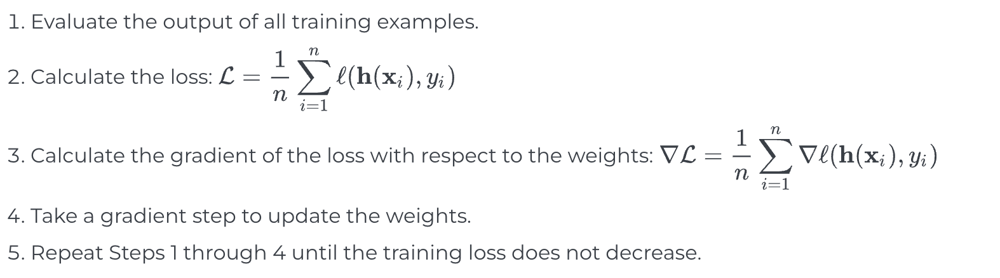
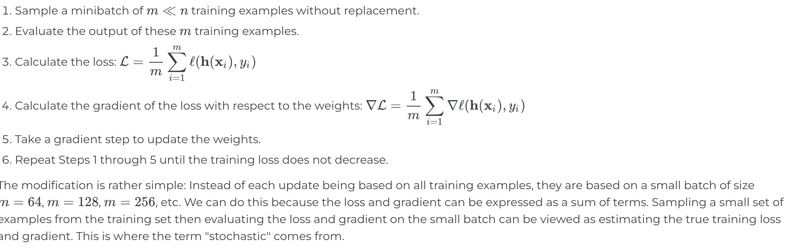

# Stochastic Gradient Descent (SGD) and Training Tricks for Neural Networks

## Overview

Backpropagation tells us **which direction** to adjust the weights.

**Stochastic Gradient Descent (SGD)** determines **how far** we move in that direction.

In practice, neural networks often require additional optimization techniques to train effectively. Three of the most important techniques are:

1. Learning rate scheduling (step size decay)
2. Momentum
3. Feature normalization

These techniques help neural networks converge faster and find better solutions.

---
# Training via Gradiant Descent



# Stochastic Gradient Descent (SGD)
However, with deep neural networks, evaluating and calculating the loss and gradients of every single example is very expensive.


Recall the standard gradient descent update rule:

\[
W \leftarrow W - \alpha \nabla L
\]

where:

- \(W\) = model parameters
- \(\alpha\) = learning rate (step size)
- \(\nabla L\) = gradient of the loss function

In SGD, gradients are typically computed using a minibatch rather than the entire dataset.

\[
W \leftarrow W - \alpha \nabla L_{batch}
\]

The key question becomes:

> How large should the learning rate \(\alpha\) be?

---

# Why Learning Rate Matters

The learning rate determines how much the weights change after each update.

### Small Learning Rate

```text
Pros:
✓ Stable
✓ Less overshooting

Cons:
✗ Very slow learning
✗ May take a long time to converge
```

### Large Learning Rate

```text
Pros:
✓ Faster exploration
✓ Faster initial progress

Cons:
✗ Can overshoot minima
✗ Can become unstable
```

The challenge is balancing these two effects.

---

# The Geometry of Optimization

A neural network may contain millions of weights.

This means optimization occurs in a very high-dimensional space.

```text
   Loss

     ^
     |
     |      /
     |     /
     |    /
     |___/__________> Parameters
```

Different directions have different curvature:

- Some directions are very steep.
- Some directions are very flat.

---

## Flat Directions

In flat regions:

\[
\left| \nabla L \right|
\]

is very small.

Progress can become extremely slow.

A larger learning rate helps the optimizer make meaningful progress.

---

## Steep Directions

In steep regions:

\[
\left| \nabla L \right|
\]

is large.

A large learning rate may cause oscillation:

```text
      /
     /
----X----
     \
      \
```

The optimizer bounces back and forth across the valley.

---

# Learning Rate Scheduling

A common strategy is:

1. Start with a relatively large learning rate.
2. Train for many epochs.
3. Reduce the learning rate.
4. Continue training.
5. Repeat until convergence.

This is called **learning rate decay** or **learning rate scheduling**.

---

## Example Schedule

Start with:

\[
\alpha = 0.1
\]

Train for 150 epochs.

Reduce by:

\[
10\times
\]

New learning rate:

\[
\alpha = 0.01
\]

Train for another 100 epochs.

Reduce again:

\[
\alpha = 0.001
\]

Continue until progress stops.

---

## Why This Works

### Early Training

Use a large learning rate:

```text
Large steps
Fast movement
Explore parameter space
```

This helps make progress in flat regions.

---

### Late Training

Use a small learning rate:

```text
Small precise steps
Reduced oscillation
Fine tuning
```

This allows convergence to a good local minimum.

---

# Learning Rate Decay Visualization

```text
Epochs

0 --------------------->

α = 0.1
██████████████

α = 0.01
██████

α = 0.001
██

α = 0.0001
█
```

The learning rate gradually decreases as training progresses.

---

# Epochs

An **epoch** means processing the entire training dataset once.

Example:

```text
Training Set = 10,000 examples

1 Epoch
= seeing all 10,000 examples once

100 Epochs
= seeing all examples 100 times
```

The learning rate is often adjusted after a fixed number of epochs.

---

# Momentum

## Motivation

SGD often exhibits a zigzagging pattern.

Imagine descending a narrow valley.

```text
\        /
 \      /
  \ /\ /
   X  X
  / \/ \
 /      \
/        \
```

Instead of moving directly toward the minimum, SGD bounces side to side.

This slows convergence.

---

# The Key Idea

Rather than using only the current gradient:

\[
g_t
\]

we average information from previous gradients.

This creates a smoother direction of travel.

Think of a rolling ball:

```text
Gradient Descent:
step, stop
step, stop
step, stop

Momentum:
roll..................
```

Momentum builds velocity.

---

# Momentum Formula

Maintain a running gradient estimate:

\[
G_t
\]

Update it as:

\[
G_t
=
\beta G_{t-1}
+
(1-\beta)g_t
\]

where:

- \(g_t\) = current gradient
- \(G_{t-1}\) = previous momentum estimate
- \(\beta\) = momentum parameter

Typical values:

\[
\beta = 0.9
\]

or

\[
\beta = 0.99
\]

---

# Weight Update with Momentum

Instead of:

\[
W
\leftarrow
W
-
\alpha g_t
\]

use:

\[
W
\leftarrow
W
-
\alpha G_t
\]

The update now follows the smoothed gradient direction.

---

# Choosing Beta

## Small Beta

Example:

\[
\beta = 0.1
\]

Effect:

```text
Mostly current gradient
Little memory
Almost SGD
```

---

## Large Beta

Example:

\[
\beta = 0.9
\]

Effect:

```text
Strong memory
Smooth updates
Less oscillation
```

---

# Why Momentum Helps

## 1. Reduces Zigzagging

Consider gradients:

```text
+1
-1
+1
-1
+1
-1
```

Averaging them tends toward:

```text
0
```

The oscillation disappears.

---

## 2. Faster Convergence

Momentum smooths noisy directions and preserves movement in useful directions.

Result:

```text
More progress
Fewer oscillations
Faster training
```

---

## 3. Escaping Small Local Minima

Momentum can sometimes carry optimization through shallow local minima.

```text
     _
 ___/ \___
```

The accumulated velocity helps prevent getting stuck.

---

# Python Example: SGD

```python
import numpy as np

# weight
w = 5.0

# gradient
grad = 2.0

# learning rate
alpha = 0.1

# SGD update
w = w - alpha * grad

print(w)
```

Output:

```text
4.8
```

---

# Python Example: Momentum

```python
import numpy as np

# previous momentum
G_prev = 1.2

# current gradient
grad = 2.0

beta = 0.9

G = beta * G_prev + (1 - beta) * grad

print(G)
```

Output:

```text
1.28
```

The update uses:

```python
w = w - alpha * G
```

instead of the raw gradient.

---

# Feature Normalization

Another critical trick for training neural networks is feature normalization.

Neural networks are sensitive to feature scale.

---

## Problem: Different Units

Suppose we have two features:

### Heart Rate

```text
60 - 100
```

### Height (cm)

```text
150 - 200
```

Height values are much larger numerically.

As a result, height can dominate the optimization process.

The network may learn more from numerical scale than actual importance.

---

# Standardization

A common solution is to standardize every feature.

For each feature:

### Step 1: Subtract Mean

\[
x' = x - \mu
\]

where:

\[
\mu
=
\text{mean(feature)}
\]

Now the feature has mean 0.

---

### Step 2: Divide by Standard Deviation

\[
x_{norm}
=
\frac{x-\mu}{\sigma}
\]

where:

\[
\sigma
=
\text{standard deviation}
\]

Now the feature has:

\[
\text{Mean}=0
\]

and

\[
\text{Variance}=1
\]

---

# Example

Suppose age values are:

```text
20, 30, 40, 50, 60
```

Mean:

\[
\mu = 40
\]

For age 50:

\[
z=
\frac{50-40}{14.14}
=
0.71
\]

The feature now reflects distance from the mean rather than raw units.

---

# Python Example: Feature Normalization

```python
import numpy as np

x = np.array([20, 30, 40, 50, 60])

mean = np.mean(x)
std = np.std(x)

x_norm = (x - mean) / std

print(x_norm)
```

Output:

```text
[-1.41 -0.71 0.00 0.71 1.41]
```

---

# Why Normalization Helps

Without normalization:

```text
Feature A: 0 - 1
Feature B: 0 - 1000
```

Feature B dominates training.

---

With normalization:

```text
Feature A: mean 0, variance 1
Feature B: mean 0, variance 1
```

Both features contribute fairly.

Benefits include:

- Faster convergence
- More stable gradients
- Better optimization
- Improved training performance

---

# Complete Neural Network Training Loop

```text
Initialize Weights
        │
        ▼
Forward Propagation
        │
        ▼
Compute Loss
        │
        ▼
Backpropagation
        │
        ▼
Compute Gradients
        │
        ▼
SGD + Momentum Update
        │
        ▼
Adjust Learning Rate
        │
        ▼
Repeat
```

---

# Key Takeaways

1. **SGD updates neural network weights using minibatch gradients.**

2. **Learning rate controls how large each weight update is.**

3. **Start with a larger learning rate and gradually reduce it during training.**

4. **Learning rate decay helps optimize both flat and steep regions of the loss surface.**

5. **Momentum averages previous gradients to reduce oscillations and accelerate learning.**

6. **Momentum update:**

   \[
   G_t = \beta G_{t-1} + (1-\beta)g_t
   \]

7. **Feature normalization standardizes all features to similar scales.**

   \[
   x_{norm}
   =
   \frac{x-\mu}{\sigma}
   \]

8. **Normalization often improves convergence speed and training stability.**

---

# One-Sentence Summary

Effective neural network training combines SGD with learning rate decay, momentum, and feature normalization to achieve faster convergence, smoother optimization, and better overall performance.

# Overall tricks
* Momentum: If 𝛽 is small when updating the gradient, you are heavily considering the previous weights.
* Dropping step size:  By decreasing the learning rate by a factor of 10, we will now make progress in the steep region.