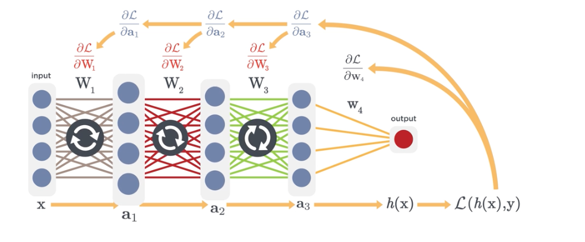

# Backpropagation in Neural Networks

## Overview

Forward propagation allows a neural network to make a prediction.

Backpropagation is the algorithm that allows a neural network to **learn**.

The basic idea is simple:

1. Perform a forward pass to compute the prediction.
2. Compute the loss (error).
3. Compute gradients of the loss with respect to every weight.
4. Update the weights using gradient descent.
5. Repeat until the network converges.



---

# Why Do We Need Backpropagation?

A neural network can contain thousands or millions of parameters.

For example:

```text
Input
  │
  ▼
Layer 1 (W1)
  │
  ▼
Layer 2 (W2)
  │
  ▼
Layer 3 (W3)
  │
  ▼
Output Layer (W4)
```

The parameters are all of the weight matrices:

\[
W^{(1)}, W^{(2)}, W^{(3)}, W^{(4)}
\]

Training requires computing:

\[
\frac{\partial L}{\partial W^{(1)}},
\quad
\frac{\partial L}{\partial W^{(2)}},
\quad
\frac{\partial L}{\partial W^{(3)}},
\quad
\frac{\partial L}{\partial W^{(4)}}
\]

where \(L\) is the loss function.

Computing each derivative independently would involve repeating a large amount of work.

Backpropagation avoids this by efficiently reusing intermediate calculations.

---

# The Core Idea

Forward propagation moves information:

```text
Input → Hidden Layers → Output
```

Backpropagation moves gradients:

```text
Loss → Output Layer → Hidden Layers → Input Layer
```

The gradient starts at the output and is propagated backward through the network.

As the gradient reaches each layer, we compute:

1. Gradient of the weights
2. Weight update
3. Gradient for the previous layer

This means all gradients can be computed in a **single backward pass**.

---

# Neural Network Review

Recall that each layer computes:

### Linear Transformation

\[
a^{(l)} = W^{(l)} \tilde{q}^{(l-1)}
\]

### Activation

\[
q^{(l)} = g(a^{(l)})
\]

where:

- \(a^{(l)}\) = pre-activation values
- \(q^{(l)}\) = post-activation values
- \(g\) = activation function

Forward propagation produces:

\[
q^{(L)}
\]

which is the final prediction.

---

# Loss Function

After computing the prediction, we compare it to the true answer.

Suppose:

\[
y = \text{true value}
\]

\[
\hat y = q^{(L)}
\]

A common regression loss is Mean Squared Error (MSE):

\[
L =
\frac{1}{2}
(\hat y - y)^2
\]

The goal of training is to minimize:

\[
L
\]

---

# Gradient Descent Refresher

Gradient descent updates parameters in the direction that reduces loss.

For a weight matrix \(W\):

\[
W
\leftarrow
W - \eta
\frac{\partial L}{\partial W}
\]

where:

- \(\eta\) = learning rate
- \(\frac{\partial L}{\partial W}\) = gradient

If the gradient is positive:

```text
Weight decreases
```

If the gradient is negative:

```text
Weight increases
```

This gradually reduces the loss.

---

# Why Gradients Are Difficult

Consider a network:

\[
h(x)
=
W^{(4)}
g(
W^{(3)}
g(
W^{(2)}
g(
W^{(1)}
x
)))
\]

This is a deeply nested function.

Computing gradients directly becomes complicated because every layer affects every later layer.

Fortunately, calculus provides a solution:

## The Chain Rule

For functions:

\[
z = f(y)
\]

\[
y = g(x)
\]

the derivative is:

\[
\frac{dz}{dx}
=
\frac{dz}{dy}
\frac{dy}{dx}
\]

Backpropagation is simply the chain rule applied repeatedly.

---

# The Backpropagation Variable

Instead of directly computing gradients with respect to weights, backpropagation first computes gradients with respect to the pre-activation values:

\[
a^{(l)}
\]

Define:

\[
\delta^{(l)}
=
\frac{\partial L}
{\partial a^{(l)}}
\]

This quantity is often called the **error signal**.

The entire algorithm revolves around propagating:

\[
\delta^{(L)},
\delta^{(L-1)},
\delta^{(L-2)},
\dots
\]

backward through the network.

---

# Backpropagation at the Output Layer

The backward pass begins at the final layer.

After computing the loss:

\[
L
\]

we compute:

\[
\delta^{(L)}
=
\frac{\partial L}
{\partial a^{(L)}}
\]

This step requires ordinary calculus.

For many loss functions and activation functions this derivative is straightforward.

Once we know:

\[
\delta^{(L)}
\]

we can compute:

### Weight Gradient

\[
\frac{\partial L}
{\partial W^{(L)}}
=
\delta^{(L)}
(\tilde q^{(L-1)})^T
\]

This tells us how the final layer weights should change.

---

# Propagating Backward

After computing the gradient for the current layer, we compute the gradient for the previous layer.

The general formula is:

\[
\delta^{(l-1)}
=
(W^{(l)})^T
\delta^{(l)}
\odot
g'(a^{(l-1)})
\]

where:

- \(\odot\) = element-wise multiplication
- \(g'\) = derivative of activation function

This is the core backpropagation equation.

It allows gradients to move backwards one layer at a time.

---

# Visualizing Backpropagation

Forward pass:

```text
x
 │
 ▼
Layer 1
 │
 ▼
Layer 2
 │
 ▼
Layer 3
 │
 ▼
Prediction
```

Backward pass:

```text
Prediction
 │
 ▼
Loss
 │
 ▼
Gradient Layer 3
 │
 ▼
Gradient Layer 2
 │
 ▼
Gradient Layer 1
```

Forward computes outputs.

Backward computes gradients.

---

# Complete Training Cycle

## Step 1: Forward Propagation

Compute:

\[
q^{(L)}
\]

the network prediction.

---

## Step 2: Compute Loss

Example:

\[
L=
\frac{1}{2}
(\hat y-y)^2
\]

---

## Step 3: Compute Output Gradient

\[
\delta^{(L)}
=
\frac{\partial L}
{\partial a^{(L)}}
\]

---

## Step 4: Compute Weight Gradient

\[
\frac{\partial L}
{\partial W^{(L)}}
\]

---

## Step 5: Update Weights

\[
W^{(L)}
\leftarrow
W^{(L)}
-
\eta
\frac{\partial L}
{\partial W^{(L)}}
\]

---

## Step 6: Move Back One Layer

Compute:

\[
\delta^{(L-1)}
\]

Then compute:

\[
\frac{\partial L}
{\partial W^{(L-1)}}
\]

Update the weights.

---

## Step 7: Repeat

Continue moving backward until the first layer.

```text
for layer = L down to 1:
    compute gradient
    update weights
    propagate gradient backward
```

---

# Backpropagation Pseudocode

```text
Forward Pass

q(0) = x

for l = 1 to L:
    a(l) = W(l) * q(l-1)
    q(l) = activation(a(l))

Compute Loss

L = loss(q(L), y)

Backward Pass

delta(L) = dL/da(L)

for l = L down to 1:

    dW(l) = delta(l) * q(l-1)^T

    W(l) = W(l) - learning_rate * dW(l)

    delta(l-1) =
        W(l)^T * delta(l)
        elementwise multiply
        activation_derivative(a(l-1))
```

---

# Simple Numerical Example

Suppose:

Prediction:

\[
\hat y = 0.8
\]

True value:

\[
y = 1.0
\]

Loss:

\[
L=
\frac12(0.8-1)^2
\]

\[
L=0.02
\]

Derivative of loss:

\[
\frac{\partial L}
{\partial \hat y}
=
0.8-1
=
-0.2
\]

This means increasing the prediction would reduce the loss.

Backpropagation uses this error signal to determine how every weight contributed to the mistake.

---

# Python Example: Single Gradient Descent Step

```python
import numpy as np

# prediction
y_hat = 0.8

# target
y = 1.0

# MSE loss derivative
dL_dyhat = y_hat - y

print("Gradient:", dL_dyhat)
```

Output:

```text
Gradient: -0.2
```

---

# Python Example: Tiny Backpropagation Example

```python
import numpy as np

# input
x = 2.0

# weight
w = 0.5

# true value
y = 1.0

# ------------------
# forward pass
# ------------------

y_hat = w * x

loss = 0.5 * (y_hat - y) ** 2

# ------------------
# backward pass
# ------------------

dL_dyhat = y_hat - y

dyhat_dw = x

dL_dw = dL_dyhat * dyhat_dw

# gradient descent update
learning_rate = 0.1

w = w - learning_rate * dL_dw

print("Loss:", loss)
print("Gradient:", dL_dw)
print("Updated weight:", w)
```

Output:

```text
Loss: 0.0
Gradient: 0.0
Updated weight: 0.5
```

This simple example demonstrates the same process used in deep neural networks:

1. Forward pass
2. Compute loss
3. Compute gradient
4. Update weights

The only difference in deep networks is that the gradients are propagated through many layers using the chain rule.

---

# Relationship Between Forward Propagation and Backpropagation

## Forward Pass

Computes predictions.

\[
x
\rightarrow
a
\rightarrow
q
\rightarrow
\hat y
\]

Purpose:

```text
Generate output
```

---

## Backward Pass

Computes gradients.

\[
L
\rightarrow
\delta^{(L)}
\rightarrow
\delta^{(L-1)}
\rightarrow
...
\rightarrow
\delta^{(1)}
\]

Purpose:

```text
Generate learning updates
```
---

# PyTorch Example: Backward Pass with `.backward()`

```python
import torch
import torch.nn as nn

# Create a simple neural network
model = nn.Sequential(
    nn.Linear(10, 5),
    nn.ReLU(),
    nn.Linear(5, 1)
)

# Create input, target, and loss function
x = torch.randn(32, 10)  # batch of 32 samples
y = torch.randn(32, 1)   # target values
loss_fn = nn.MSELoss()

# Forward pass
predictions = model(x)
loss = loss_fn(predictions, y)

# Backward pass - compute gradients
loss.backward()

# Access gradients
for param in model.parameters():
    if param.grad is not None:
        print(f"Gradient shape: {param.grad.shape}")
        # Use gradients for weight updates (e.g., with optimizer)

# Gradient descent step (manual update)
learning_rate = 0.01
with torch.no_grad():
    for param in model.parameters():
        if param.grad is not None:
            param -= learning_rate * param.grad

# Clear gradients for next iteration
model.zero_grad()
```

**Key observations:**
- `loss.backward()` automatically computes gradients for all parameters using backpropagation
- Gradients are stored in `param.grad` for each parameter
- `model.zero_grad()` clears gradients before the next backward pass
- In practice, use `torch.optim.SGD` or `torch.optim.Adam` instead of manual updates

---

# Key Takeaways

1. Neural networks are trained using **gradient descent**.

2. We need gradients for every weight matrix:

   \[
   \frac{\partial L}{\partial W^{(1)}},
   \frac{\partial L}{\partial W^{(2)}},
   \dots
   \]

3. Directly computing these gradients is inefficient.

4. **Backpropagation** uses the **chain rule** to efficiently compute all gradients in a single backward pass.

5. The algorithm begins at the output layer and propagates gradients toward the input layer.

6. At each layer:
   - Compute the weight gradients.
   - Update the weights.
   - Compute gradients for the previous layer.

7. Training consists of repeating:

```text
Forward Pass
     ↓
Compute Loss
     ↓
Backward Pass
     ↓
Gradient Update
     ↓
Repeat
```

---

# One-Sentence Summary

Backpropagation is an efficient application of the chain rule that propagates gradients from the output layer back to the input layer, allowing every weight in a neural network to be updated using gradient descent in a single backward pass.