# Convolutional Neural Networks (ConvNets, CNN)

A class of deep learning algorithms that analyze images

* Images are very high dimensional when vectorized
* Variances which are obvious to humans aren't to DNNs

Not only are images high dimensional, but neighboring pixels in an image are also highly correlated. More concretely, an image pixel does not really contain a lot of information, but a block of image pixels is often much more meaningful. To understand this, consider an image of a tiger. Looking at a single pixel does not give you any information about the image, but by looking at a block of images (e.g., several neighboring pixels that make a patch of fur with orange and black stripes), you can guess that the image contains a tiger. If we vectorize an image before inputting it into a multilayer Perceptron, we end up with one long 1 million dimensional vector and essentially lose much of the spatial relation between neighboring pixels.

This is where convolutional neural networks (ConvNets) come into play. On a high level, ConvNets try to learn small filters that can detect small regional patterns at the first few layers. The vector output of these layers might have higher values if a particular pattern is present, and lower otherwise. In later layers, these outputs are passed into multilayer Perceptrons for classification.

CNN
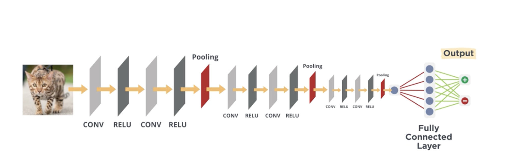
* CNNs are translation invariant

At the heart of a convolutional network is convolution: passing a filter (with learned kernel) over the image to find patterns. These filters are learned through training and optimized during back propagation.  Images are represented as  3-dimensional tensors, of dimensions height × width × 3, where the last dimension captures the color channels.  Convolutional neural networks have the ability to filter local regions of images to recognize patterns.  Most popular filter size is 3 X 3 (both small and odd numbered).

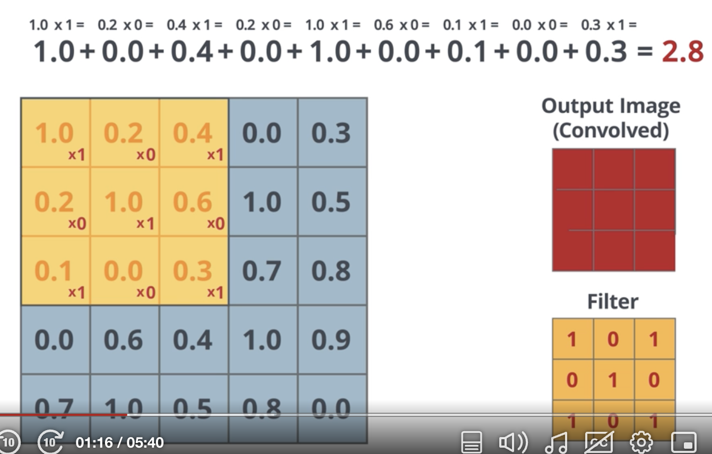
Apply filter over image and calculate each pixel times the filter.  Sum these all together, that gives the feature response (The inner product of the convolve filter and a certain part of the image).  A high number means a lot of similarity between image and filter.

Move filter one pixel to the right and redo, 
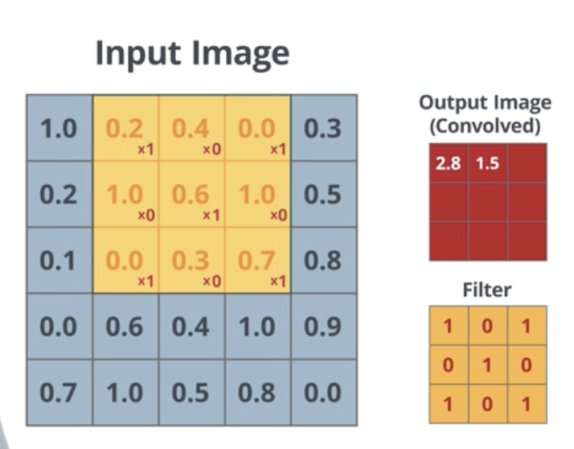

continuing to the right and then down a row
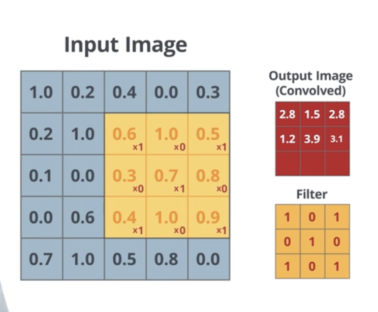

same filter will be applied to every pixel in the picture

If color need to break up into red, green and blue channels and then apply filter to each one and average them all to get a new image (slightly smaller). This called a feature map (The output of the convolutional filter over the input images to a particular layer.).  Do this multiple times and this creates the first layer
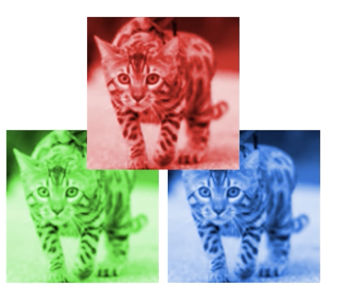

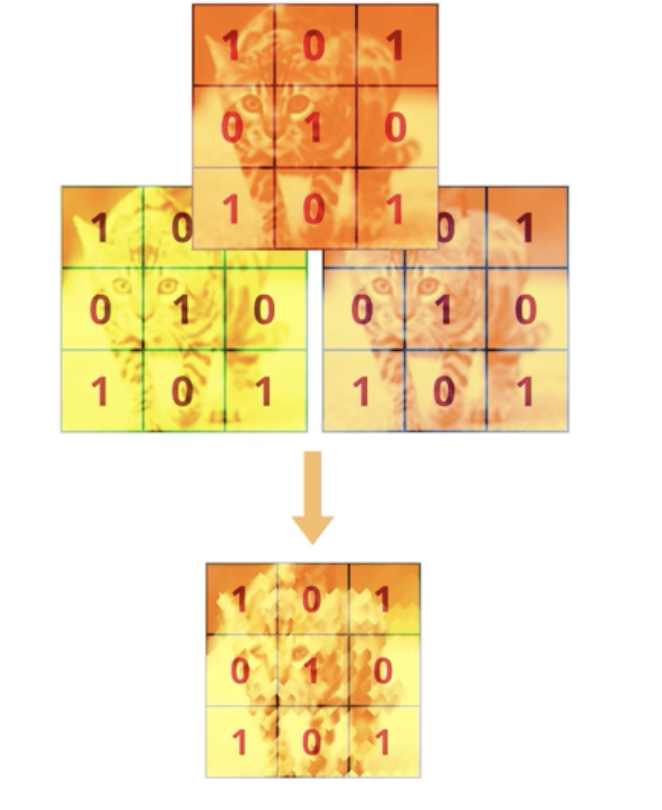

Keep repeating.  If there is no pattern to find, the feature response is a weighted average with the result of blurring the image.

## Padding
Applying convolution to images will reduce the size of the image, and sometimes we want to make sure the size of the output layer is the same as the input image so we pad the images with zeros around the borders. (Alternatively, one can also pad with pixels from the image
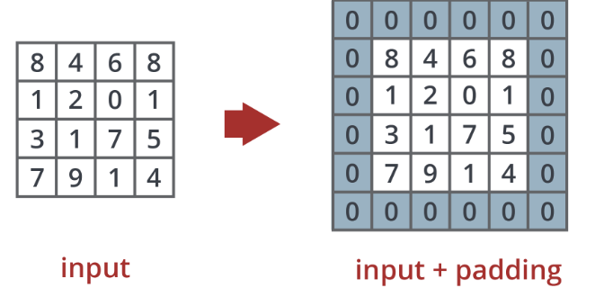

## Stride Size
tride is the amount by which the filter is moved by as it passes over the image. For a dense representation of the image, we can shift the filter by one pixel at a time. To train fewer nodes, we can shift the filter by more pixels; for example, with a stride of the size of the filter. A large stride increases the area of influence for pixels in activations in deeper layers. 

[Viewer](https://github.com/generic-github-user/Image-Convolution-Playground/tree/master)

## Blurring
One of the challenges when working with images is that natural images are translation invariant, but vector representations of images are not. That is to say, humans could look at a picture that contains a cat and easily identify the cat, no matter where in the picture it is. When representing images as a vector, even the slightest change in camera position or object orientation will create a completely new vector. Convolution layers solve this challenge a bit by blurring the image.

## Pooling Layers
* Translation invariance is the ability to withstand small shifts of an object in a photo.
To try and address the issue of an object being moved around significantly in pictures use pooling layers (they don't look for where but if object is present).  
Take image and apply filter and then only keep blocks with largest numbers.  A pooling layer looks at little patches of the image and introduces translation invariance into ConvNets.

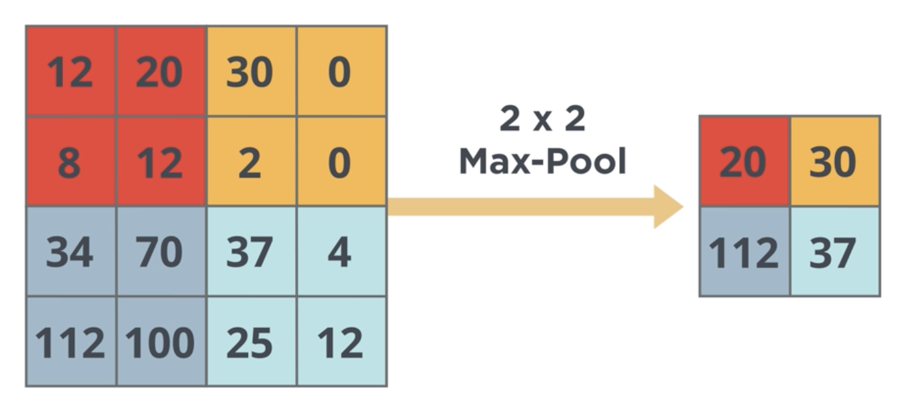
viz. look for cat eyes, cat nose, cat ears and if all present say image is probably a cat.
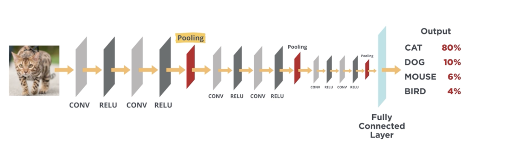
* Pooling introduces translation invariance by conveying what patterns are apparent in the image, without conveying where they are exactly.
Correct answer.
* If you use Photoshop to switch the location of the eyes and the mouth of a cat, a convolutional net with pooling layers would likely still "recognize" the image as a cat.
* By the end of our network, if we have multiple convolution and pooling layers, our final image is smaller than the original input image and we can classify the entire image, not just a region.
* Two common pooling methods are max pooling and mean pooling.

*example*
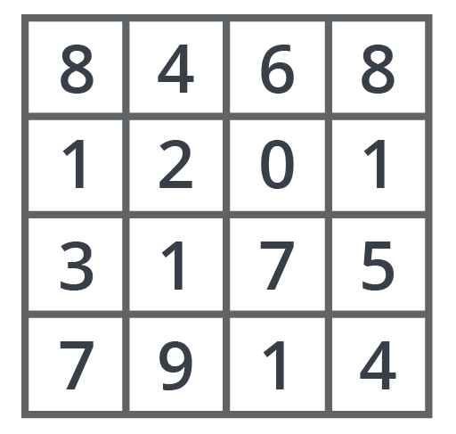
If we apply a max pooling of size 2 to this array, we'll capture the largest value in the four quadrants of the array. For example, the top-left quadrant contains 8, 4, 2, and 1. The largest value, 8, is captured in our smaller pooling array in the top-left location. If we do this to reduce the entire 4 × 4 into a 2 × 2 array, we will get: 
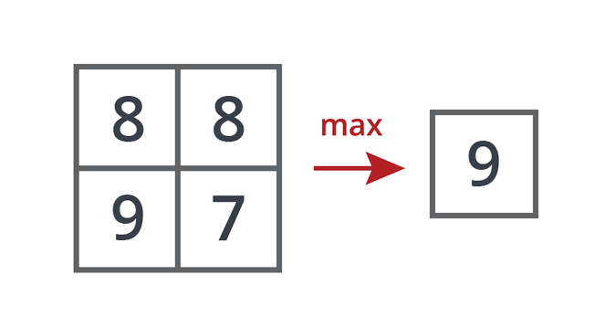
It is not entirely identical, but several values remained unchanged and the max output was still 9. The key is that the very large numbers will always survive, as they will remain the max values in their 2 × 2 sub-grids. If there are multiple rounds of pooling, the final output will likely be identical even if the image is translated. 

**Increase of Receptive Field**
* *nice property of pooling layers is that they shrink the image size. In the case above, with a 2 × 2 pooling window, we half the size of the activations. 
* * it speeds up processing downstream
* * it increases the receptive field (or the span) of the next convolution layer. 
Imagine, for example, in the example above, the final output is inserted into a 2 × 2 convolutional filter. This filter will convolve the 7 and 9, which are originally 4 pixels apart from each other. This increase in the receptive field is particularly useful for object recognition if the object spans the whole image. 

**Nonlinearity**
* max pooling also introduces a nonlinearity into the network. Similar to a fully connected network, which uses ReLUs as nonlinear transition functions, max pooling can have a similar nonlinear effect in convolutional networks. (Note that convolutional filters are linear transformations.) 

[Tool](https://adamharley.com/)
[Tool](https://ecornell.s3.amazonaws.com/content/CIS/CIS537/ConvNetViz/conv/flat.html)

## Batch Normalization
A batch normalization layer of a neural network computes the mean and standard deviation of each pixel of the activations in this layer across the entire minibatch. This information is then used to normalize the activations (i.e., subtract the mean and divide by the standard deviation). The result is much more stable training and improved tolerance toward large learning rates. 

Batch normalization is usually applied before the transition function layer to the output of a convolutional layer.  It tries to normalize the features of an output layer (current minibatch).  Speeds up training a lot.
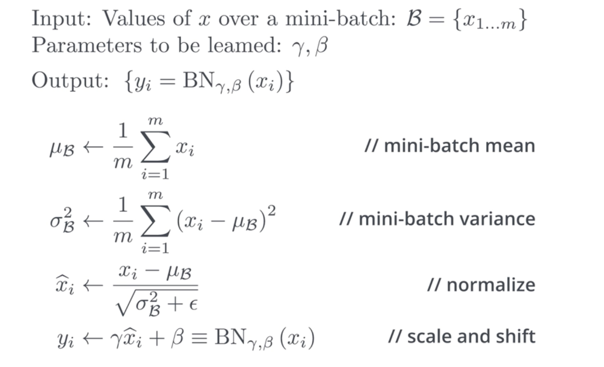

* Feature normalization on inputs to hidden layers is not as simple as feature normalization on the original input. This is because at layer 𝑖, the input depends on the previous 𝑖 −1 layers, and the weights will change as the weights are updated.
* Learn an offset 𝛽 and a multiplicative scalar 𝛾.
* Increase the learning rate 𝛼.
* Calculating the mean and standard deviation for all the points in the mini batch.
* Batch normalization lets you start with a large α when doing (S)GD because the normalization prevents divergence

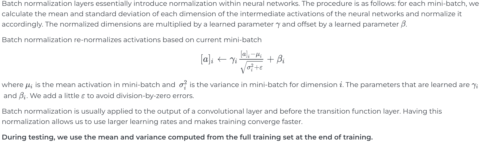

## Preserving Information
With many layers data can be lost between layers.  
* Residual networks (ResNets) address this shortcoming by adding the input of each layer directly to its output, making it easy for a layer to preserve information.   (combines the output plus the input into the previous layer)
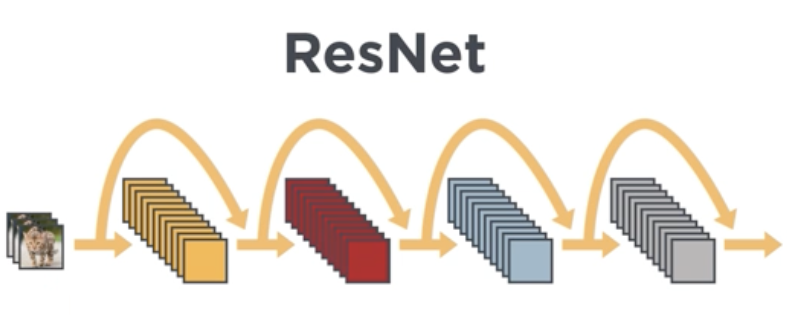
* Dense networks (DenseNets) takes such connections to the next level by considering all outputs of the preceding layers as inputs to a layer.  Takes the output and adds to subsequent layers.  State of the art for NNs
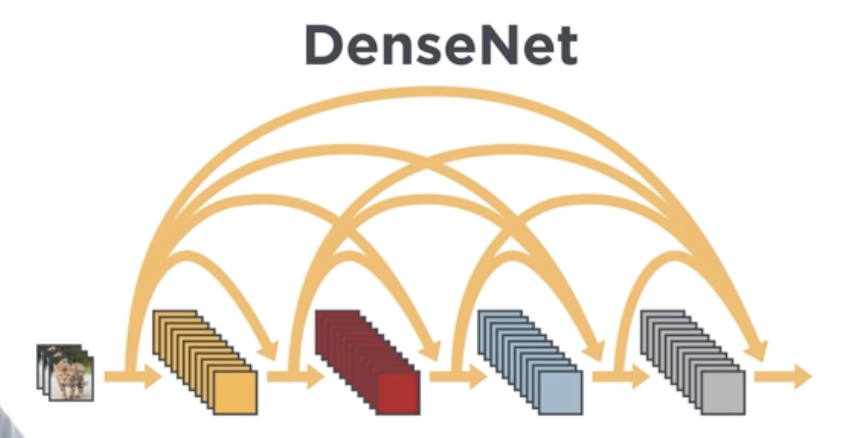

