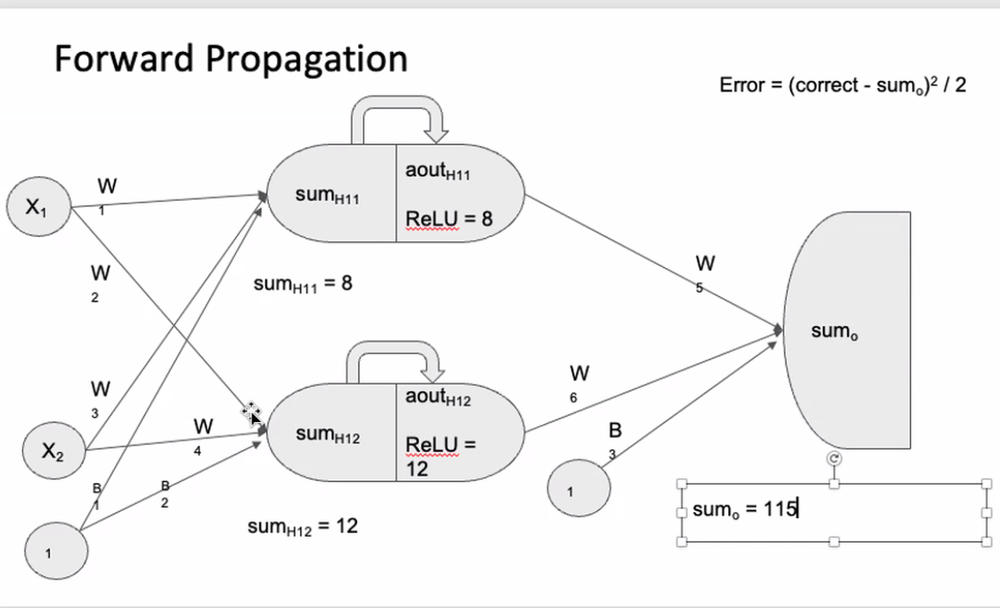
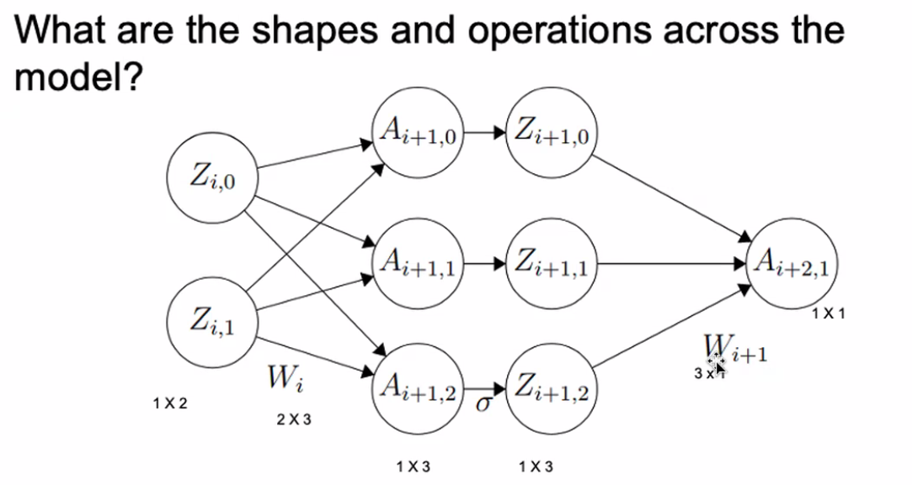

# Forward Propagation in Neural Networks

## Overview

Forward propagation is the process of **evaluating a neural network** for a given input vector **x**. The input may come from either:

- The training set
- The test set

During forward propagation, the input is fed into the network and passed forward through each layer until a final output is produced.

The term **forward propagation** comes from the fact that information moves in a single direction:

```text
Input → Hidden Layers → Output
```

---

# Neural Network Structure
**Example with math**


Inputs use linear regression
Then apply the activation function to create new sum and this pass on to next which again uses linear regression again and etc

So, looking but no activation function on last step


---

A neural network consists of multiple layers.

```text
x
│
▼
Layer 1
│
▼
Layer 2
│
▼
...
│
▼
Layer L
│
▼
Output
```

We treat the input as the **0th layer**:

\[
q^{(0)} = x
\]

This allows us to describe every layer using the same mathematical operations.

---

# Operations Performed at Each Layer

Each layer performs exactly two operations:

1. Matrix multiplication (linear transformation)
2. Activation function (non-linear transformation)

Given the output from the previous layer:

\[
q^{(l-1)}
\]

we compute:

### Step 1: Linear Transformation

\[
a^{(l)} = W^{(l)} \tilde{q}^{(l-1)}
\]

where:

- \(W^{(l)}\) = weight matrix of layer \(l\)
- \(\tilde{q}^{(l-1)}\) = previous output augmented with a bias term
- \(a^{(l)}\) = pre-activation vector

### Step 2: Activation Function

\[
q^{(l)} = g(a^{(l)})
\]

where:

- \(g(\cdot)\) is the activation (transfer) function
- \(q^{(l)}\) becomes the output of the current layer and input to the next layer

---

# General Forward Propagation Formula

For each layer:

\[
a^{(l)} = W^{(l)} \tilde{q}^{(l-1)}
\]

\[
q^{(l)} = g(a^{(l)})
\]

Repeat until the final layer \(L\).

The neural network output is:

\[
q^{(L)}
\]

---

# Forward Propagation Algorithm

## Pseudocode

```text
q(0) = x

for l = 1 to L:

    q_tilde = add_bias(q(l-1))

    a(l) = W(l) * q_tilde

    q(l) = activation(a(l))

return q(L)
```


---

# The Bias Trick

The lecture mentions adding a "little constant dimension" at every layer.

This is the same bias trick used in perceptrons and linear classifiers.

Instead of writing:

\[
a = Wq + b
\]

we augment the input vector by adding a constant value 1.

### Original Vector

\[
q =
\begin{bmatrix}
0.5\\
0.8
\end{bmatrix}
\]

### Augmented Vector

\[
\tilde{q} =
\begin{bmatrix}
1\\
0.5\\
0.8
\end{bmatrix}
\]

Now the bias can be absorbed directly into the weight matrix.

### Without Augmentation

\[
a = Wq + b
\]

### With Augmentation

\[
a = \tilde{W}\tilde{q}
\]

This simplifies both the mathematics and implementation.

---

# Activation Functions

The activation function introduces non-linearity into the network.

Without activation functions, a deep neural network would collapse into a single linear transformation.

## Sigmoid

Maps values into the range (0,1).

\[
g(z) =
\frac{1}{1+e^{-z}}
\]

Python:

```python
def sigmoid(z):
    return 1 / (1 + np.exp(-z))
```

---

## ReLU (Rectified Linear Unit)

Most commonly used in modern hidden layers.

\[
g(z) = \max(0,z)
\]

Python:

```python
def relu(z):
    return np.maximum(0, z)
```

---

## Tanh

Outputs values between -1 and 1.

\[
g(z) = \tanh(z)
\]

Python:

```python
def tanh(z):
    return np.tanh(z)
```

---

# Numerical Example

Suppose our input vector is:

\[
x =
\begin{bmatrix}
2\\
3
\end{bmatrix}
\]

Add a bias term:

\[
\tilde{x} =
\begin{bmatrix}
1\\
2\\
3
\end{bmatrix}
\]

---

## Weight Matrix

\[
W =
\begin{bmatrix}
0.5 & 0.1 & 0.2\\
0.4 & 0.3 & 0.7
\end{bmatrix}
\]

---

## Linear Transformation

Compute:

\[
a = W\tilde{x}
\]

\[
a=
\begin{bmatrix}
0.5(1)+0.1(2)+0.2(3)\\
0.4(1)+0.3(2)+0.7(3)
\end{bmatrix}
\]

\[
a=
\begin{bmatrix}
1.3\\
3.1
\end{bmatrix}
\]

---

## Activation (ReLU)

\[
q = \max(0,a)
\]

\[
q=
\begin{bmatrix}
1.3\\
3.1
\end{bmatrix}
\]

Because both values are positive, ReLU leaves them unchanged.

This output becomes the next layer's input.

---

# Multi-Layer Example

Consider a network with:

```text
Input
  │
  ▼
Layer 1
  │
  ▼
Layer 2
  │
  ▼
Output
```

### Layer 1

\[
a^{(1)} = W^{(1)}x
\]

\[
q^{(1)} = g(a^{(1)})
\]

### Layer 2

\[
a^{(2)} = W^{(2)}q^{(1)}
\]

\[
q^{(2)} = g(a^{(2)})
\]

### Final Output

\[
y = q^{(2)}
\]

---

# Python Example: Single-Layer Forward Propagation

```python
import numpy as np

# Input vector
x = np.array([2, 3])

# Add bias term
x_aug = np.concatenate(([1], x))

# Weight matrix
W = np.array([
    [0.5, 0.1, 0.2],
    [0.4, 0.3, 0.7]
])

# Linear transformation
a = W @ x_aug

# ReLU activation
q = np.maximum(0, a)

print("a =", a)
print("q =", q)
```

Output:

```text
a = [1.3 3.1]
q = [1.3 3.1]
```

---

# Python Example: Full Forward Propagation Through Multiple Layers

```python
import numpy as np

def relu(x):
    return np.maximum(0, x)

# Input layer
q = np.array([2.0, 3.0])

# -------------------
# Layer 1
# -------------------

q_aug = np.concatenate(([1], q))

W1 = np.array([
    [0.1, 0.2, 0.3],
    [0.4, 0.5, 0.6]
])

a1 = W1 @ q_aug
q1 = relu(a1)

# -------------------
# Layer 2
# -------------------

q1_aug = np.concatenate(([1], q1))

W2 = np.array([
    [0.7, 0.8, 0.9]
])

a2 = W2 @ q1_aug
q2 = relu(a2)

print("Layer 1 output:", q1)
print("Final network output:", q2)
```

---

# Shape Analysis

Understanding dimensions is critical.

Suppose:

- Input contains 3 features
- Hidden layer contains 4 neurons
- Output layer contains 2 neurons

Then:

\[
x \in \mathbb{R}^{3}
\]

After adding bias:

\[
\tilde{x} \in \mathbb{R}^{4}
\]

First layer weights:

\[
W^{(1)} \in \mathbb{R}^{4 \times 4}
\]

Output of hidden layer:

\[
q^{(1)} \in \mathbb{R}^{4}
\]

After adding bias:

\[
\tilde{q}^{(1)} \in \mathbb{R}^{5}
\]

Second layer weights:

\[
W^{(2)} \in \mathbb{R}^{2 \times 5}
\]

Output:

\[
q^{(2)} \in \mathbb{R}^{2}
\]

Always verify matrix dimensions before implementing a network.

---

# Key Takeaways

1. **Forward propagation evaluates a neural network for a given input vector.**

2. **The input vector is treated as layer 0.**

   \[
   q^{(0)} = x
   \]

3. **Each layer performs two operations:**

   \[
   a^{(l)} = W^{(l)}\tilde{q}^{(l-1)}
   \]

   \[
   q^{(l)} = g(a^{(l)})
   \]

4. **The output of one layer becomes the input to the next layer.**

5. **A bias dimension (typically 1) is added to each layer's output.**

6. **Activation functions introduce non-linearity and allow neural networks to learn complex relationships.**

7. **The final network prediction is the output of the last layer:**

   \[
   q^{(L)}
   \]

---

# One-Sentence Summary

Forward propagation starts with an input vector \(x\), repeatedly applies weight matrices and activation functions across layers, and produces the final output \(q^{(L)}\), which represents the neural network's prediction.

---

# PyTorch Implementation Example

Here's a simple neural network implementing forward propagation in PyTorch:

```python
import torch
import torch.nn as nn

# Define a simple neural network
class SimpleNN(nn.Module):
    def __init__(self, input_size=10, hidden_size=5, output_size=2):
        super(SimpleNN, self).__init__()
        # Layer 1: input_size -> hidden_size
        self.layer1 = nn.Linear(input_size, hidden_size)
        # Layer 2: hidden_size -> output_size
        self.layer2 = nn.Linear(hidden_size, output_size)
        # Activation function
        self.relu = nn.ReLU()
    
    def forward(self, x):
        # Forward propagation through layer 1
        a1 = self.layer1(x)  # Linear transformation: a^(1) = W^(1) * q^(0)
        q1 = self.relu(a1)   # Activation: q^(1) = g(a^(1))
        
        # Forward propagation through layer 2
        a2 = self.layer2(q1) # Linear transformation: a^(2) = W^(2) * q^(1)
        q2 = a2              # Output layer (no activation)
        
        return q2

# Create model and input
model = SimpleNN(input_size=10, hidden_size=5, output_size=2)
x = torch.randn(1, 10)  # Batch of 1 sample with 10 features

# Forward propagation
output = model(x)
print(f"Input shape: {x.shape}")
print(f"Output shape: {output.shape}")
print(f"Output: {output}")
```

**Key Points:**
- `nn.Linear` performs the matrix multiplication: \(a^{(l)} = W^{(l)} q^{(l-1)}\) (bias included automatically)
- `nn.ReLU()` applies the activation function: \(q^{(l)} = g(a^{(l)})\)
- The `forward()` method implements forward propagation by passing input through each layer sequentially
- Each layer's output becomes the next layer's input

