# Neural Nets

Artificial neural networks describe a powerful machine learning method for supervised learning problems such as image recognition, language processing, and speech recognition. Neural networks can be particularly important because they learn their own internal representation of the data before they apply a final classifier. Deep learning refers to using neural networks with multiple layers of non-linear representations applied sequentially. This way, neural networks can learn increasingly complex representations and learn to extract semantically meaningful features from the data. 

weights come in like linear classifier
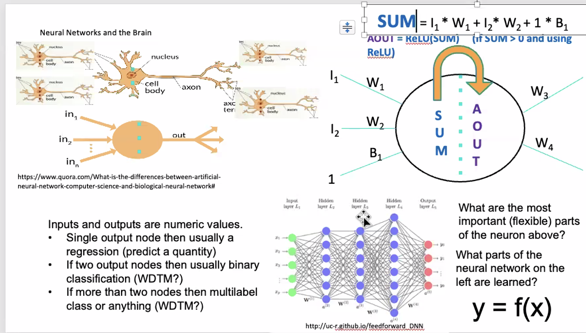
if large number means strong signal.  This sent to activation function (e.g ReLu or Tanh) and it creates output.  

A neural network can approximate a decision boundary locally using kinks. The direction and position of those kinks are determined by the parameters U, W, b,c that are learned from data using stochastic gradient descent. If you introduce enough kinks, you can approximate any continuous function arbitrarily well.
* Stochastic gradient descent (SGD) is the most common way to learn the parameter.
Use piecewise hinge functions to approximate the non-linear boundary with multi-layer Perceptrons.  A neural network is intuitively a sum of many little hinges.  A hinge can be expressed using max(x,0)
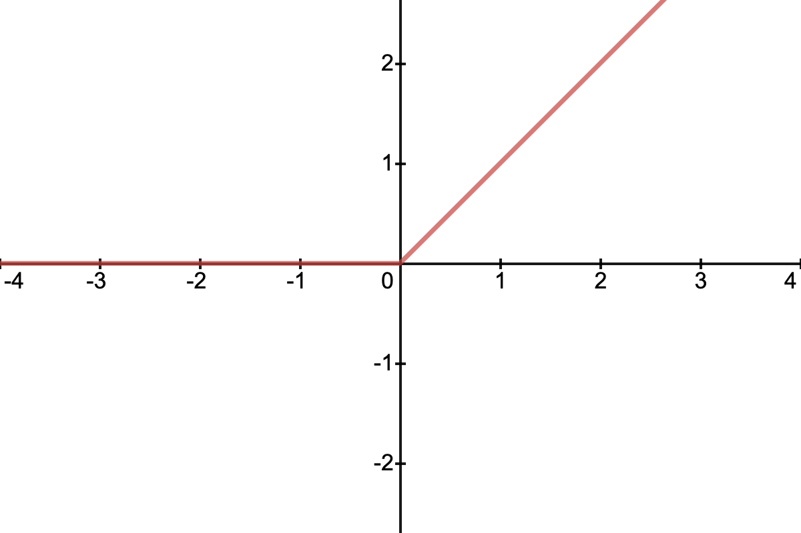
* This is restrictive since hinge is at (0,0) which we might now want.  Want hinge anywhere so: max(wx + b, 0) + c.  
* In this form hinge occurs at (x_sub0, y_sub0) = (- b/w, c).  
* * When input point x is high dimensional the hinge function can be generalized to max(w^Tx + b,0) + c
Thus a simple one-layer NN with M hinge functions that outputs a scalar h(x) is just a sum of these hinges weighted differently
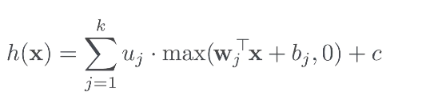
The most common way to learn these parameters is using stochastic gradient descent

NN
* Can be used for regression or classification
* * Output of regression network is a real number or a vector of real numbers
* * Output of a classification network is a normalized probability vector

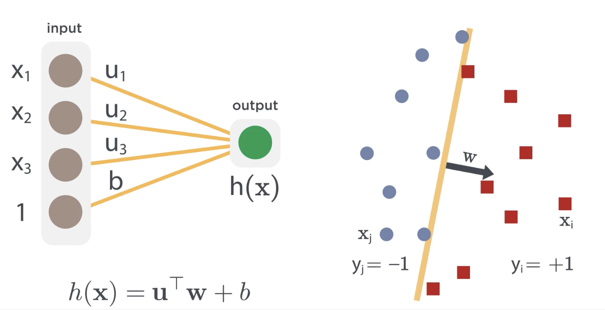

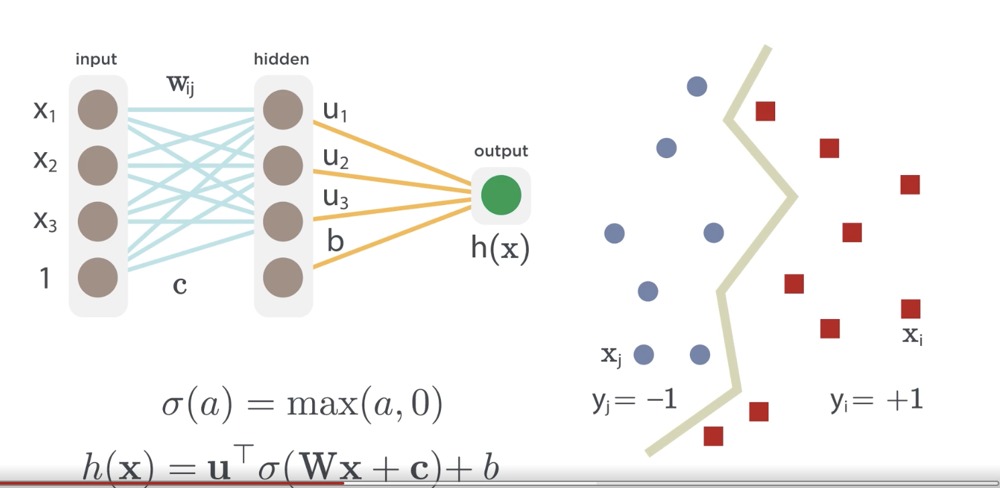

add hidden neurons
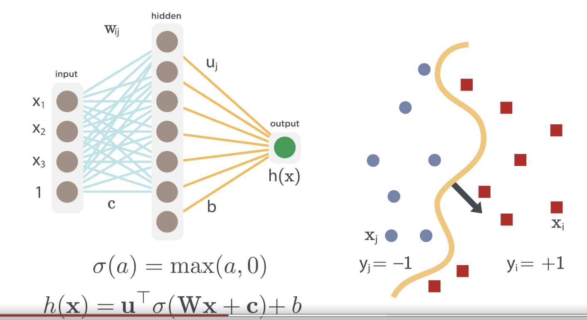

Can add multiple kinks without making very wide by adding more layers.  Here 4 neurons, each correspond to a hinge function.  by end have 64 kinks
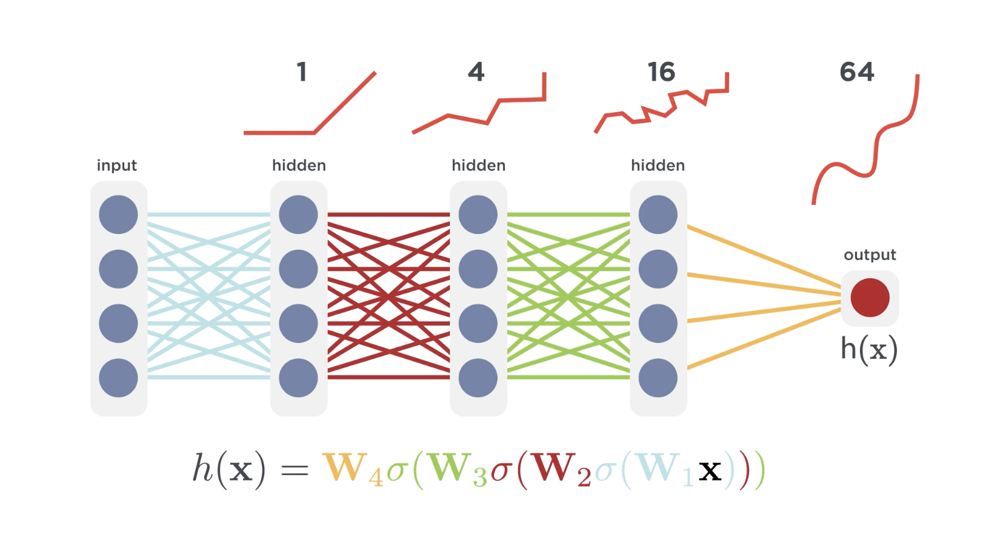

## Neural Networks
[Demo](https://learn.ecornell.cornell.edu/courses/1865331/pages/activity-design-a-neural-network?module_item_id=37520079) and its [code](https://github.com/tensorflow/playground)
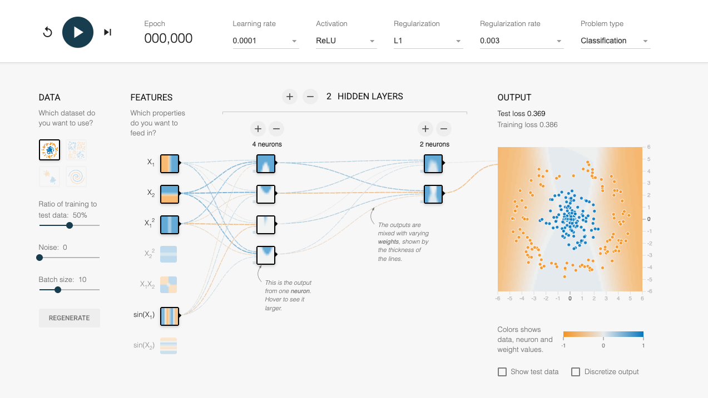

* Made up fo two main components
* * Matrix multiplying (esentially the linear functions)
* * Transition function (switches these linear functions on/off, aka kink).  AKA RuLU

### Transition Function
* A transition function is the part of artificial neural networks that gives them the ability to express nonlinear functions.
* Rectified linear unit, sigmoidal unit, and hyperbolic tangent are examples of transition functions.

**Rectified Linear Unit (RuLU)**
sigma(z) = max(z,0)
Most popular transition function because it doesn’t completely fall into the same pitfall of the other two functions: having ends that are too flat and thus not easy to optimize. Although the left part of the ReLU is flat, it is not symmetric, so when the sign of the activation changes, the gradient is very strong.  So, when don't care about the inverse use this.  e.g. what is the inverse of a rock?  Nothing.

**Sigmoid Functions**
No matter input output z will always be between 0-1
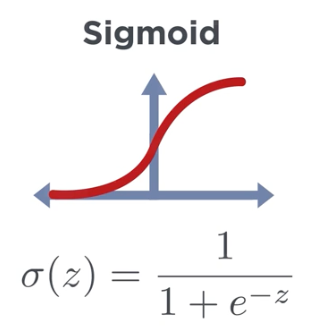
Used to be used a lot in DNN 20 years ago but not now because:
* initial inspiration to have ANN imitate the  human brain has become less relevant
* They create large regions that are flat (essentially all zero gradient) and are hard to optimize
* Measures the confidence of being in the positive class

**Hyperbolic Tangent (tanh) Function**
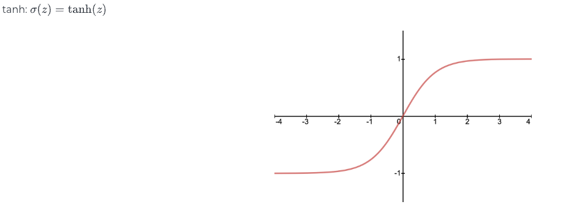
Has a similar shape to the sigmoid function, but its range is between -1 and 1. While it is useful for binary classification, this transition function runs into the same problem as sigmoid functions due to their similar shapes.  Do care about inverses, eg. in physics

### Loss Function
Like any other model NNs require a loss function.

**Squared Loss Function**
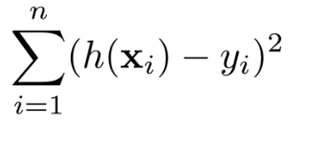
Sum of the data points and penalize h of xi minus yi and square it

**Cross Entropy Loss Function**
If want our neural network to do a multi-class classification of k classes, what should the last layer’s activation be? Assume that the last layer has k neurons implement a softmax function on the last layer.
If want our neural network to do a multi-class classification of k classes, what should the last layer’s activation be? Assume that the last layer has k neurons implement a softmax function on the last layer.  

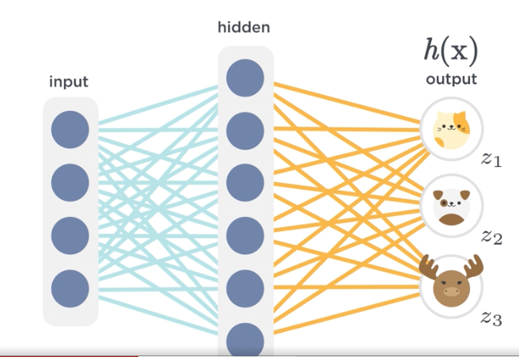
h of x is multidimensional (here 3)
convert outputs to probabilities for each class
In last layer turn output into probability
1. Make all values positive
2. Divide by the sum of the three
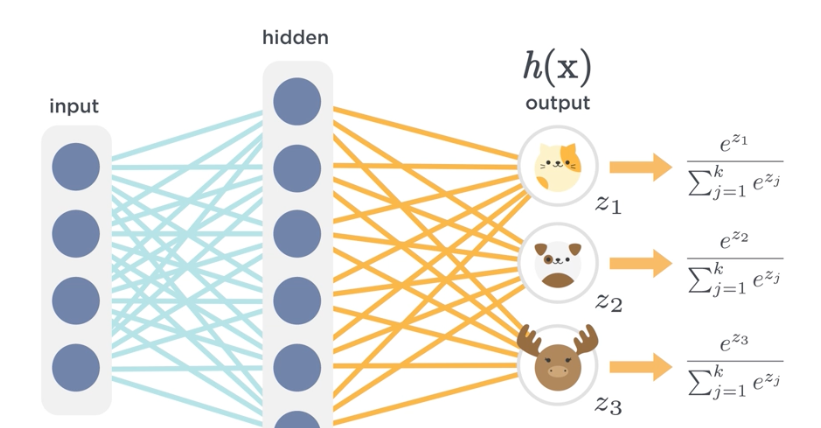

Want to minimize loss function so take the negative log.  
Loss function is essentially the summing of all the data points and take the log of the probability of hte true label given that the data point, given the neurual network and the whole thing is negated.
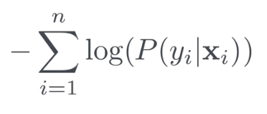

## Regression NN
https://learn.ecornell.cornell.edu/courses/1865331/pages/read-apply-loss-functions?module_item_id=37520091

[Foward Propagation](forward_propagation.md)

[Back Propagation](back_propagation.md)

## Speed up training with Stochastic Gradient Decent (SGD)
Instead of figuring out the loss for each datapont picking a small batch randomly.  Compute gradiant for each datapoint and sum up.  This won't get 100% answer but pretty close.  

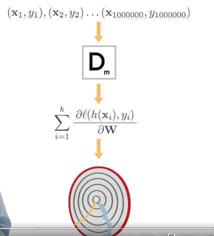

* Neural network functions are not strictly convex.
* It is better for a neural net to converge on a wide minima so that there’s enough room for the test points to deviate from the training data and still incur small loss.
* SGD is a great for training neural networks exactly because the gradient updates are so noisy.
* One cannot always reproduce results with neural networks because where you start on the function will influence where you end up on the function, and one does not always start in the same place.

[SGD](SGD.md)

## Addressing Overfitting
We can mitigate overfitting in neural networks in one of two ways: 
* dropout regularization
* weight decay using L2 regularization. 
Dropout regularization involves forcing some nodes of the neural networks to zero for each minibatch of training sets, preventing any neuron from relying too much on another one. 

### Weight Decay
Viz. "L2 Regularalization"
Minimize the loss function plus lambda * the squared L2 norm of the weights.  You set the lambda
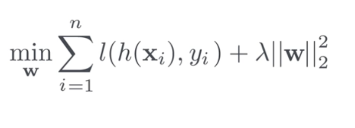

### Drop Out
* Specific to NNs
* When you get your minibatch from an SGD update, before forward propagation of samples, hypotheically toss a coin for each neuron.  Heads force it to be 0 and if tails leave untouched.  Then change for next batch
* Avoids coadaptation
* This random variable is drawn independently each time such a transition function is evaluated — however, only during training the network. This is done at all nodes of all layers and effectively forces the network to rely less on any given neuron, preventing it from simply memorizing the training set.

[ConvNets](convnets.md) are especially used in image recognition
[Neural Sequence Models](Deep_avg_network.md) are neural networks that have been specialized for sequence data, such as written text or DNA sequences. 